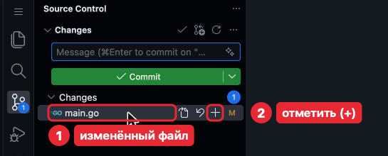
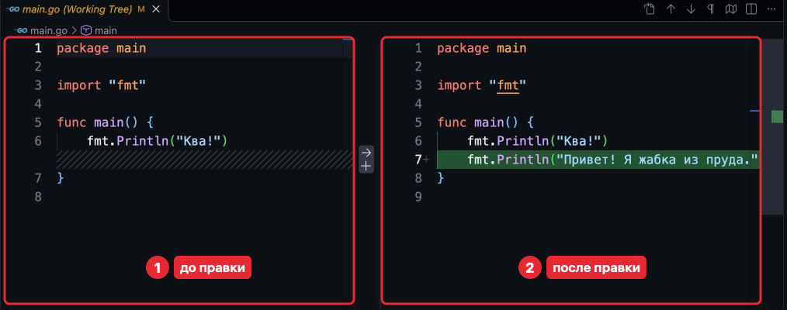
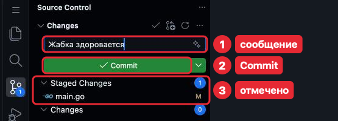

# 1. Репозиторий и коммит

Git хранит историю проекта. Каждое сохранённое состояние всех файлов
с сообщением, что изменилось, автором и временем — **коммит** (commit).
Репозиторий — папка проекта вместе с историей коммитов.

Репозиторий *pond* теперь в двух местах: на GitHub и в Codespace — GitHub
скопировал его туда при создании Codespace. Коммиты сохраняются в Codespace;
как отправить их в GitHub — в [части 2](02-github-push-pull.md). Git в Codespace
уже настроен: имя и почта берутся из аккаунта GitHub.

Сохранение коммитом — пять команд. У каждой, кроме *git log*, есть кнопка в панели
Source Control (Система управления версиями) — иконка-ветка в Activity Bar (Панель действий).
Делай так, как удобнее: результат одинаковый.

| Команда | Кнопка в Source Control (Система управления версиями) | Что делает |
|---|---|---|
| *git status* | Список **Changes** (Изменения) | Какие файлы изменены и что войдёт в коммит |
| *git diff* | Нажать на файл в списке | Изменения построчно |
| *git add .* | **+** у файла (Stage Changes, Индексировать изменения) | Отметить изменения для коммита |
| *git commit -m "сообщение"* | Поле **Message** и кнопка **Commit** | Сохранить отмеченное коммитом |
| *git log --oneline* | — | История коммитов |

Команды набирай в Terminal (Терминал) в корне *pond*: в строке приглашения —
*/workspaces/pond*.

## Три состояния изменения

*git add* и *git commit* переводят изменение из одного состояния в другое:

1. **Изменено** — файл отредактирован.
2. **Отмечено** (staged) командой *git add* — изменение попадёт в следующий коммит;
   так в коммит можно положить не все изменённые файлы. В курсе почти всегда
   отмечаем всё: *git add .*, точка — «все изменения в текущей папке и глубже».
3. **Сохранено** командой *git commit* — в истории. Автосохранение и Cmd + S сюда
   не относятся: они записывают только файл.

## *git status*

Перед коммитом смотрят, что изменилось. Набери:

```sh
git status
```

Терминал ответит (пример — в задаче «Жабка квакает»: *README.md* изменён,
*go.mod* и *main.go* новые):

```
On branch main
Your branch is up to date with 'origin/main'.

Changes not staged for commit:
  (use "git add <file>..." to update what will be committed)
  (use "git restore <file>..." to discard changes in working directory)
	modified:   README.md

Untracked files:
  (use "git add <file>..." to include in what will be committed)
	go.mod
	main.go

no changes added to commit (use "git add" and/or "git commit -a")
```

- «On branch main» — ты в ветке *main*.
- «up to date with 'origin/main'» — все твои коммиты уже в GitHub (часть 2).
- «modified: README.md» — файл изменён, но не отмечен (в Explorer (Проводник) — буква **M**).
- «Untracked files» — новые файлы, git их ещё не хранит (в Explorer (Проводник) — буква **U**).
- Строки «(use …)» — подсказки git, выполнять не нужно.

«nothing to commit, working tree clean» — всё сохранено.

**Кнопкой.** Открой Source Control (Система управления версиями): изменённые файлы — в списке **Changes**, с той же
буквой **M** или **U**. Если список **Changes** пуст — всё сохранено.



Кнопки появляются, когда наводишь на строку файла (или нажимаешь на неё). Изогнутую
стрелку (Discard Changes, отменить изменения) не нажимай: она стирает правку
без возврата.

## *git diff*

*git status* называет файлы, а *git diff* показывает, что именно в них поменялось.
Набери:

```sh
git diff
```

Терминал ответит (пример — в *main.go* добавлена строка):

```
diff --git a/main.go b/main.go
index 106fb8a..533f7e7 100644
--- a/main.go
+++ b/main.go
@@ -4,4 +4,5 @@ import "fmt"
 
 func main() {
 	fmt.Println("Ква!")
+	fmt.Println("Привет! Я жабка из пруда.")
 }
```

Строка с '+' добавлена, с '-' удалена, без знака — не менялась. Первые пять строк —
какой файл и какое место в нём. Новые файлы (Untracked) и уже отмеченные изменения
*git diff* не показывает: после *git add .* он молчит. Поэтому смотри его до отметки —
так находится то, что в коммит попасть не должно.

Если внизу терминала ':' — ответ длинный и показан
постранично: пробел листает, *q* — выход (Ctrl + C не помогает).

**Кнопкой.** Нажми на файл в списке **Changes**: откроется сравнение — слева файл
до правки, справа после, добавленные строки подсвечены зелёным, удалённые — красным.
Стрелку между половинами не нажимай: она отменяет правку. Закрыть сравнение —
крестиком на вкладке.



## *git add .* и *git commit*

Когда изменения проверены, их отмечают и сохраняют коммитом. Набери по очереди:

```sh
git add .
git commit -m "Жабка здоровается"
```

*git add* ничего не отвечает. *git commit* ответит:

```
[main a37d77f] Жабка здоровается
 1 file changed, 1 insertion(+)
```

После *-m* в кавычках — **сообщение коммита** (commit message). В ответе — ветка,
номер коммита (у тебя другой) и сколько строк изменилось; у новых файлов ещё строка
«create mode 100644 имя» — число пропусти.

**Кнопкой.** Нажми **+** у файла (Stage Changes — Индексировать изменения;
**+** у заголовка **Changes** отмечает все файлы сразу) — файл переедет в список **Staged Changes**
(Промежуточные изменения). Набери сообщение в поле **Message** (Сообщение) над списком
и нажми **Commit** (Фиксация). Стрелку рядом с **Commit** не трогай. Если нажать
**Commit**, ничего не отметив, VS Code спросит, отметить ли всё, — ответь **Yes**.



## *git log --oneline*

Сохранённый коммит виден в истории. Набери:

```sh
git log --oneline
```

Терминал ответит:

```
a37d77f (HEAD -> main) Жабка здоровается
c53348b (origin/main, origin/HEAD) Жабка квакает
384560f Create devcontainer.json
8d339cd Initial commit
```

Слева — номер коммита, справа — сообщение, новые сверху. Два нижних появились
при создании *pond* на GitHub. «HEAD -> main» — где ты сейчас, «origin/main» — что уже есть
в GitHub: верхний коммит ещё не отправлен. «origin/HEAD» пропусти.

## Сообщение коммита

По истории потом ищут, где что менялось, поэтому сообщение говорит, что теперь
умеет программа или что исправлено.

| Хорошо | Плохо |
|---|---|
| «Жабка представляется по имени» | «задание 1» |
| «Исправлено приветствие» | «правки», «fix» |

Одна задача — один коммит; исправление после разбора — отдельный коммит.

## Если что-то пошло не так

| Ситуация | Что делать |
|---|---|
| «nothing added to commit but untracked files present» | Новые файлы не отмечены: *git add .* и снова коммит |
| Опечатка в сообщении коммита | Оставить, историю не исправляем |
| После *git commit* без *-m* открылась вкладка «COMMIT_EDITMSG» | Напиши сообщение в первой строке, Cmd + S, закрой вкладку. Закрыть пустой — коммит отменится |
| Нужно вернуть файл к последнему коммиту | *git restore имя-файла*. Изменения пропадут безвозвратно |
