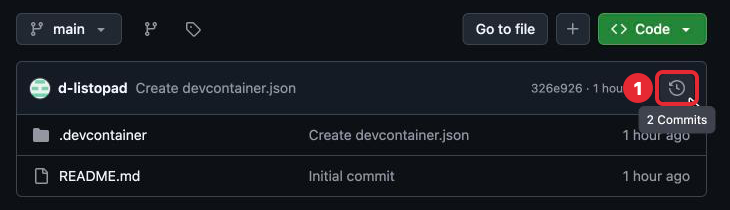
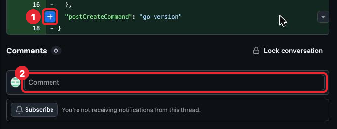

# 2. GitHub: push и pull

## Зачем это нужно

Коммиты из части 1 хранятся в репозитории, который лежит в Codespace (его копию
GitHub сделал, когда создавал Codespace, — часть 1). Codespace
временный: если его удалить или не открывать 30 дней, вместе с ним пропадёт и история.
Кроме того, преподаватель не видит твой Codespace. Нужна копия репозитория в месте,
которое не пропадёт и доступно другим.

Такая копия — **удалённый репозиторий** (remote repository): тот же репозиторий,
но на сервере. Для `pond` это репозиторий на github.com. Удалённый репозиторий
по умолчанию называется `origin`.

Codespace сам связан с репозиторием на GitHub, из которого создан: настраивать
связь не нужно.

## `git push` — отправить коммиты в GitHub

```sh
git push
```

Отправляет в GitHub коммиты, которых там ещё нет. Без push коммит существует только
в Codespace, и преподаватель его не увидит.

Ответ выглядит так (числа и идентификаторы у тебя будут другими):

```
$ git push
Enumerating objects: 8, done.
Counting objects: 100% (8/8), done.
Delta compression using up to 2 threads
Compressing objects: 100% (4/4), done.
Writing objects: 100% (6/6), 580 bytes | 580.00 KiB/s, done.
Total 6 (delta 0), reused 0 (delta 0), pack-reused 0 (from 0)
To https://github.com/ЛОГИН/pond
   384560f..127484c  main -> main
```

Строки до `To` — git упаковывает и отправляет коммиты, их можно не читать. Важна
последняя: `384560f..127484c` — какой коммит был последним на GitHub и какой стал,
`main -> main` — коммиты твоей ветки `main` отправлены в `main` на GitHub.

Порядок после каждой задачи:

```sh
git status
git add .
git commit -m "Жабка представляется по имени"
git push
```

Проверить, что всё дошло: открыть `pond` на github.com — над списком файлов видно
сообщение последнего коммита.

Все команды набирай в корне `pond`: строка приглашения кончается на `/workspaces/pond`.

## `git pull` — забрать коммиты из GitHub

```sh
git pull
```

Забирает из GitHub коммиты, которых нет в Codespace. В шаге 2 не понадобится —
с шага 3 (часть 3).

## Комментарии к коммиту

На github.com у каждого коммита есть страница. Чтобы её найти, открой `pond` и нажми
справа над списком файлов ссылку **N Commits** (N — число коммитов). На узком экране
вместо надписи там иконка часов, надпись появляется, если навести на неё курсор.



*1 — иконка истории коммитов; рядом подсказка «2 Commits».*

Откроется список коммитов. Нажми на сообщение нужного коммита — откроется его страница:
видны изменения. Внизу страницы — поле **Comment** для общего комментария: набери
текст и нажми зелёную кнопку **Comment** под полем — комментарий появится над полем.
Можно прокомментировать и одну строку: если навести на неё курсор (без трекпада —
нажать на строку), слева появится синяя кнопка **+**. Для ответа на вопрос к разбору
комментарий к строке не нужен.



*1 — кнопка **+** у строки, 2 — поле общего комментария. Кнопку **Subscribe** и остальное
не трогай.*

До шага 3 преподаватель разбирает задачи так: оставляет комментарии к твоему коммиту,
а GitHub присылает об этом уведомление — на почту аккаунта и в колокольчик справа
вверху на github.com. Ответить можно полем комментария под замечанием на той же
странице, а ответ на «Вопрос к разбору» пиши в поле **Comment** внизу страницы коммита.

## Если что-то пошло не так

| Сообщение | Что значит | Что делать |
|---|---|---|
| `! [rejected] ... (fetch first)` | В GitHub есть коммиты, которых нет у тебя | Выполнить `git pull`, затем снова `git push` |
| `Everything up-to-date` | Отправлять нечего: всё уже в GitHub | Ничего, это не ошибка |
