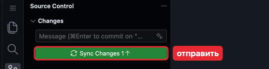
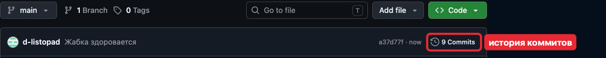
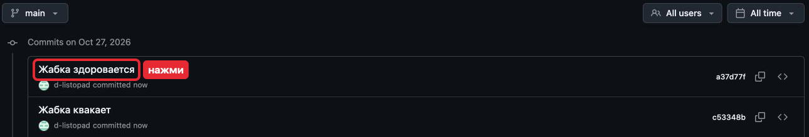
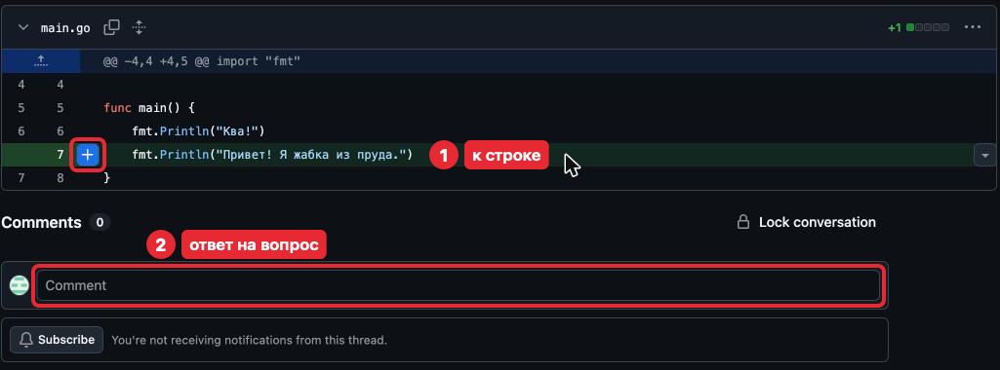

# 2. GitHub: push и pull

Коммиты из части 1 лежат только в Codespace. Преподаватель их не видит, а если
Codespace удалить или не открывать 30 дней, история пропадёт. Поэтому их отправляют
в **удалённый репозиторий** (remote repository) — `pond` на github.com. Его имя
в командах — `origin`. Связь Codespace с ним уже настроена.

## `git push` — отправить коммиты в GitHub

После коммита отправь его в GitHub. Набери в корне `pond`:

```sh
git push
```

Терминал ответит:

```
Enumerating objects: 7, done.
Counting objects: 100% (7/7), done.
Delta compression using up to 2 threads
Compressing objects: 100% (4/4), done.
Writing objects: 100% (5/5), 561 bytes | 561.00 KiB/s, done.
Total 5 (delta 0), reused 0 (delta 0), pack-reused 0 (from 0)
To https://github.com/ЛОГИН/pond
   384560f..c53348b  main -> main
```

Числа у тебя другие. Строки до `To` пропусти. `384560f..c53348b` — последний коммит
на GitHub был и стал; `main -> main` — твоя ветка `main` отправлена в `main` на GitHub.
Проверить: на странице `pond` над списком файлов — сообщение последнего коммита.

**Кнопкой.** После коммита в Source Control появится кнопка **Sync Changes**
(Синхронизировать изменения) с числом неотправленных коммитов и стрелкой вверх.
Нажми её: она делает `git pull`, затем `git push`. Если VS Code спросит, синхронизировать
ли с `origin/main`, — **OK**.



Вместе с частью 1 получается порядок после каждой задачи, в корне `pond` (или те же
шаги кнопками: список Changes, **+**, сообщение и **Commit**, **Sync Changes**):

```sh
git status
git add .
git commit -m "Жабка квакает"
git push
```

`git pull` — обратное: забрать из GitHub коммиты, которых нет в Codespace. Понадобится
позже.

## Комментарии к коммиту

Отправленный коммит виден на GitHub, и разбор задачи пока идёт в комментариях к нему.
Открой `pond` и нажми справа над списком файлов **N Commits** (Коммиты; на узком
экране — иконка часов).



Число на кадре больше, чем у тебя: демонстрационный репозиторий прошёл больше задач.

Откроется список коммитов. Нажми на сообщение своего коммита:



Откроется страница коммита с изменениями. Внизу — поле **Comment** (Комментарий):
ответ на «Вопрос к разбору» пиши туда и нажимай зелёную кнопку **Comment**. Синяя
**+** у строки (появляется при наведении или нажатии на строку) — комментарий к одной
строке, для ответа не нужен. Subscribe и остальное не трогай.



О комментариях преподавателя GitHub пришлёт уведомление на почту и в колокольчик
справа вверху. Отвечать — полем под его комментарием.

## Если что-то пошло не так

| Сообщение | Что делать |
|---|---|
| `! [rejected] ... (fetch first)` | В GitHub есть коммиты, которых нет у тебя: `git pull --rebase` (поставит твои коммиты после них), затем `git push` |
| `Everything up-to-date` | Отправлять нечего, это не ошибка |
