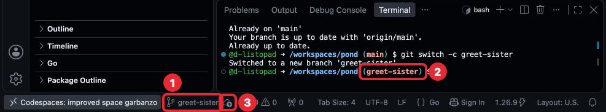
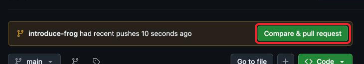
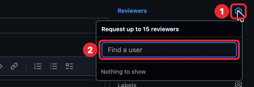
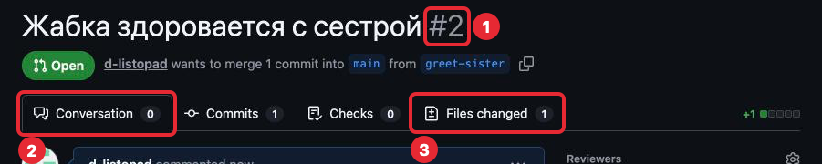
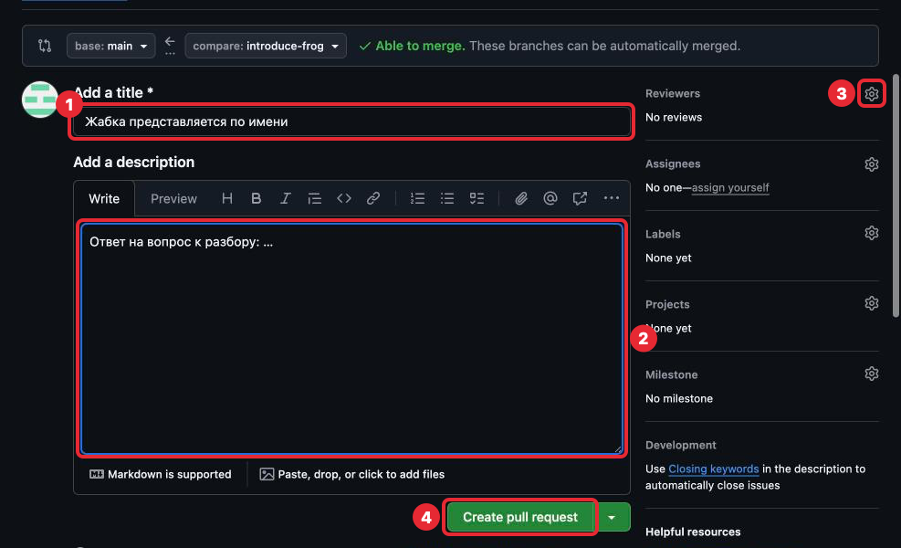
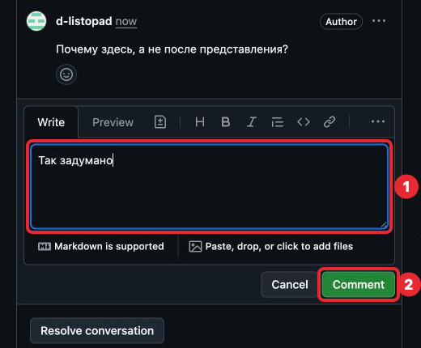
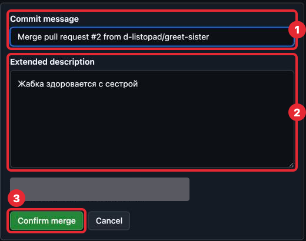
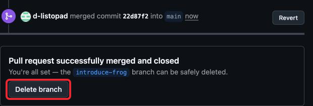

# 3. Ветки и pull request

## Зачем это нужно

Пока все коммиты идут подряд в одну историю, и каждый сразу становится частью
основной версии программы. На работе так не делают: новую возможность сначала
делают отдельно, показывают коллегам, исправляют по замечаниям и только потом
добавляют в основную версию. Так в основной версии не появляется непроверенный код.

Удобно представить черновик и чистовик: ветка задачи — черновик, ветка `main` —
чистовик, и в чистовик переносится только проверенное.

**Ветка** (branch) — отдельная линия истории коммитов. Посмотреть её можно уже
знакомой командой: `git log --oneline` (часть 1) в ветке покажет все коммиты `main`
и сверху новые коммиты ветки. В `main` этих новых коммитов нет, пока ветку не вольют.

Основная ветка называется `main`: в ней лежит рабочая версия программы. Её GitHub
создал сам вместе с репозиторием в шаге 0; её имя ты видела в кнопке
**Create codespace on main** и в строке приглашения терминала: `(main)`. Для каждой
задачи создаётся своя ветка, коммиты идут в неё, а `main` при этом не меняется.

При переключении на другую ветку файлы в Explorer меняются на версию этой ветки.
В `main` правок, сохранённых коммитом в ветке, не будет — они не пропали, а лежат
в ветке, и `git switch имя-ветки` вернёт их. Правки без коммита переходят вместе
с тобой.

**Pull request** — «просьба забрать»: запрос на GitHub влить ветку в `main`. В нём
видны все изменения ветки, и к любой строке можно оставить комментарий. Разбор задачи проходит в pull
request: преподаватель оставляет замечания, ты отвечаешь и исправляешь.

**Слияние** (merge) — перенос коммитов ветки в `main`. Делается после того, как
pull request одобрен.

## Коротко: путь каждой задачи

Шпаргалка на каждую задачу. Подробности по каждому пункту — ниже.

| № | Что сделать | Команда или кнопка |
|---|---|---|
| 1 | Перейти в `main`, забрать последнее, создать ветку | `git switch main`, `git pull`, `git switch -c имя-ветки` |
| 2 | Сделать задачу, сохранить коммитом | `git add .`, `git commit -m "..."` |
| 3 | Отправить ветку в GitHub | первый раз `git push --set-upstream origin имя-ветки`, дальше `git push` |
| 4 | Открыть pull request | **Compare & pull request** на github.com |
| 5 | Ответить на замечания, исправить, отправить | коммит и `git push` в ту же ветку |
| 6 | После одобрения влить ветку и вернуться в `main` | **Merge pull request** → **Confirm merge** → **Delete branch**, `git switch main`, `git pull` |

## Порядок работы над задачей

С шага 3 каждая задача проходит этот путь.

### 1. Создать ветку

Перед началом задачи — убедиться, что ты в `main` и у тебя последняя версия,
затем создать ветку. Команды ниже — для задачи 1 шага 3, ветка `introduce-frog`;
в следующих задачах у ветки своё имя, его называет задача или выбираешь ты.

```sh
git switch main
git pull
git switch -c introduce-frog
```

- `git switch main` — перейти в ветку `main`.
- `git pull` — забрать из GitHub новое, если оно там есть.
- `git switch -c introduce-frog` — создать (create) ветку с этим именем и сразу
  перейти в неё.

В первый раз команды ответят так:

```
Already on 'main'
Your branch is up to date with 'origin/main'.
Already up to date.
Switched to a new branch 'introduce-frog'
```

`Already on 'main'` — ты и так в `main`; `Already up to date.` — нового в GitHub нет.
Это не ошибки. После последней команды строка приглашения кончается
на `(introduce-frog)`.

Имя ветки — коротко о задаче, латиницей, слова через дефис: `introduce-frog`,
`newborn-frog`. Текущая ветка видна в строке приглашения в скобках (шаг 1, «Куда
набирать») и в Status Bar слева, рядом с именем Codespace, со значком ветки.



*1 — ветка в Status Bar, 2 — ветка в строке приглашения, 3 — облачко: ветки ещё нет
на GitHub, его не трогай, ветку отправит команда из пункта 3. На кадре ветка другой
задачи, `greet-sister`; у тебя будет `introduce-frog`. Когда начнёшь править файлы,
после имени ветки в Status Bar появится звёздочка — есть изменения без коммита.
Панели Outline, Timeline и значки справа в Status Bar — не обращай внимания.*

### 2. Сделать задачу и сохранить коммитом

Как обычно: код, проверки по критериям приёмки, `git add .`, `git commit -m "..."`.
Коммитов в ветке может быть несколько.

### 3. Отправить ветку в GitHub

Первый раз для новой ветки:

```sh
git push --set-upstream origin introduce-frog
```

На GitHub этой ветки ещё нет. Команда создаёт её там (`origin` — это GitHub, часть 2)
и связывает с твоей веткой в Codespace. Ответ (числа и логин у тебя другие):

```
Enumerating objects: 5, done.
Counting objects: 100% (5/5), done.
Delta compression using up to 2 threads
Compressing objects: 100% (3/3), done.
Writing objects: 100% (3/3), 395 bytes | 395.00 KiB/s, done.
Total 3 (delta 2), reused 0 (delta 0), pack-reused 0 (from 0)
remote: Resolving deltas: 100% (2/2), completed with 2 local objects.
remote: 
remote: Create a pull request for 'introduce-frog' on GitHub by visiting:
remote:      https://github.com/твой-логин/pond/pull/new/introduce-frog
remote: 
To https://github.com/твой-логин/pond
 * [new branch]      introduce-frog -> introduce-frog
branch 'introduce-frog' set up to track 'origin/introduce-frog'.
```

Первые строки — git упаковывает и отправляет коммиты, их можно пропустить. Строки
с `remote:` пишет GitHub: в них ссылка на форму pull request — запасной путь, если
не будет плашки из пункта 4. `[new branch]` — ветка создана на GitHub; `set up
to track` — связь установлена, дальше в этой ветке хватает `git push`.

Если набрать просто `git push`, git ответит
`fatal: The current branch introduce-frog has no upstream branch.` и сам напишет
нужную команду — её можно скопировать. Последние строки про `push.autoSetupRemote`
пропусти.

### 4. Открыть pull request

1. Открыть `pond` на github.com. Над списком файлов появится жёлтая плашка
   «introduce-frog had recent pushes…» и кнопка **Compare & pull request** — нажать её.

   

   *Кнопка Compare & pull request в жёлтой плашке.*

2. Откроется форма pull request. **Add a title** — что делает задача, например
   «Жабка представляется по имени». Если коммит в ветке один, GitHub подставит сюда
   его сообщение: если оно говорит, что сделано, оставь. Если коммитов несколько,
   там будет имя ветки — впиши заголовок сама.
3. **Add a description** — большое поле под заголовком: в нём ответ на «Вопрос к разбору»
   из задачи.
4. Справа в **Reviewers** нажать на шестерёнку — откроется список; нажать
   на `d-listopad`, затем на пустое место формы. Под Reviewers появится его имя.

   

   *1 — шестерёнка Reviewers, 2 — поле поиска. У тебя под ним будет строка
   `d-listopad`; на кадре написано «Nothing to show», потому что он снят из аккаунта
   самого преподавателя, а себя выбрать нельзя.*
5. Нажать **Create pull request**. Откроется страница pull request с номером
   (`#1` и дальше) и вкладками **Conversation** и **Files changed**. Вернуться к ней
   можно через вкладку **Pull requests** репозитория.

   

   *1 — номер pull request, 2 — вкладка Conversation (обсуждение), 3 — вкладка
   Files changed (изменённые строки). Commits и Checks не нужны.*

   После этого в Codespace может всплыть вопрос «Would you like Visual Studio Code
   to periodically run "git fetch"?» — нажми **No**: новое из GitHub ты забираешь
   сама командой `git pull`. В Activity Bar может появиться иконка GitHub Pull
   Requests — ею не пользуемся, pull request смотрим на github.com.



*1 — заголовок, 2 — описание с ответом на вопрос к разбору, 3 — шестерёнка Reviewers,
4 — кнопка Create pull request. Сверху `base: main ← compare: introduce-frog` — ветку
предлагают влить в `main`, `Able to merge` — влить можно. Стрелку рядом с Create pull
request, кнопки над описанием, Preview и панели справа (Assignees, Labels, Projects,
Milestone, Development) не трогай. На кадре у Reviewers написано «No reviews»:
преподавателя не выбрали, потому что снимали в его же аккаунте.*

### 5. Разбор

Преподаватель оставляет комментарии к строкам кода на вкладке **Files changed**
pull request: у строки открывается поле, и он отправляет комментарий кнопкой
**Comment** (или копит несколько через **Start a review**). Так это выглядит
у преподавателя:


*1 — строка, к которой оставляют комментарий, 2 — кнопка Comment, 3 — Start a review.
Тебе эти кнопки нужны, только если сама захочешь оставить комментарий к строке.
На кадре файл новый целиком; у тебя зелёным будут только изменённые строки.*

GitHub пришлёт уведомление, а сами комментарии видны в pull request на вкладке
**Conversation**. Ты увидишь так. Ответ пишется в поле **Reply...** прямо под
комментарием; после текста нажми **Comment** под полем — ответ появится под замечанием.


*1 — комментарий к строке, 2 — поле Reply... для ответа. Кнопку **Resolve conversation**
не нажимай: закрыть обсуждение — решение преподавателя. Метку Author, смайлик, «…»
и View reviewed changes не трогай.*



*1 — поле ответа с набранным текстом, 2 — кнопка Comment: отправить ответ. Cancel
стирает набранное.*

На каждый комментарий:

- исправить код в той же ветке, сделать коммит и `git push` — pull request обновится
  сам, новый pull request не нужен. Замечание к исправленной строке GitHub пометит
  **Outdated**: значит, строка изменилась, обсуждение осталось на Conversation;
- ответить в комментарии, что сделано, или задать вопрос, если замечание непонятно.

Когда всё в порядке, преподаватель одобряет pull request (**Approve**): в pull
request появится запись, что `d-listopad` одобрил изменения, с зелёной галочкой.

### 6. Влить ветку в `main`

1. Внизу pull request нажать **Merge pull request**. Стрелку рядом с ней не трогай:
   нужен способ слияния по умолчанию.

   

   *Ссылку View command line instructions и Convert to draft не нажимай.*

2. Появятся поля с сообщением слияния и кнопка **Confirm merge**. Поля не меняй:
   GitHub заполнил их номером pull request и именем ветки, по ним слияние потом
   находится в истории. Нажать **Confirm merge**.

   

   *1 — Commit message, 2 — Extended description: их не меняй; 3 — Confirm merge.
   Серым закрыта строка с адресом почты, от имени которой GitHub запишет слияние.*

3. Появится надпись «Pull request successfully merged and closed». Нажать
   **Delete branch**: ветка задачи больше не нужна, её коммиты уже в `main`. Ветка
   удалится только на GitHub, в Codespace она останется — она не мешает. Кнопку
   **Revert** не нажимай: она отменяет слияние. После удаления на месте Delete branch
   появится **Restore branch** — её тоже не трогай.

   

   > **Осторожно.** После **Delete branch** рядом появляется кнопка
   > **Delete codespace**. Её не нажимай: она удалит твой Codespace вместе с файлами,
   > которые ещё не отправлены в GitHub.

4. В Codespace вернуться в `main` и забрать слитые изменения:

   ```sh
   git switch main
   git pull
   ```

   Ответ будет такой (буквы, цифры и числа строк у тебя другие):

   ```
   Switched to branch 'main'
   Your branch is up to date with 'origin/main'.
   remote: Enumerating objects: 1, done.
   remote: Counting objects: 100% (1/1), done.
   remote: Total 1 (delta 0), reused 0 (delta 0), pack-reused 0 (from 0)
   Unpacking objects: 100% (1/1), 966 bytes | 966.00 KiB/s, done.
   From https://github.com/твой-логин/pond
      22d87f2..54638e1  main       -> origin/main
   Updating 22d87f2..54638e1
   Fast-forward
    main.go | 1 +
    1 file changed, 1 insertion(+)
   ```

   `up to date` сравнивает с тем, что git последний раз видел на GitHub, а не с GitHub
   сейчас, — поэтому и нужен `git pull`. `Fast-forward` и список файлов — слитые
   изменения пришли. В `git log` появится коммит «Merge pull request #1 …»: его создал
   GitHub при слиянии, это нормально.

Задача сдана. Следующая начинается снова с пункта 1.

## Если что-то пошло не так

| Ситуация | Что делать |
|---|---|
| Начала задачу, а ветку не создала, коммита ещё нет | `git switch -c имя-ветки`: изменения перейдут в новую ветку вместе с тобой |
| Коммит уже сделан в `main`, push ещё не было | Не делай `git push`. Выполни `git switch -c имя-ветки` — коммит окажется в новой ветке — и напиши преподавателю, как вернуть `main` к прежнему виду |
| Нет плашки **Compare & pull request** | Открой ссылку из строк `remote:` в ответе `git push`. Или вкладка **Pull requests → New pull request**, в поле **compare** выбрать свою ветку, затем **Create pull request** — откроется та же форма |
| `git switch main` пишет `Your local changes ... would be overwritten` | Есть изменения без коммита. Сначала сделать коммит в текущей ветке. Совет про `stash` в том же сообщении пропусти |
| После `Merge pull request` в Codespace нет изменений | Не выполнены `git switch main` и `git pull` |
