# 3. Ветки и pull request

До сих пор коммиты шли прямо в *main*, а разбор был в комментариях к коммиту. На работе
так не делают: новую возможность готовят отдельно от рабочей версии, показывают
коллегам и только после проверки добавляют в неё. Для этого есть ветки и pull request.

**Ветка** (branch) — отдельная линия коммитов. Основная ветка *main* — рабочая версия
программы, её GitHub создал вместе с репозиторием (ты видела её в **Create codespace
on main** и в строке приглашения: «(main)»). Каждая задача делается в своей ветке,
*main* при этом не меняется. При переключении на другую ветку файлы в Explorer (Проводник)
меняются на её версию: правки, сохранённые коммитом, остаются в своей
ветке, правки без коммита переходят с тобой.

**Pull request** — запрос на GitHub влить ветку в *main*. В нём видны изменения,
к строкам оставляют комментарии — так проходит разбор. **Слияние** (merge) —
перенос коммитов ветки в *main* после одобрения.

## Путь каждой задачи

Каждая задача с этого места проходит шесть пунктов:

| № | Что сделать | Команда | Кнопка |
|---|---|---|---|
| 1 | Перейти в *main*, забрать новое, создать ветку | *git switch main*, *git pull*, *git switch -c имя-ветки* | Ветка в Status Bar (Строка состояния) → *main*, **⟳** рядом; ветка в Status Bar (Строка состояния) → **Create new branch...** |
| 2 | Сделать задачу, сохранить коммитом | *git add .*, *git commit -m "..."* | **+** и **Commit** в Source Control (Система управления версиями), часть 1 |
| 3 | Отправить ветку в GitHub | первый раз *git push --set-upstream origin имя-ветки*, дальше *git push* | **Publish Branch**, дальше **Sync Changes** |
| 4 | Открыть pull request | — | **Compare & pull request** на github.com |
| 5 | Ответить на замечания, исправить | коммит и *git push* в ту же ветку | **Commit** и **Sync Changes** |
| 6 | После одобрения влить и вернуться в *main* | *git switch main*, *git pull* | **Merge pull request** → **Confirm merge** → **Delete branch** на github.com; ветка в Status Bar (Строка состояния) → *main*, **⟳** |

Пример — задача «Жабка представляется», ветка *introduce-frog*.

### 1. Создать ветку

Ветка создаётся от свежей *main*, поэтому сначала перейди в неё и забери новое
с GitHub, потом создай ветку. Набери по очереди:

```sh
git switch main
git pull
git switch -c introduce-frog
```

Терминал ответит:

```
Already on 'main'
Your branch is up to date with 'origin/main'.
Already up to date.
Switched to a new branch 'introduce-frog'
```

*switch* — переключиться, *-c* — create, создать. «Already on», «Already up to date» —
ты уже в *main* и нового нет, это не ошибки. Имя ветки — коротко о задаче, латиницей,
через дефис: так его можно набрать в команде без кавычек. Текущая ветка видна в строке
приглашения и в Status Bar (Строка состояния):

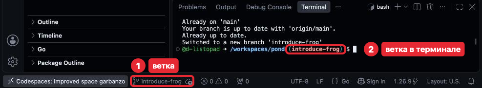

Облачко рядом с веткой в Status Bar (Строка состояния) — ветки ещё нет на GitHub, не трогай. Звёздочка
после имени — есть изменения без коммита.

**Кнопкой.** Нажми на имя ветки в Status Bar (Строка состояния): сверху откроется
список. В нём *main* — перейти в *main*, **Create new branch...** (Создать новую ветвь) —
создать ветку от текущей: набери имя и нажми Enter. Забрать новое с GitHub — значок
**⟳** справа от имени ветки (Synchronize Changes, синхронизировать): он делает
*git pull* и *git push*.

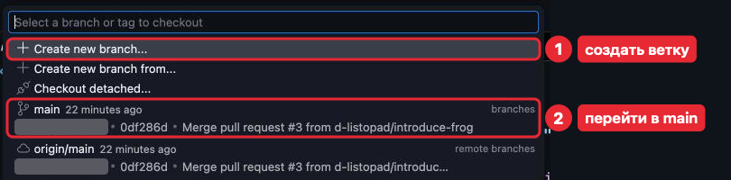

Строки «Create new branch from...», «Checkout detached...» и *origin/main* (та же ветка
на GitHub) не нужны. Серым на кадре закрыто имя автора.

### 2. Сделать задачу

Теперь в ветке делается сама задача — как раньше: код, проверка по критериям,
*git add .*, *git commit -m "..."*. Коммитов может быть несколько.

### 3. Отправить ветку

Ветка пока есть только в Codespace. Чтобы открыть pull request, отправь её
на GitHub. В первый раз набери:

```sh
git push --set-upstream origin introduce-frog
```

Терминал ответит:

```
...
remote: Create a pull request for 'introduce-frog' on GitHub by visiting:
remote:      https://github.com/ЛОГИН/pond/pull/new/introduce-frog
remote: 
To https://github.com/ЛОГИН/pond
 * [new branch]      introduce-frog -> introduce-frog
branch 'introduce-frog' set up to track 'origin/introduce-frog'.
```

Команда создаёт ветку на GitHub («[new branch]») и связывает её с твоей («set up
to track»); дальше в этой ветке хватает *git push*. Первые строки ответа (на месте
«...») такие же, как у *git push* в части 2. В строках «remote:» — ссылка на форму pull
request, запасной путь к пункту 4. Если набрать только *git push*, git ответит
«fatal: The current branch introduce-frog has no upstream branch.» и напишет нужную
команду; строки про «push.autoSetupRemote» пропусти.

**Кнопкой.** В новой ветке Source Control (Система управления версиями) показывает **Publish Branch** (Опубликовать
ветвь) — то же, что *git push --set-upstream*. Для следующих коммитов —
**Sync Changes**, как в части 2.

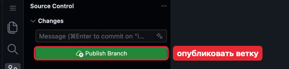

### 4. Открыть pull request

Ветка на GitHub — теперь попроси влить её в *main* и назначь преподавателя проверяющим.

1. Открой *pond* на github.com и нажми **Compare & pull request** (Сравнить и создать
   запрос) в жёлтой плашке.

   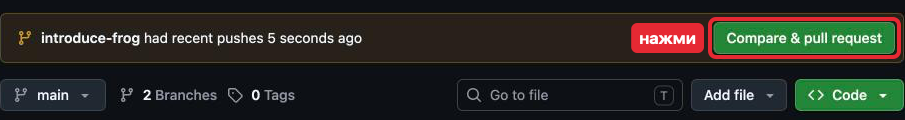

2. Заполни форму:

   - **Add a title** (Заголовок) — что делает задача (если коммит один, GitHub
     подставит его сообщение);
   - **Add a description** (Описание) — ответ на «Вопрос к разбору».

   Над формой:

   - «base: main ← compare: introduce-frog» — ветку вливают в *main*;
   - «Able to merge» — влить можно.

   Остальное не трогай.

   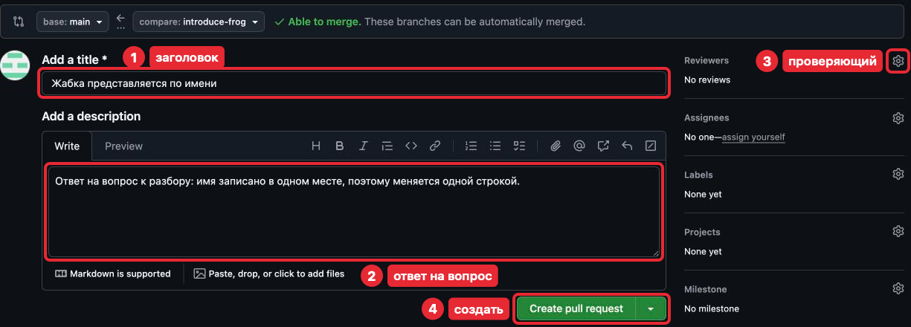

3. В **Reviewers** (Проверяющие) нажми шестерёнку, в поле **Find a user** (найти
   пользователя) набери *d-listopad*, выбери его в списке и нажми на пустое место формы.

   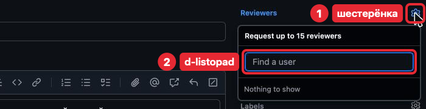

   На кадре список пуст: он снят из аккаунта преподавателя. У тебя в нём будет *d-listopad*.

4. Нажми **Create pull request** (Создать запрос). Откроется pull request с номером;
   найти его потом — вкладка **Pull requests** (Запросы на слияние) репозитория.
   Вкладки **Commits** и **Checks** не нужны.

   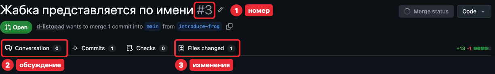

   Номер на кадре — *#3*, у тебя свой: демонстрационный репозиторий прошёл больше
   задач. **Merge status** и **Code** справа не нужны.

   Если Codespace спросит «Would you like Visual Studio Code to periodically run
   "git fetch"?» — **No**. Иконку GitHub Pull Requests в Activity Bar (Панель
   действий) не используем.

### 5. Разбор

Pull request открыт — дальше преподаватель его проверяет. Он комментирует строки
на вкладке **Files changed** (Изменённые файлы):

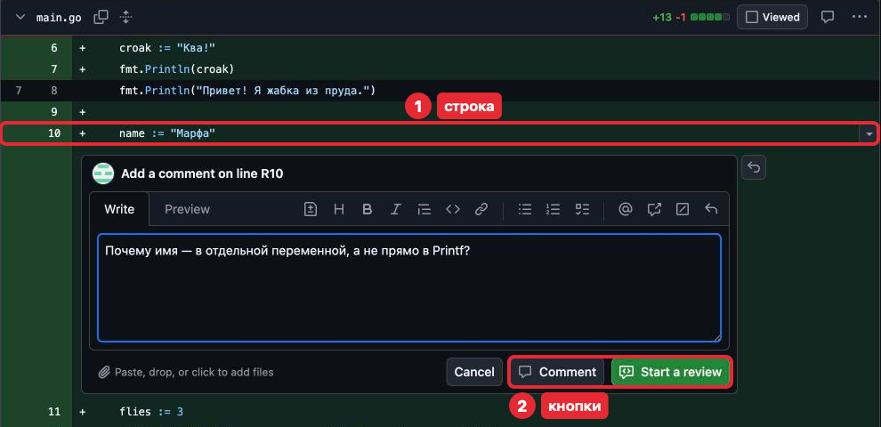

Кнопки **Comment** и **Start a review** на этом кадре нужны, только если сама
захочешь прокомментировать строку.

Придёт уведомление, а комментарии появятся на вкладке **Conversation** (Обсуждение).
Отвечай в поле **Reply...** (Ответить) под комментарием. **Resolve conversation**
(Закрыть обсуждение) не нажимай: его закрывает преподаватель.

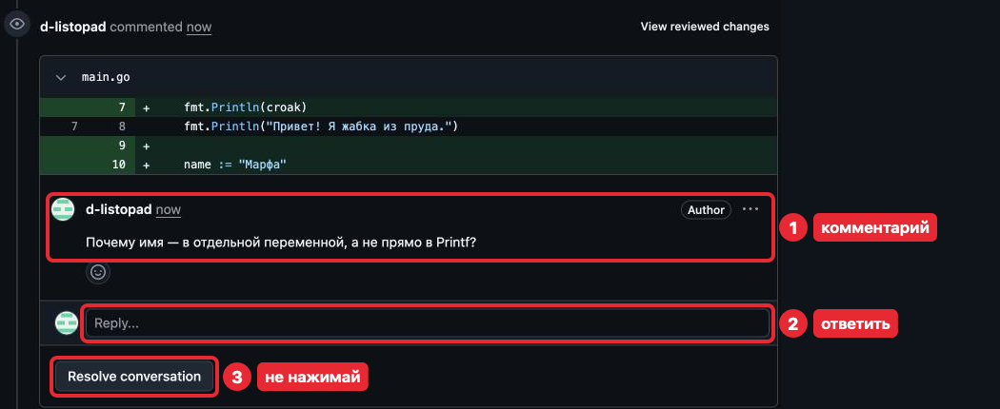

Метку **Author** у комментария на кадре пропусти: у тебя её не будет.

Набери ответ и нажми **Comment** (Комментировать). **Cancel** стирает набранное.

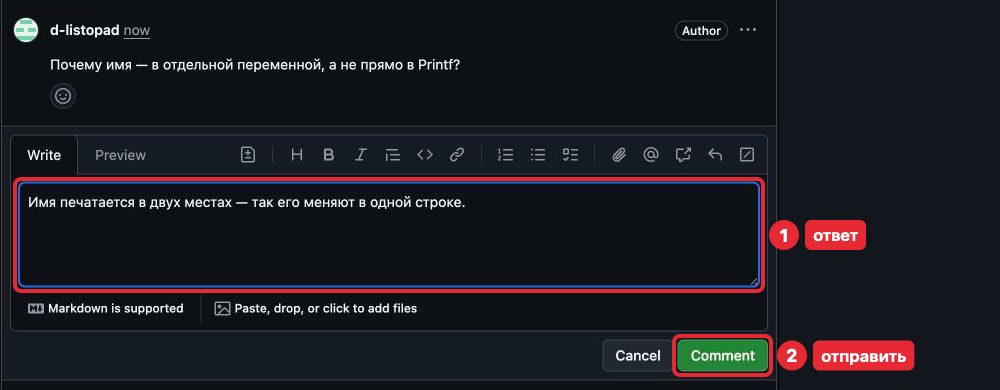

Исправления — коммит и *git push* в ту же ветку: pull request обновится сам.
Комментарий к изменённой строке GitHub пометит **Outdated** (Устарел). Когда всё
в порядке, преподаватель одобряет (**Approve**) — появится запись с зелёной галочкой.

### 6. Влить ветку

После одобрения ветку вливаешь сама и возвращаешься в *main* — к следующей задаче.

1. Нажми **Merge pull request** (Влить запрос). Стрелку рядом не трогай: она меняет
   способ слияния.

   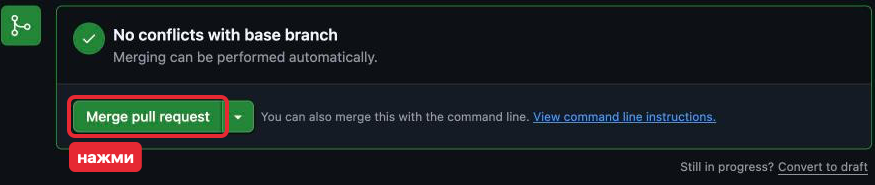

2. Поля сообщения не меняй, нажми **Confirm merge** (Подтвердить слияние). Серым
   на кадре закрыта почта.

   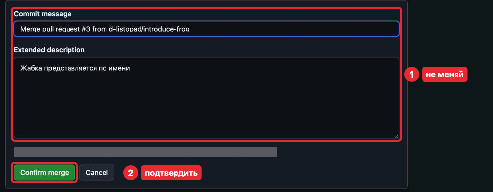

   Номер в сообщении у тебя свой, на кадре — *#3*.

3. Нажми **Delete branch** (Удалить ветку): ветка удалится на GitHub, её коммиты уже
   в *main* (в Codespace она останется, не мешает). **Revert** и **Restore branch**
   не нажимай: они отменяют слияние и возвращают ветку.

   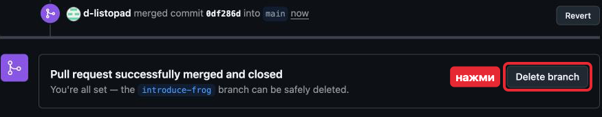

   > **Осторожно.** Рядом появится **Delete codespace** — не нажимай: удалит Codespace
   > вместе с неотправленными файлами.

4. В Codespace набери по очереди:

   ```sh
   git switch main
   git pull
   ```

   Терминал ответит:

   ```
   Switched to branch 'main'
   Your branch is up to date with 'origin/main'.
   remote: Enumerating objects: 1, done.
   remote: Counting objects: 100% (1/1), done.
   remote: Total 1 (delta 0), reused 0 (delta 0), pack-reused 0 (from 0)
   Unpacking objects: 100% (1/1), 966 bytes | 966.00 KiB/s, done.
   From https://github.com/ЛОГИН/pond
      a37d77f..0df286d  main       -> origin/main
   Updating a37d77f..0df286d
   Fast-forward
    main.go | 7 ++++++-
    1 file changed, 6 insertions(+), 1 deletion(-)
   ```

   «up to date» git пишет по тому, что видел на GitHub в прошлый раз, поэтому
   *git pull* всё равно нужен. В ответе:

   - «Fast-forward» — слитые изменения пришли;
   - ниже — какие файлы изменились;
   - строки «remote:», «Unpacking», «From» пропусти.

   Коммит «Merge pull request #1 …» в *git log* создал GitHub.

   **Кнопкой.** Нажми на имя ветки в Status Bar (Строка состояния), выбери *main*, затем нажми **⟳**
   справа от имени.

   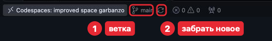

Следующая задача начинается с пункта 1.

## Если что-то пошло не так

| Ситуация | Что делать |
|---|---|
| Ветку не создала, коммита ещё нет | *git switch -c имя-ветки*: изменения перейдут в неё |
| Коммит сделан в *main*, push не было | Не делай *git push*. *git switch -c имя-ветки* — коммит окажется в ветке; напиши преподавателю, как вернуть *main* |
| Нет плашки **Compare & pull request** | Ссылка из строк «remote:» или **Pull requests → New pull request**, в **compare** своя ветка |
| *git switch main*: «Your local changes ... would be overwritten» | Сначала коммит в текущей ветке. Совет про «stash» пропусти |
| После merge в Codespace нет изменений | Не выполнены *git switch main* и *git pull* |
