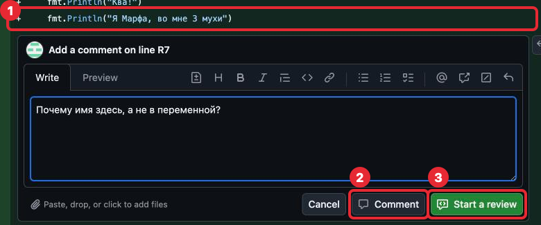
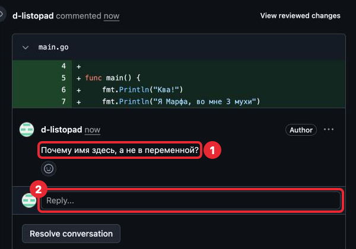
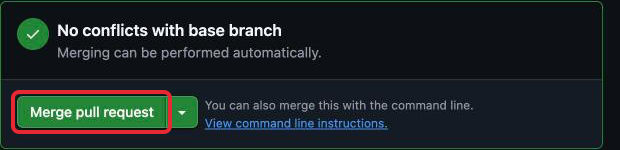

# 3. Ветки и pull request

## Зачем это нужно

Пока все коммиты идут подряд в одну историю, и каждый сразу становится частью
основной версии программы. На работе так не делают: новую возможность сначала
делают отдельно, показывают коллегам, исправляют по замечаниям и только потом
добавляют в основную версию. Так в основной версии не появляется непроверенный код.

Удобно представить черновик: работа идёт на отдельном листе, и только проверенный
текст переносится в чистовик.

**Ветка** (branch) — отдельная линия истории коммитов. Посмотреть её можно уже
знакомой командой: `git log --oneline` (часть 1) в ветке покажет все коммиты `main`
и сверху новые коммиты ветки. В `main` этих новых коммитов нет, пока ветку не вольют.

Основная ветка называется `main`: в ней лежит рабочая версия программы. Её GitHub
создал сам вместе с репозиторием в шаге 0; её имя ты видела в кнопке
**Create codespace on main** и в строке приглашения терминала: `(main)`. Для каждой
задачи создаётся своя ветка, коммиты идут в неё, а `main` при этом не меняется.

При переключении на другую ветку файлы в Explorer меняются на версию этой ветки.
В `main` твоих правок из ветки не будет — они не пропали, а лежат в ветке, и команда
`git switch имя-ветки` вернёт их.

**Pull request** — дословно «просьба забрать»: ты просишь, чтобы изменения ветки
забрали в `main`. Слово pull то же, что в `git pull` (часть 2). Это запрос на GitHub
влить ветку в `main`. В нём видны все изменения
ветки, и к любой строке можно оставить комментарий. Разбор задачи проходит в pull
request: преподаватель оставляет замечания, ты отвечаешь и исправляешь.

**Слияние** (merge) — перенос коммитов ветки в `main`. Делается после того, как
pull request одобрен.

## Коротко: путь каждой задачи

Шпаргалка на каждую задачу. Подробности по каждому пункту — ниже.

| № | Что сделать | Команда или кнопка |
|---|---|---|
| 1 | Перейти в `main`, забрать последнее, создать ветку | `git switch main`, `git pull`, `git switch -c имя-ветки` |
| 2 | Сделать задачу, сохранить коммитом | `git add .`, `git commit -m "..."` |
| 3 | Отправить ветку в GitHub | первый раз `git push --set-upstream origin имя-ветки`, дальше `git push` |
| 4 | Открыть pull request | **Compare & pull request** на github.com |
| 5 | Ответить на замечания, исправить, отправить | коммит и `git push` в ту же ветку |
| 6 | После одобрения влить ветку и вернуться в `main` | **Merge pull request**, **Delete branch**, `git switch main`, `git pull` |

## Порядок работы над задачей

С шага 3 каждая задача проходит этот путь.

### 1. Создать ветку

Перед началом задачи — убедиться, что ты в `main` и у тебя последняя версия,
затем создать ветку. Команды ниже — для задачи 1 шага 3, ветка `introduce-frog`;
в следующих задачах у ветки своё имя, его называет задача или выбираешь ты.

```sh
git switch main
git pull
git switch -c introduce-frog
```

- `git switch main` — перейти в ветку `main`.
- `git pull` — забрать из GitHub новое, если оно там есть.
- `git switch -c introduce-frog` — создать (create) ветку с этим именем и сразу
  перейти в неё.

В первый раз команды ответят так:

```
Already on 'main'
Your branch is up to date with 'origin/main'.
Already up to date.
Switched to a new branch 'introduce-frog'
```

`Already on 'main'` — ты и так в `main`; `Already up to date.` — нового в GitHub нет.
Это не ошибки. После последней команды строка приглашения кончается
на `(introduce-frog)`.

Имя ветки — коротко о задаче, латиницей, слова через дефис: `introduce-frog`,
`newborn-frog`. Текущая ветка видна в строке приглашения в скобках (шаг 1, «Куда
набирать») и в Status Bar слева, рядом с именем Codespace, со значком ветки.


*1 — ветка в Status Bar, 2 — ветка в строке приглашения. Звёздочка после имени
в Status Bar значит, что в ветке есть изменения, ещё не сохранённые коммитом.*

### 2. Сделать задачу и сохранить коммитом

Как обычно: код, проверки по критериям приёмки, `git add .`, `git commit -m "..."`.
Коммитов в ветке может быть несколько.

### 3. Отправить ветку в GitHub

Первый раз для новой ветки:

```sh
git push --set-upstream origin introduce-frog
```

На GitHub этой ветки ещё нет. Команда создаёт её там (`origin` — это GitHub, часть 2)
и связывает с твоей веткой в Codespace. После этого в этой ветке достаточно
`git push`. Если набрать просто `git push`, git ответит
`fatal: The current branch introduce-frog has no upstream branch.` и сам напишет
нужную команду — её можно скопировать.

### 4. Открыть pull request

1. Открыть `pond` на github.com. Над списком файлов появится жёлтая плашка
   «introduce-frog had recent pushes…» и кнопка **Compare & pull request** — нажать её.

   

   *Кнопка Compare & pull request в жёлтой плашке.*

2. Откроется форма pull request. **Add a title** — что делает задача, например
   «Жабка представляется по имени». GitHub подставит сюда сообщение коммита: если оно
   говорит, что сделано, оставь.
3. **Add a description** — большое поле под заголовком: в нём ответ на «Вопрос к разбору»
   из задачи.
4. Справа в **Reviewers** нажать на шестерёнку и выбрать `d-listopad`.
5. Нажать **Create pull request**.


*1 — заголовок, 2 — описание с ответом на вопрос к разбору, 3 — шестерёнка Reviewers,
4 — кнопка Create pull request. Стрелку рядом с ней и панели справа (Assignees, Labels,
Projects, Milestone, Development) не трогай. На кадре у Reviewers написано
«No reviews»: преподавателя на кадре не выбрали, потому что снимали в его же аккаунте.*

### 5. Разбор

Преподаватель оставляет комментарии к строкам кода на вкладке **Files changed**
pull request: у строки открывается поле, и он отправляет комментарий кнопкой
**Comment** (или копит несколько через **Start a review**). Ты увидишь так:



*1 — строка, к которой оставляют комментарий, 2 — кнопка Comment, 3 — Start a review.
Так выглядит, когда комментарий пишет преподаватель; тебе эти кнопки нужны, только
если сама захочешь оставить комментарий к строке.*

GitHub пришлёт уведомление, а сами комментарии видны в pull request на вкладке
**Conversation**. Ответ пишется в поле **Reply...** прямо под комментарием.



*1 — комментарий к строке, 2 — поле Reply... для ответа. Кнопку **Resolve conversation**
не нажимай: закрыть обсуждение — решение преподавателя.*

На каждый комментарий:

- исправить код в той же ветке, сделать коммит и `git push` — pull request обновится
  сам, новый pull request не нужен;
- ответить в комментарии, что сделано, или задать вопрос, если замечание непонятно.

Когда всё в порядке, преподаватель одобряет pull request (**Approve**): в pull
request появится запись, что `d-listopad` одобрил изменения, с зелёной галочкой.

### 6. Влить ветку в `main`

1. Внизу pull request нажать **Merge pull request**. Стрелку рядом с ней не трогай:
   нужен способ слияния по умолчанию.

   

2. Появятся поля с сообщением слияния — их не меняй — и кнопка **Confirm merge**.
   Нажать её.

   

3. Появится надпись «Pull request successfully merged and closed». Нажать
   **Delete branch**: ветка задачи больше не нужна, её коммиты уже в `main`.

   

   > **Осторожно.** После **Delete branch** рядом появляется кнопка
   > **Delete codespace**. Её не нажимай: она удалит твой Codespace вместе с файлами,
   > которые ещё не отправлены в GitHub.

4. В Codespaces вернуться в `main` и забрать слитые изменения:

   ```sh
   git switch main
   git pull
   ```

Задача сдана. Следующая начинается снова с пункта 1.

## Если что-то пошло не так

| Ситуация | Что делать |
|---|---|
| Начала задачу, а ветку не создала, коммита ещё нет | `git switch -c имя-ветки`: изменения перейдут в новую ветку вместе с тобой |
| Коммит уже сделан в `main`, push ещё не было | Не делай `git push`. Выполни `git switch -c имя-ветки` — коммит окажется в новой ветке — и напиши преподавателю, как вернуть `main` к прежнему виду |
| Нет плашки **Compare & pull request** | Вкладка **Pull requests → New pull request**, в поле **compare** выбрать свою ветку |
| `git switch main` пишет `Your local changes ... would be overwritten` | Есть изменения без коммита. Сначала сделать коммит в текущей ветке |
| После `Merge pull request` в Codespaces нет изменений | Не выполнены `git switch main` и `git pull` |
