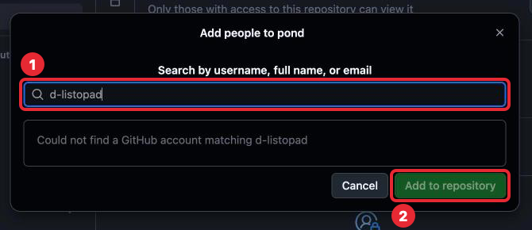
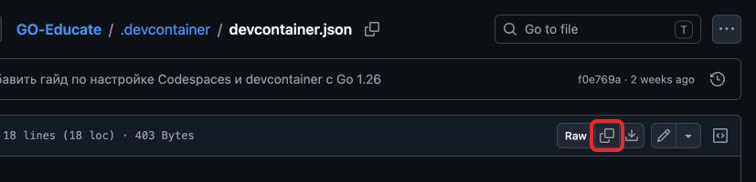
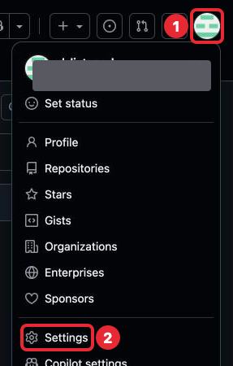
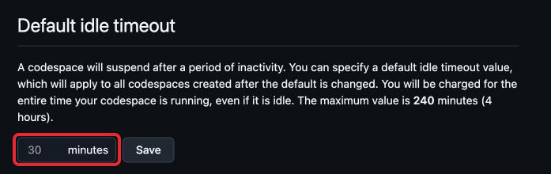

# Шаг 0. Настройка среды

На iPad нельзя установить Go напрямую: iPadOS не позволяет запускать программы,
которые превращают код в работающую программу. Поэтому код мы будем писать
на облачном компьютере **Codespace**: он стоит у GitHub, а не у тебя, и открывается
прямо в Safari. В нём уже есть **редактор кода** VS Code — программа, в которой пишут
код. Такие компьютеры даёт сервис GitHub Codespaces; на бесплатном аккаунте GitHub
это 60 часов в месяц.

Весь курс ты будешь делать одну программу — «Пруд». У программы много файлов: код,
описание, настройки. Все файлы одной программы, сложенные в одну папку, называют
**проектом** (project). Твой проект будет храниться на GitHub в **репозитории**
(repository) — папке на GitHub, которая помнит не только файлы, но и все их прошлые
версии. Репозиторий твоего проекта называется `pond`. А этот репозиторий, GO-Educate, —
учебник: уроки и тексты задач читаются прямо на github.com.

Всё, что нужно для работы с кодом, — Go, редактор, его настройки — вместе называют
**средой** (environment); отсюда название шага. Остаётся создать репозиторий, описать
в нём среду и создать Codespace — это 20–30 минут. Шаг заканчивается тем, что Codespace
открылся. Что в нём где и как с ним работать — следующий шаг.

Скриншоты сделаны в тёмной теме и на компьютере, у тебя цвета и расположение кнопок
могут отличаться: ищи кнопку по названию, оно выделено **жирным**.
Красной рамкой отмечено, куда нажать или куда смотреть, номера — в каком порядке.
На скриншотах логин `d-listopad` — это аккаунт преподавателя, у тебя на его месте
будет твой логин.

---

## Что понадобится

- iPad с клавиатурой. Трекпад или мышь очень желательны: в редакторе мелкие кнопки,
  и попадать в них пальцем неудобно.
- Safari (другие браузеры тоже подойдут, но инструкция написана под Safari).
- Держи iPad горизонтально: на узком экране GitHub прячет часть кнопок.

---

## 1. Свой репозиторий `pond`

1. Открой [github.com/new](https://github.com/new).
2. В поле **Repository name** набери `pond`. Под полем появится зелёное
   «pond is available» — имя свободно.
3. В **Choose visibility** выбери **Private**: репозиторий видишь только ты и те,
   кого ты пригласишь. Это учебный код, посторонним он не нужен, а доступ
   преподавателю ты дашь сама в разделе 2.
4. Включи переключатель **Add README** (положение **On**). README — файл с описанием
   проекта, GitHub показывает его на странице репозитория под списком файлов.
   Он нужен сразу: Codespace нельзя создать для совсем пустого репозитория.
5. Поле **Owner** — твой логин, его не меняй; подсказку с другим именем репозитория
   не нажимай. Остальные поля (**Description**, **Start with a template**,
   **Add .gitignore**, **Add license**) тоже не трогай. Нажми **Create repository**
   внизу страницы.

*1 — имя `pond`, 2 — Private, 3 — Add README включён, 4 — кнопка Create repository.*

Откроется страница твоего репозитория: имя `pond` с меткой Private и один файл
`README.md`. Часть имени после точки называют **расширением** (file extension):
это метка, которая говорит, что внутри файла, как `.docx` у документа Word.
`.md` значит «текст с простой разметкой: заголовки, списки».

---

## 2. Преподаватель — в collaborators

Collaborator — человек, которому ты дала доступ к своему репозиторию. Преподавателю
он нужен, чтобы читать твой код и оставлять замечания.

1. На странице `pond` открой **Settings**. Если вкладки не видно в строке вкладок,
   она спрятана в меню **More** справа.

   

   *1 — меню More, 2 — Settings.*

2. Слева выбери **Collaborators**. Если GitHub попросит ещё раз ввести пароль
   или код — это проверка, что это ты; введи его.

   

   *1 — раздел Collaborators в меню слева, 2 — кнопка Add people.*

3. Нажми **Add people**, набери логин `d-listopad`, выбери его в списке под полем
   и нажми **Add to repository**.

   

   *1 — поле, в котором набирается логин, 2 — кнопка Add to repository. Скриншот снят
   из аккаунта самого преподавателя, поэтому под полем написано «Could not find…»:
   себя пригласить нельзя. У тебя на этом месте появится строка `d-listopad`.*

В списке появится `d-listopad` с пометкой **Pending Invite**: приглашение ждёт, пока
преподаватель его примет. Это нормально, больше ничего делать не нужно.

---

## 3. Описание среды

Codespace собирается по файлу `devcontainer.json` в папке `.devcontainer`; запись
`.devcontainer/devcontainer.json` значит то же самое: косая черта отделяет папку
от файла в ней. В этом файле сказано, какую версию Go поставить и какие дополнения
редактора включить. **Дополнение** (extension) редактора — небольшая программа, которая
добавляет ему умений, например подсветку кода на Go; не путай с расширением в имени
файла. Образец файла лежит в GO-Educate, его нужно скопировать в `pond`.

1. На странице `pond` нажми кнопку **+** рядом с **Go to file** (на широком экране
   вместо неё может быть кнопка **Add file**) и выбери **Create new file**.

   

   *1 — кнопка +, 2 — Create new file.*

2. В поле имени набери `.devcontainer/devcontainer.json`. После косой черты GitHub
   сам превратит `.devcontainer` в папку, и в поле останется `devcontainer.json`.
3. Скопируй содержимое образца. Открой
   [`.devcontainer/devcontainer.json`](../../.devcontainer/devcontainer.json)
   в новой вкладке: нажми на ссылку и удерживай → **Открыть в новой вкладке**, иначе
   уйдёшь со страницы, где уже набрано имя файла. На открывшейся странице нажми
   **Copy raw file**, вернись на вкладку с `pond` и вставь в большое поле для текста
   файла под его именем (Cmd + V).

   

   *Кнопка Copy raw file — вторая в группе справа над текстом файла, между Raw
   и кнопкой скачивания.*

   

   *1 — путь и имя файла (`main` рядом — ветка, о ней в п. 4), 2 — вставленное
   содержимое, 3 — кнопка Commit changes..., 4 — кнопка, которая закрывает панель
   Marketplace. Строки мелким шрифтом под полем — подсказки GitHub, на них
   не обращай внимания.*

   Справа может открыться панель **Marketplace** и закрыть часть поля — закрой её
   кнопкой 4 или не обращай внимания.

   Что ты вставила — настройки среды по строкам. Менять их не нужно:

   | Строка | Что значит |
   |---|---|
   | `"image": "…go:1.26-trixie"` | Готовая система для Codespace, в которой уже стоит Go 1.26 |
   | `"extensions": ["golang.go"]` | Дополнение редактора для Go: подсветка, подсказки, проверка кода |
   | `"editor.formatOnSave": true` | Cmd + S расставляет отступы в коде; автосохранение — нет (шаг 1) |
   | `"files.autoSave": "afterDelay"` | Файл сохраняется сам через секунду после правки |
   | `"go.toolsManagement.autoUpdate": true` | Вспомогательные программы Go обновляются сами |
   | `"cpus": 2` | Компьютер с двумя ядрами (ядро — часть процессора); на двух ядрах бесплатно 60 часов в месяц |
   | Остальное | Название среды и команда, которая после сборки показывает версию Go |

4. Пока файл есть только на этой странице. Чтобы записать его в репозиторий как новую
   версию — ту самую, которую репозиторий помнит, — делают **commit**; подробно —
   в шаге 2. Нажми **Commit changes...**. В открывшемся окне ничего не меняй: поле
   **Commit message** GitHub заполнил сам, выбрано **Commit directly to the main
   branch** — так и оставь. `main` — основная ветка (branch) репозитория; что такое
   ветки, разберём в шаге 3. Нажми **Commit changes**.

   

   *1 — Commit directly to the main branch, 2 — кнопка Commit changes.*

GitHub покажет записанный файл. Нажми `pond` в строке пути сверху — в списке файлов
репозитория появилась папка `.devcontainer`.

---

## 4. Время до автоостановки

Codespace сам останавливается, если в нём ничего не делать, — по умолчанию через
30 минут, и всё это время часы списываются. Поставь 15 минут: если забудешь остановить
Codespace, потеряешь меньше. Сделай это до создания Codespace: настройка действует
только на Codespace, созданные после неё.

1. Нажми на свою аватарку справа вверху на любой странице GitHub → **Settings**.
   Это настройки аккаунта, а не те Settings, что у репозитория в разделе 2.

   

   *1 — аватарка, 2 — Settings: настройки аккаунта. Серым закрыто имя владельца
   скриншота, у тебя там будет твоё.*

2. Слева выбери **Codespaces**. В поле **Default idle timeout** поставь 15 и нажми
   **Save** справа от поля.

   

   *Поле Default idle timeout, по умолчанию 30 minutes. Остальные настройки на этой
   странице не трогай.*

---

## 5. Создание Codespace

1. На странице репозитория `pond` нажми зелёную кнопку **<> Code**.
2. Перейди на вкладку **Codespaces**.
3. Нажми **Create codespace on main**.

*1 — кнопка Code, 2 — вкладка Codespaces, 3 — Create codespace on main. Строка внизу
со словами «paid for by» значит, что часы идут из твоего бесплатного лимита.*

4. Подожди. В первый раз сборка занимает 2–4 минуты: GitHub ставит в Codespace Go
   и дополнения из `devcontainer.json`. Окно редактора уже видно, но работать в нём
   пока нельзя: справа внизу висит уведомление **Setting up remote connection:
   Building codespace...**, слева внизу — **Opening Remote...**. Это нормально,
   дождись, пока они исчезнут.

   

   *Уведомление о сборке. Пока оно висит, ничего не нажимай.*

5. Появится окно **Do you trust the authors of the files in this folder?** — «доверяешь
   ли ты авторам файлов в этой папке». Это твой репозиторий, нажми
   **Trust Folder & Continue**. Без этого Codespace останется в ограниченном режиме
   (Restricted Mode) и не даст запускать программы.
6. Справа может быть открыта панель **Chat** — помощник с искусственным интеллектом,
   который пишет код за тебя. В курсе код пишешь ты сама, иначе не научишься, поэтому
   закрой панель крестиком в правом верхнем углу. Если она откроется снова — закрой
   так же.

*1 — Trust Folder & Continue, 2 — крестик, который закрывает панель Chat. Полоса
Restricted Mode сверху исчезнет после Trust. Вкладку README и надпись Sign In внизу
пока не трогай — окно разберём в шаге 1.*

Codespace готов. Он один на весь курс: кнопку **Create codespace on main** больше
не нажимай. Как открыть его снова и остановить — в шаге 1.

---

## 6. Настройка Safari на iPad

**Весь экран под Safari.** Если рядом с Safari открыто другое приложение, закрой его:
редактору нужна вся ширина экрана.

**Отдельное окно без вкладок.** Когда Codespace открыт, нажми в Safari кнопку
**Поделиться** (квадрат со стрелкой вверх) → **На экран «Домой»**. На экране «Домой»
появится иконка Codespace, его удобно открывать через неё. Зачем: в обычном Safari
некоторые сочетания клавиш срабатывают в браузере, а не в редакторе, — например,
Cmd + W закрывает вкладку Safari целиком. Если при первом открытии иконки GitHub
попросит войти, войди тем же аккаунтом.

**Раскладка.** Код пишется в английской раскладке: слова Go пишутся латиницей,
а фигурные скобки `{}` есть только в английской раскладке. Переключение — клавиша
с глобусом или Ctrl + Пробел, в зависимости от клавиатуры.

---

## 7. Лимиты

Часы списываются с **твоего** аккаунта: 60 часов в месяц на 2-ядерном компьютере.
Посмотреть остаток: аватарка → **Settings** → слева **Billing and plans → Plans
and usage**, раздел **Codespaces**.

Codespace — временный компьютер: если не заходить в него 30 дней, GitHub удалит его
вместе со всеми файлами, которые не записаны в репозиторий на GitHub. Cmd + S
и автосохранение сохраняют файл только внутри Codespace; как записать работу
в репозиторий — шаг 2.

---

## Что настроено и что меняется

После этого шага часть проекта настроена раз и навсегда, а часть будет меняться
в каждой задаче. Строки с шагом больше 0 — то, чего у тебя пока нет: оно появится
в указанном шаге, создавать сейчас не нужно.

| Что | С какого шага | Трогать? |
|---|---|---|
| `.devcontainer/devcontainer.json` — настройки среды | 0 | Нет. Если среда сломалась — Rebuild Container (шаг 1), а не правка файла |
| Codespace | 0 | Один на весь курс. Открывать существующий, не создавать новый |
| Collaborators в Settings | 0 | Нет |
| `README.md` — описание проекта | 0 | Сейчас нет. С шага 2 — да, когда программа научилась новому |
| Папка `try` — примеры из уроков, и `.gitignore` — список того, что git не сохраняет | 1 | `try` — да. `.gitignore` — нет |
| `go.mod` — служебный файл Go (в `try` — шаг 1, в корне `pond` — шаг 2) | 1 | Руками нет. Его меняют только команды `go` |
| `main.go` — код программы | 2 | Да, здесь пишется программа |

---

## Как проходить урок

Каждый следующий шаг курса проходится в одном и том же порядке. Шаг — это 10–20 минут
чтения и 1–2 часа практики, его не нужно делать за один раз.

1. **Прочитать урок.** Ссылка на следующий — в конце каждого урока, раздел «Что дальше».
   Незнакомое слово — в [словаре терминов](../glossary.md).
2. **Набрать примеры руками** в Codespace и запустить их. Настройки, как в этом шаге,
   копируем, а код набираем: так запоминается синтаксис — правила записи кода: где
   скобки, где кавычки. Для примеров будет папка `try` (задача шага 1).
3. **Ответить на «Проверь себя»** в конце урока. Сначала ответ своими словами, потом
   раскрыть правильный: нажми на строку «Ответ» с треугольником. Если ответ не совпал —
   перечитать нужный раздел, прежде чем идти дальше.
4. **Сделать задачи** из папки `tasks/` рядом с уроком — в своём репозитории `pond`,
   по порядку номеров. В задачах с шага 1 раздел «Где менять» говорит, какие файлы
   задача меняет, а какие трогать не нужно.
5. **Проверить себя по критериям приёмки.** Каждый пункт с флажком должен выполняться.
   Флажки — список для самопроверки: на GitHub они не нажимаются, отмечать ничего
   не нужно. Если под пунктом написано «Как проверить» — сделать именно эту проверку.
6. **Записать работу в репозиторий на GitHub.** Как это делается, покажет задача
   шага 2, а подробно — раздел [Git](../../Git/README.md).
7. **Пройти разбор**: преподаватель оставит замечания на GitHub, ты отвечаешь на них
   и исправляешь код. Где их найти, покажет задача шага 2, а с шага 3 для разбора
   будет отдельная страница на GitHub.

**Если застряла:**

- Прочитать сообщение об ошибке целиком: в нём файл, строка и что не так.
- Найти сообщение в таблице «Типичные ошибки» урока (в шагах 0–1 — «Если что-то пошло
  не так»).
- Вернуться к разделу урока, на который ссылается подсказка в задаче.
- Не получилось за 20–30 минут — записать, что пробовала, и спросить преподавателя.
  Это нормальная часть работы, а не провал.

---

## Если что-то пошло не так

| Проблема | Что делать |
|---|---|
| Нет вкладки Codespaces в меню Code | Проверь, что ты вошла в свой аккаунт GitHub |
| Сборка висит больше 5 минут | Обнови страницу |
| Нажала Cancel в окне доверия | Внизу окна будет надпись **Restricted Mode**. Нажми на неё и выбери **Trust** |
| Экран выглядит не так, как описано здесь | GitHub иногда меняет интерфейс. Напиши преподавателю, что видишь, — урок поправим |
| Закончились 60 часов | Ждать начала следующего месяца или спросить у преподавателя про запасной вариант |

---

## Что дальше

Сделай задачу [Среда готова](tasks/01-environment.md), затем переходи к шагу 1
[Редактор VS Code](../01-vscode/lesson.md).
