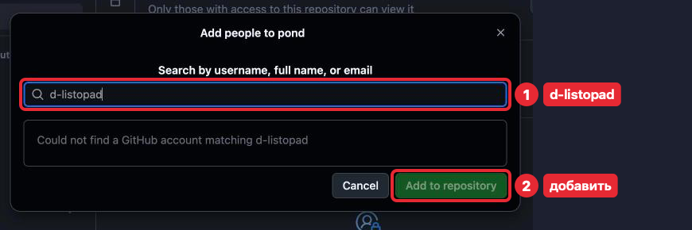
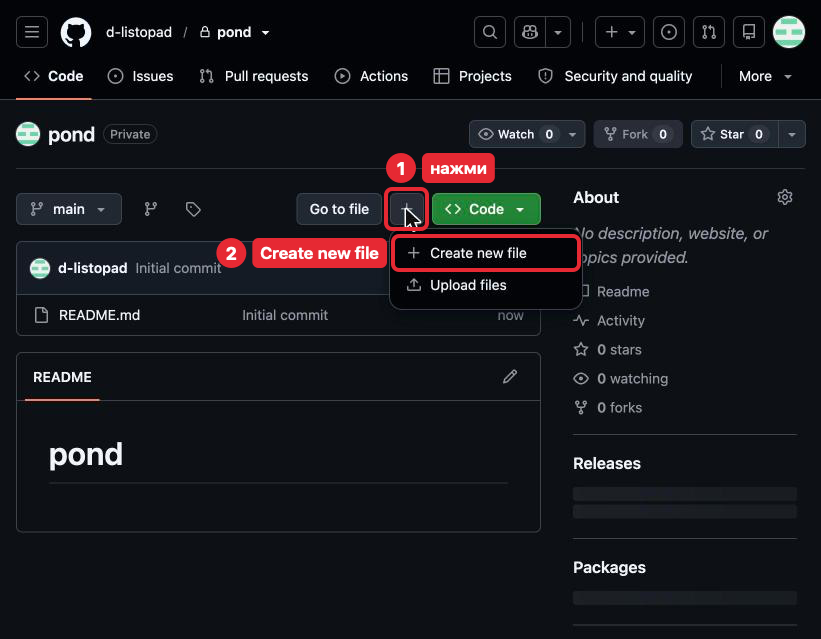
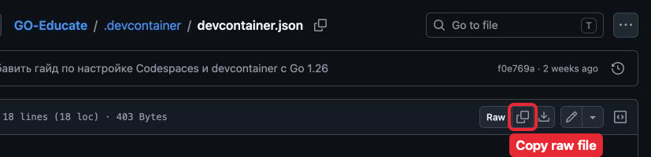
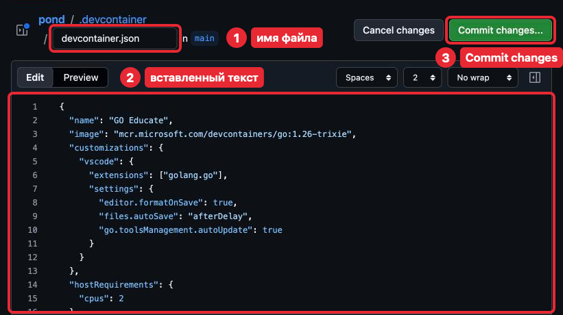
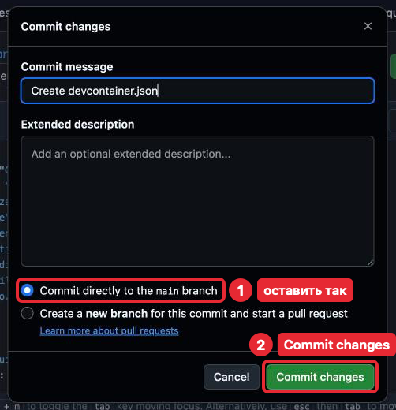
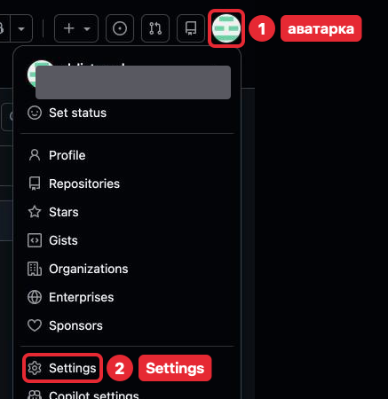
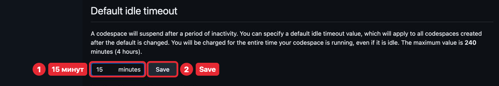
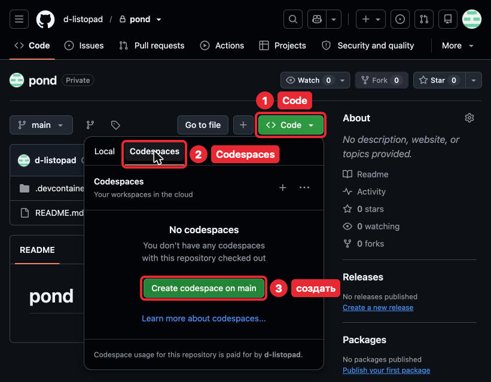
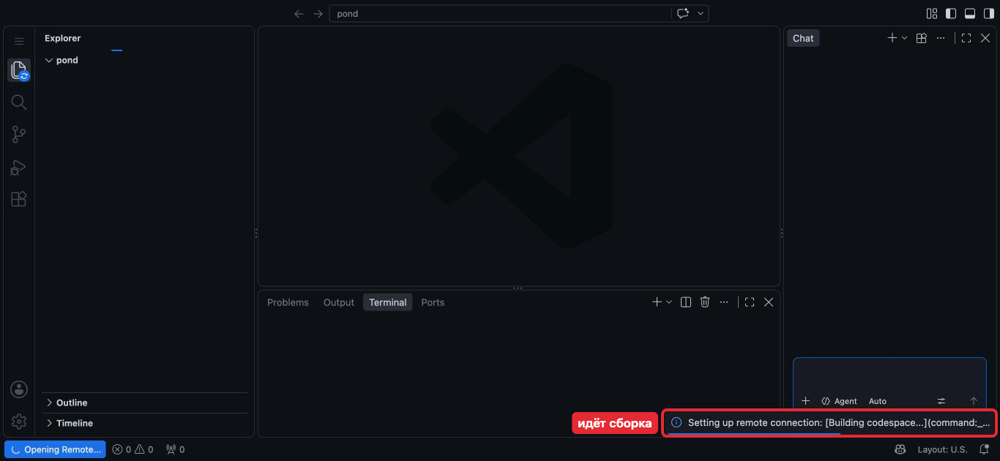
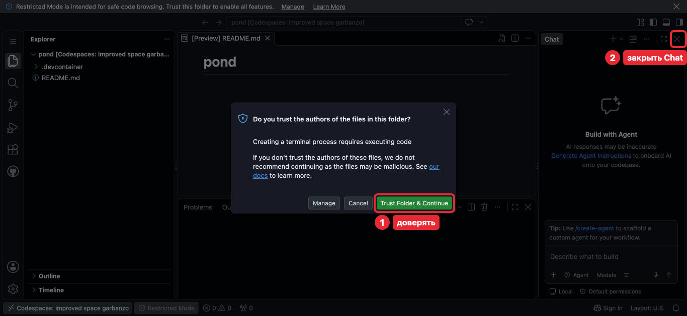

# Шаг 0. Настройка среды

На iPad нельзя установить Go, поэтому код пишется на облачном компьютере GitHub —
**Codespace**. Он открывается в Safari, в нём есть редактор кода VS Code. Всё вместе —
Go, редактор и его настройки — называют **средой** (environment).

Весь курс ты делаешь одну программу — «Пруд». Её файлы в одной папке — **проект**
(project) — хранятся на GitHub в **репозитории** (repository) `pond`: папке,
которая помнит прошлые версии файлов. В конце шага (20–30 минут) у тебя будут `pond`
и открытый Codespace.

## Что настроено и что меняется

Часть того, что ты сейчас настроишь, не меняется до конца курса:

| Что | Трогать? |
|---|---|
| `.devcontainer/devcontainer.json` — настройки среды | Нет. Если среда сломалась — Rebuild Container (покажем позже), а не правка файла |
| Codespace | Один на весь курс: открывать существующий, не создавать новый. Исключение — GitHub удалил его (раздел 7) |
| Collaborators в Settings | Нет |
| `README.md` — описание проекта | Пока нет |

Про каждый новый файл урок скажет, можно ли его трогать.

## Перед началом

- iPad с клавиатурой; трекпад или мышь желательны: кнопки в редакторе мелкие.
- Safari, iPad горизонтально: на узком экране GitHub прячет кнопки.
- На скриншотах ищи кнопку по названию **жирным**: у тебя расположение может
  отличаться. Рамка — куда нажать, номер — порядок, рядом подпись. Интерфейс GitHub
  и VS Code английский, поэтому кнопки названы как на экране, а в скобках — по-русски.
  `d-listopad` — логин преподавателя.

## 1. Свой репозиторий `pond`

Начнём с места, где будет жить проект, — репозитория на GitHub.

1. Открой [github.com/new](https://github.com/new).
2. В **Repository name** (имя репозитория) набери `pond`. Под полем появится
   «pond is available».
3. В **Choose visibility** (видимость) выбери **Private** (закрытый): репозиторий видишь
   только ты и те, кого пригласишь.
4. Включи **Add README** (**On**) — описание проекта. Без него репозиторий пуст,
   и Codespace не создать.
5. Остальные поля (**Owner**, **Description**, **Start with a template**,
   **Add .gitignore**, **Add license**) не трогай. Нажми **Create repository** (создать
   репозиторий).

Откроется `pond` с меткой Private и файлом `README.md`. Часть имени после точки —
**расширение** (file extension): оно говорит, что внутри, как `.docx` у документа Word.
`.md` — текст с разметкой: заголовки, списки.

## 2. Преподаватель — в collaborators

Репозиторий закрытый, поэтому преподаватель пока его не видит. Collaborator (соавтор) —
человек с доступом к твоему репозиторию: преподаватель будет читать код и оставлять
замечания.

1. На странице `pond` открой **Settings** (настройки; если не видно — в меню **More**
   справа).

   

2. Слева выбери **Collaborators**. Если GitHub попросит пароль или код — введи.

   

3. Нажми **Add people** (добавить людей), набери `d-listopad`, выбери его в списке
   и нажми **Add to repository** (добавить в репозиторий).

   

   Кадр снят из аккаунта преподавателя, поэтому под полем «Could not find…»; у тебя
   там будет строка `d-listopad`.

В списке появится `d-listopad` с пометкой **Pending Invite** (приглашение ждёт
ответа). Больше ничего делать не нужно.

## 3. Описание среды

Теперь опишем среду, которую GitHub соберёт для `pond`. Codespace собирается по файлу
`.devcontainer/devcontainer.json` (папка, косая черта, файл): какой Go поставить
и какие дополнения включить. **Дополнение** (extension) — программа, которая добавляет
редактору умений, например подсветку Go; не путай с расширением имени файла. Образец
лежит в этом учебнике (GO-Educate): скопируй его.

1. На странице `pond` нажми **+** рядом с **Go to file** (или **Add file** — добавить
   файл) → **Create new file** (создать файл).

   

2. В поле имени набери `.devcontainer/devcontainer.json`. После косой черты GitHub
   сделает `.devcontainer` папкой, в поле останется `devcontainer.json`.
3. Открой [образец](../../.devcontainer/devcontainer.json) в новой вкладке (нажми
   и удерживай ссылку → **Открыть в новой вкладке**, чтобы не потерять набранное имя).
   Нажми **Copy raw file** (скопировать файл), вернись к `pond` и вставь в поле текста
   файла (Cmd + V).

   

   

   `main` рядом с именем — ветка, см. п. 4. Если открылась панель Marketplace — закрой
   её крестиком. Кнопки над полем (**Edit**, **Preview**, **Spaces**, **2**, **No wrap**)
   не трогай, **Cancel changes** (отменить) тоже: она стирает набранное.

   Что ты вставила:

   | Строка | Что значит |
   |---|---|
   | `"image": "…go:1.26-trixie"` | Система с Go 1.26 |
   | `"extensions": ["golang.go"]` | Дополнение для Go: подсветка, подсказки, проверка кода |
   | `"editor.formatOnSave": true` | Cmd + S выравнивает код; автосохранение — нет |
   | `"files.autoSave": "afterDelay"` | Файл сохраняется сам через секунду после правки |
   | `"cpus": 2` | Мощность облачного компьютера: два ядра процессора |
   | Остальное | Название среды и служебные настройки |

4. Записать файл в репозиторий как новую версию — **commit** (подробно — позже).
   Нажми **Commit changes...** (сохранить изменения), в окне ничего не меняй: оставь
   **Commit directly to the main branch** (`main` — основная ветка, branch; ветки
   разберём позже) и нажми **Commit changes**.

   

Нажми `pond` в строке пути сверху — в списке появилась папка `.devcontainer`.

## 4. Время до автоостановки

Описание среды готово. Прежде чем создать по нему Codespace, настроим, когда он сам
останавливается: настройка действует только на Codespace, созданные после неё.
Без дела Codespace останавливается через 30 минут, и всё это время тратятся часы
бесплатного лимита (раздел 7). Поставь 15 минут.

1. Аватарка справа вверху → **Settings** (настройки аккаунта, не репозитория).

   

   Серым закрыто имя владельца скриншота.

2. Слева **Codespaces** → **Default idle timeout** (время простоя) = 15 → **Save**
   (сохранить). Остальное на странице не трогай.

   

## 5. Создание Codespace

Всё готово, чтобы создать сам Codespace. На странице `pond`: **<> Code** (код) →
вкладка **Codespaces** → **Create codespace on main** (создать Codespace на ветке main).

«paid for by» на кадре — часы идут из твоего бесплатного лимита.

1. Подожди 2–4 минуты, пока идёт сборка (справа внизу **Building codespace...**,
   слева **Opening Remote...**). Ничего не нажимай.

   

2. На вопрос **Do you trust the authors of the files in this folder?** (доверяешь ли
   авторам файлов) нажми **Trust Folder & Continue** (доверять и продолжить): это твой
   репозиторий. Без этого Codespace не даст запускать программы (Restricted Mode —
   ограниченный режим).
3. Закрой панель **Chat** (чат) справа крестиком: она пишет код за тебя, а учишься ты.

Остальное в окне разберём позже. Codespace готов. **Create codespace on main**
больше не нажимай.

## 6. Safari на iPad

Codespace открыт в Safari. Три настройки, чтобы в нём было удобно работать:

- **Весь экран под Safari**: редактору нужна вся ширина.
- **Иконка на экране «Домой»:** в открытом Codespace **Поделиться** → **На экран
  «Домой»**, и открывай через неё. В обычном Safari часть сочетаний клавиш срабатывает
  в браузере (Cmd + W закрывает вкладку). Попросит войти — войди тем же аккаунтом.
- **Английская раскладка** для кода (скобки `{}` есть только в ней): клавиша
  с глобусом или Ctrl + Пробел.

## 7. Лимиты

Codespace бесплатен 60 часов в месяц на двух ядрах. Остаток:
аватарка → **Settings** → **Billing and plans → Plans and usage** (оплата и тарифы →
использование), раздел **Codespaces**.

Если не заходить в Codespace 30 дней, GitHub удалит его вместе с файлами, не записанными
в репозиторий. Сохранение (Cmd + S, автосохранение) хранит файл только в Codespace;
как записать работу в репозиторий — позже. Если Codespace всё же удалён — создай новый,
как в разделе 5: это единственный случай, когда новый Codespace создавать можно.

## Как проходить урок

Среда готова. Каждый следующий шаг проходится одинаково:

1. **Прочитать урок.** Незнакомое слово — в [словаре](../glossary.md).
2. **Ответить на «Проверь себя»**, потом раскрыть ответ (строка «Ответ»
   с треугольником). Не совпал — перечитать раздел.
3. **Сделать задачи** из папки `tasks/` в `pond`, по порядку. Раздел «Где менять» говорит,
   какие файлы трогать.
4. **Проверить критерии приёмки.** Флажки — список для себя, на GitHub не нажимаются.
5. **Записать работу в репозиторий и пройти разбор**: преподаватель оставит замечания,
   ты их исправишь. Как — покажем позже, справка — раздел [Git](../../Git/README.md).

**Если застряла:** прочитай сообщение об ошибке целиком и найди его в «Типичных
ошибках» урока. Не вышло за 20–30 минут — запиши, что пробовала, и спроси преподавателя.

## Если что-то пошло не так

| Проблема | Что делать |
|---|---|
| Нет вкладки Codespaces в меню Code | Проверь, что вошла в свой аккаунт GitHub |
| Сборка висит больше 5 минут | Обнови страницу |
| Нажала Cancel в окне доверия | Нажми **Restricted Mode** внизу окна → **Trust** |
| На [github.com/codespaces](https://github.com/codespaces) нет твоего Codespace | Раздел 7 |
| Экран не такой, как описано | Напиши преподавателю, что видишь |
| Закончились 60 часов | Жди следующего месяца или спроси преподавателя |

## Что дальше

Задача [Среда готова](tasks/01-environment.md), затем шаг 1
[Редактор VS Code](../01-vscode/lesson.md).
