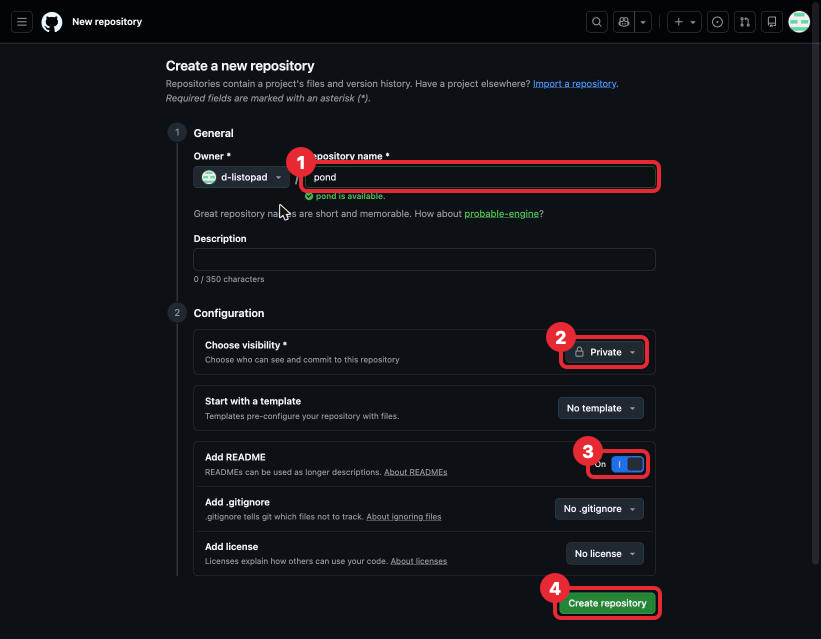
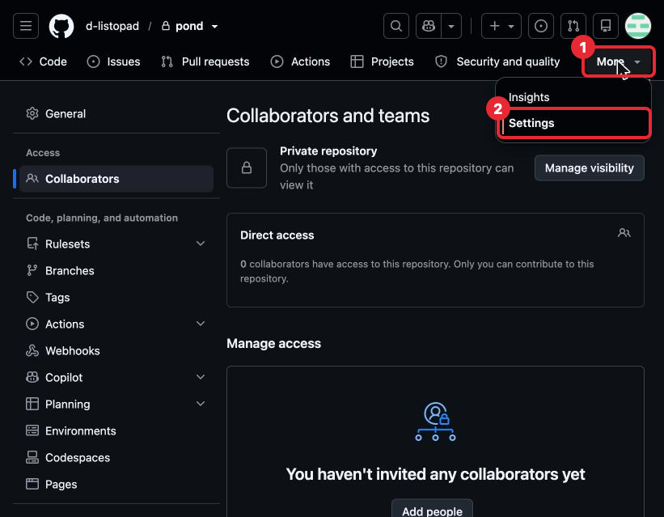
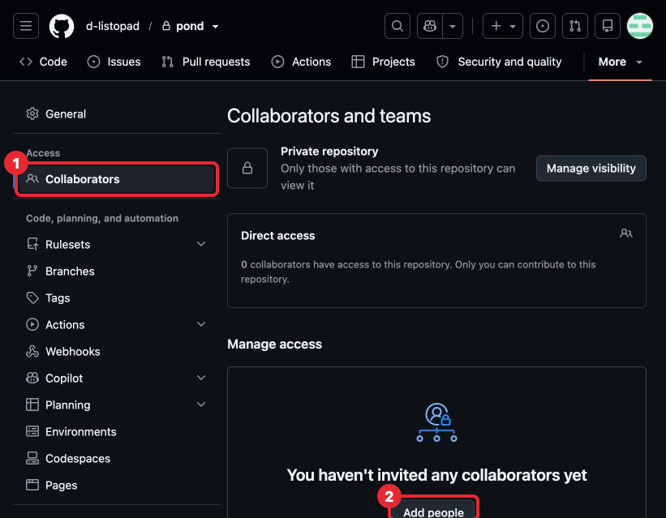
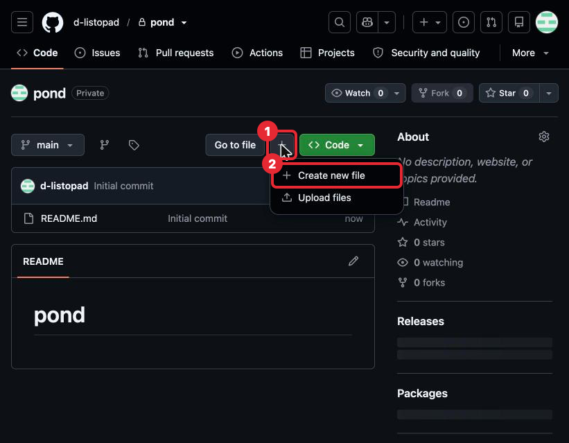
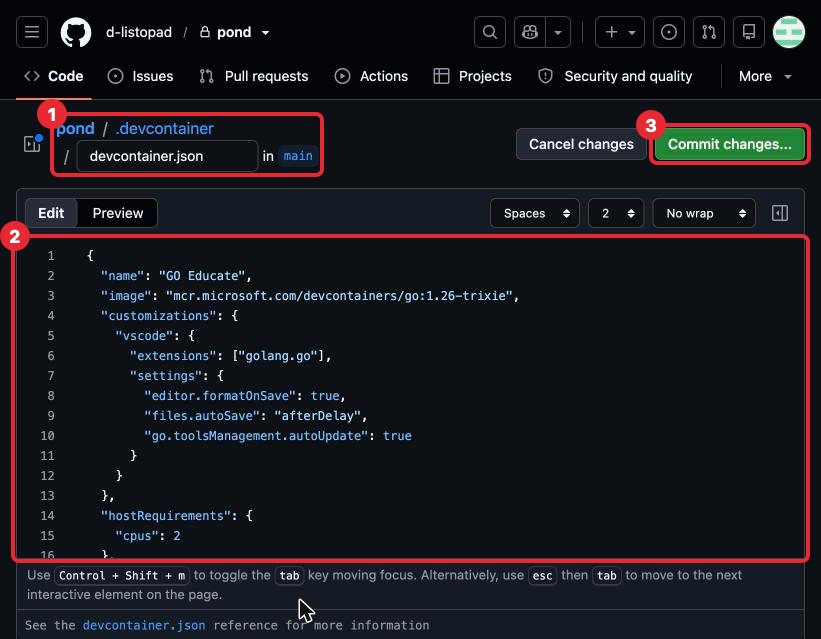
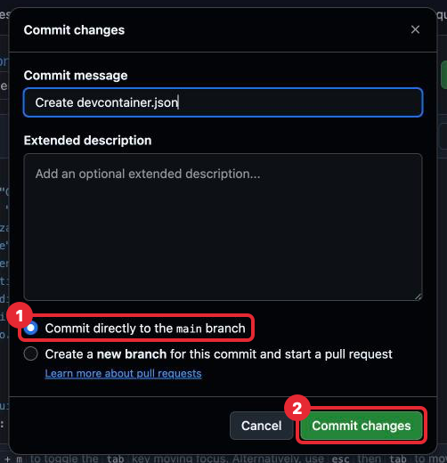
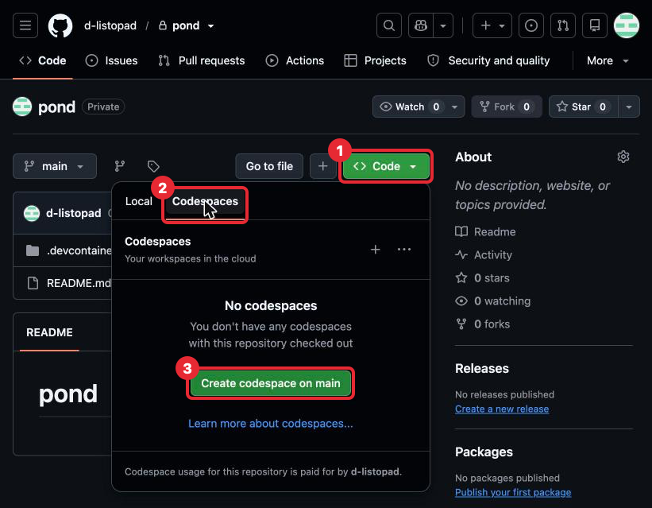
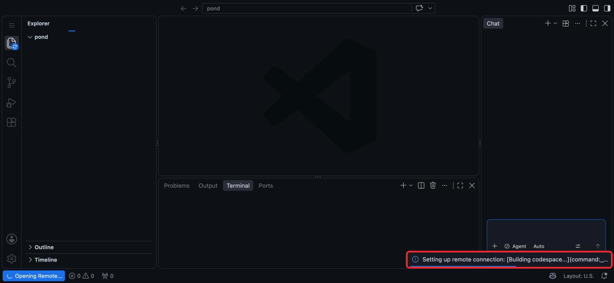
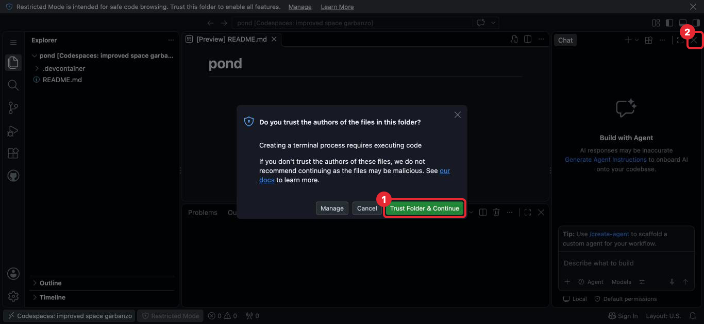

# Шаг 0. Настройка среды

На iPad нельзя установить Go напрямую: iPadOS не позволяет запускать программы,
которые превращают код в работающую программу. Поэтому мы будем писать код в **GitHub
Codespaces** — это настоящий Linux-компьютер в облаке с редактором VS Code, который
открывается прямо в Safari. Для учёбы он бесплатен: 60 часов в месяц.

Весь курс ты будешь делать одну программу — «Пруд». Она живёт в твоём собственном
репозитории `pond`, а этот репозиторий, GO-Educate, — учебник: уроки и тексты задач
читаются прямо на github.com. Codespace создаётся для `pond`.

Раз ты читаешь этот текст, аккаунт GitHub у тебя уже есть. Остаётся создать репозиторий,
описать в нём среду и создать Codespace — это 20–30 минут. Шаг заканчивается тем,
что Codespace открылся. Что в нём где и как с ним работать — следующий шаг.

Скриншоты сделаны в тёмной теме GitHub и на компьютере. У тебя цвета и расположение
кнопок могут немного отличаться: ищи кнопку по названию, оно выделено **жирным**.
Красной рамкой на скриншоте отмечено, куда нажимать, номера — в каком порядке.

---

## Что понадобится

- iPad с клавиатурой. Трекпад или мышь очень желательны.
- Safari (другие браузеры тоже подойдут, но инструкция написана под Safari).

---

## 1. Свой репозиторий `pond`

1. Открой [github.com/new](https://github.com/new).
2. В поле **Repository name** набери `pond`. Под полем появится зелёное
   «pond is available» — имя свободно.
3. В **Choose visibility** выбери **Private**: репозиторий видишь только ты и те,
   кого ты пригласишь.
4. Включи переключатель **Add README** (положение **On**): Codespace нельзя создать
   для совсем пустого репозитория. Текст README ты перепишешь в задаче шага 2.
5. Нажми **Create repository** внизу страницы.

*1 — имя `pond`, 2 — Private, 3 — Add README включён, 4 — кнопка Create repository.*

Откроется страница твоего репозитория: имя `pond` с меткой Private и один файл
`README.md`.

---

## 2. Преподаватель — в collaborators

Collaborator — человек, которому ты дала доступ к своему репозиторию. Преподавателю
он нужен, чтобы читать твой код и оставлять замечания.

1. На странице `pond` открой **Settings**. Если вкладки не видно в строке вкладок,
   она спрятана в меню **More** справа.
2. Слева выбери **Collaborators**.
3. Нажми **Add people**, набери логин `d-listopad` и подтверди приглашение.

*1 — меню More, 2 — Settings.*

*1 — раздел Collaborators в меню слева, 2 — кнопка Add people.*

---

## 3. Описание среды

Codespace собирается по файлу `.devcontainer/devcontainer.json`: в нём сказано,
какую версию Go поставить и какие расширения редактора включить. Образец лежит
в GO-Educate, его нужно скопировать в `pond`.

1. На странице `pond` нажми **+** рядом с **Go to file** (на широком экране кнопка
   называется **Add file**) и выбери **Create new file**.

   

   *1 — кнопка +, 2 — Create new file.*

2. В поле имени набери `.devcontainer/devcontainer.json`. После косой черты GitHub
   сам превратит `.devcontainer` в папку, и в поле останется `devcontainer.json`.
3. Вставь содержимое файла
   [`.devcontainer/devcontainer.json`](../../.devcontainer/devcontainer.json)
   из GO-Educate: открой его, нажми **Copy raw file** (иконка с двумя листами) и вставь
   в большое поле редактора.
4. Справа может открыться панель **Marketplace** и закрыть часть редактора. Её можно
   закрыть кнопкой справа в строке **Edit / Preview** или не обращать на неё внимания.

   

   *1 — путь и имя файла, 2 — вставленное содержимое, 3 — кнопка Commit changes...*

5. Нажми **Commit changes...**. В открывшемся окне оставь выбранным
   **Commit directly to the main branch** и нажми **Commit changes**.

   

   *1 — Commit directly to the main branch, 2 — кнопка Commit changes.*

Что такое commit, разберём в шаге 2. Сейчас достаточно знать, что так файл сохраняется
в репозиторий.

---

## 4. Создание Codespace

1. На странице репозитория `pond` нажми зелёную кнопку **<> Code**.
2. Перейди на вкладку **Codespaces**.
3. Нажми **Create codespace on main**.

*1 — кнопка Code, 2 — вкладка Codespaces, 3 — Create codespace on main.*

4. Подожди. В первый раз сборка занимает 2–4 минуты: GitHub скачивает образ с Go
   и ставит расширения. Окно редактора уже видно, но работать в нём пока нельзя:
   справа внизу висит уведомление **Setting up remote connection: Building codespace...**,
   слева внизу — **Opening Remote...**. Это нормально, дождись, пока они исчезнут.

   

   *Уведомление о сборке. Пока оно висит, ничего не нажимай.*

5. Появится окно **Do you trust the authors of the files in this folder?** — «доверяешь
   ли ты авторам файлов в этой папке». Это твой репозиторий, нажми
   **Trust Folder & Continue**. Без этого терминал не запустится.
6. Справа может быть открыта панель **Chat**. В курсе она не нужна: закрой её крестиком
   в правом верхнем углу панели.

*1 — Trust Folder & Continue, 2 — крестик, который закрывает панель Chat.*

Codespace готов. Что в этом окне где — в шаге 1.

> Если iPad в портретной ориентации, поверни его горизонтально: часть элементов GitHub
> прячется на узком экране.

---

## 5. Настройка Safari на iPad

**Полный экран.** Разверни Safari на весь экран и работай в горизонтальной ориентации.

**Отдельное окно без вкладок.** Когда Codespace открыт, нажми кнопку **Поделиться →
На экран «Домой»**. Codespace появится как отдельное приложение: без адресной строки
и вкладок Safari, а сочетания клавиш не будут перехватываться браузером.

**Раскладка.** Код пишется в английской раскладке. Переключение — клавиша с глобусом
или Ctrl + Пробел, в зависимости от клавиатуры.

---

## 6. Лимиты Codespaces

| Ресурс | Лимит |
|---|---|
| Время работы | 60 часов в месяц на 2-ядерной машине |
| Хранилище | 15 ГБ |
| Хранение остановленного Codespace | 30 дней без активности, потом удаление |

Часы списываются с **твоего** аккаунта. Посмотреть остаток:
**Settings → Billing and plans → Plans and usage → Codespaces**.

**Чтобы часы не утекали:**

- Не создавай несколько Codespace для одного репозитория. Нужен ровно один, и потом
  ты всегда открываешь его, а не создаёшь новый.
- Уменьши время до автоостановки: **Settings → Codespaces → Default idle timeout**,
  например 15 минут.
- Закончила заниматься — останови Codespace. Как — в шаге 1.

Codespace — временная машина: если не заходить в него 30 дней, GitHub удалит его вместе
со всеми файлами, которые не были отправлены в репозиторий. Как сохранять работу
в репозиторий, курс покажет в шаге 2.

---

## Что настроено и что меняется

После этого шага часть проекта настроена раз и навсегда, а часть будет меняться
в каждой задаче. Таблица дополняется по ходу курса.

| Что | С какого шага | Трогать? |
|---|---|---|
| `.devcontainer/devcontainer.json` | 0 | Нет. Если среда сломалась — Rebuild Container (шаг 1), а не правка файла |
| Codespace | 0 | Один на весь курс. Открывать существующий, не создавать новый |
| Collaborators в Settings | 0 | Нет |
| `README.md` | 2 | Да, когда программа научилась новому |
| `go.mod` | 2 | Руками нет. Его меняют только команды `go` |
| `main.go` | 2 | Да, здесь пишется программа |
| `~/try` | 1 | Да, папка для примеров из уроков, вне `pond` |

---

## Как проходить урок

Каждый следующий шаг курса проходится в одном и том же порядке. Шаг — это 10–20 минут
чтения и 1–2 часа практики, его не нужно делать за один раз.

1. **Прочитать урок** в GO-Educate: `Lessons/NN-tema/lesson.md`. Незнакомое слово —
   в [словаре терминов](../glossary.md).
2. **Набрать примеры руками** в Codespace и запустить их. Не копировать: когда код
   набираешь сама, синтаксис запоминается, а опечатки сразу показывают, как выглядят
   ошибки. Для примеров есть отдельная папка `~/try` вне проекта, её ты заведёшь
   в задаче шага 1.
3. **Ответить на «Проверь себя»** в конце урока. Сначала ответ своими словами, потом
   раскрыть правильный. Если ответ не совпал — перечитать нужный раздел, прежде чем
   идти дальше.
4. **Сделать задачи** из папки `tasks/` рядом с уроком — в своём репозитории `pond`,
   по порядку номеров. В каждой задаче раздел «Где менять» говорит, какие файлы
   она меняет, а какие трогать не нужно.
5. **Проверить себя по критериям приёмки.** Каждый пункт с флажком должен выполняться.
   Если под пунктом написано «Как проверить» — сделать именно эту проверку.
6. **Сохранить работу и отправить в GitHub.** Как это делается, покажет задача шага 2,
   а подробно — раздел [Git](../../Git/README.md).
7. **Пройти разбор**: ответить на замечания и исправить код.

**Если застряла:**

- Прочитать сообщение об ошибке целиком: в нём файл, строка и что не так.
- Найти сообщение в таблице «Типичные ошибки» урока.
- Вернуться к разделу урока, на который ссылается подсказка в задаче.
- Не получилось за 20–30 минут — записать, что пробовала, и спросить преподавателя.
  Это нормальная часть работы, а не провал.

---

## Если что-то пошло не так

| Проблема | Что делать |
|---|---|
| Нет вкладки Codespaces в меню Code | Проверь, что ты вошла в свой аккаунт GitHub |
| Нет вкладки Settings | Она в меню **More** в строке вкладок репозитория |
| Нет кнопки Add file | На узком экране вместо неё кнопка **+** рядом с Go to file |
| Сборка висит больше 5 минут | Обнови страницу |
| Нажала Cancel в окне доверия | Внизу окна будет надпись **Restricted Mode**. Нажми на неё и выбери **Trust** |
| Экран выглядит не так, как описано здесь | GitHub иногда меняет интерфейс. Напиши преподавателю, что видишь, — урок поправим |
| Закончились 60 часов | Ждать начала следующего месяца или спросить у преподавателя про запасной вариант |

---

## Что дальше

Сделай задачу [Среда готова](tasks/01-environment.md), затем переходи к шагу 1
[Редактор VS Code](../01-vscode/lesson.md).
