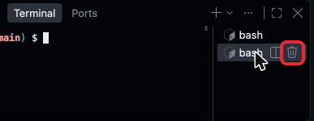
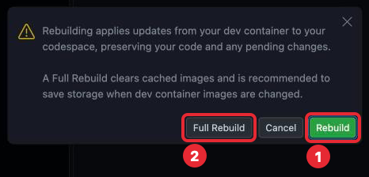
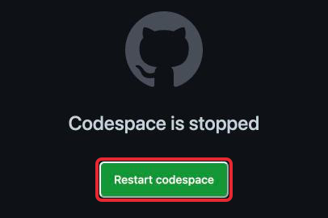
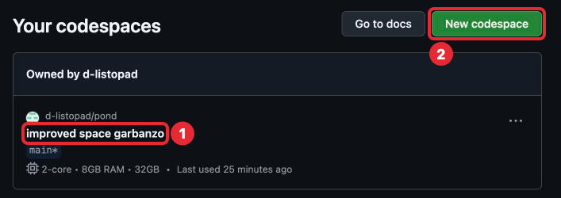

# Шаг 1. Редактор VS Code

## В прошлом уроке

В прошлом уроке ты создала свой репозиторий `pond`, добавила в него описание среды
`.devcontainer` и открыла Codespace. Среда настроена: `.devcontainer` и настройки
репозитория больше не меняются, а Codespace на весь курс один — его ты будешь
открывать, а не создавать заново. Но в окне Codespace много панелей и кнопок,
и пока непонятно, где что. Этот шаг — экскурсия по окну.

## Что такое редактор кода

Программа на Go — это обычный текст в файлах. Писать его удобнее в программе,
которая подсвечивает слова, показывает ошибки и сама расставляет отступы, — это
**редактор кода** (code editor), у нас **VS Code**. В Codespace VS Code — окно
облачного компьютера: через него ты видишь его файлы, правишь их и даёшь ему команды.

Скриншоты в этом уроке сделаны на компьютере, у тебя окно может быть чуть другой
высоты. Красная рамка — куда смотреть или нажимать, номера расшифрованы под картинкой.

## Окно целиком


*Окно Codespace, пять частей.*

1. **Activity Bar** — узкая полоска иконок слева. Переключает, что показано в панели
   справа от неё: обычно там Explorer (2), а после нажатия другой иконки — другая
   панель.
2. **Explorer** — панель файлов. Здесь видны все файлы и папки проекта: сейчас это
   папка `.devcontainer` и файл `README.md` (ⓘ рядом — просто иконка этого файла).
   Сверху — имя проекта `pond`, а после него в квадратных скобках, за словом
   `Codespaces:`, — имя твоего Codespace. Его придумал GitHub, у тебя будут другие
   слова. В заголовке оно обрезано, целиком его видно в Status Bar (5).
3. **Редактор** (editor) — большая область в центре. Здесь открываются файлы,
   здесь ты пишешь код. Каждый открытый файл — отдельная вкладка сверху. Сейчас
   открыт `README.md` в режиме просмотра, **[Preview]**: так его увидят на GitHub.
   Так его открыл сам Codespace при первом запуске; если нажать на `README.md`
   в Explorer, он откроется как обычный текст. В этом шаге README не правим,
   его ты перепишешь в шаге 2.
4. **Panel** — нижняя панель. В ней несколько вкладок, тебе нужна одна —
   **Terminal**, о нём ниже. При первом открытии в терминале напечатано приветствие
   Codespaces, делать по нему ничего не нужно.
5. **Status Bar** — строка состояния внизу. Слева — имя Codespace. Нажимать здесь
   ничего не нужно.

Поле поиска сверху по центру, иконки справа вверху (показывают и прячут панели)
и разделы Outline и Timeline внизу Explorer не нужны.

**Откуда здесь файлы.** Когда создавался Codespace, GitHub скопировал в него файлы
из репозитория `pond`. Всё, что ты меняешь в этом окне, меняется только в Codespace.
На GitHub изменения попадут, только когда ты их туда отправишь, — этому научимся
в шаге 2.

## Activity Bar: какие иконки нужны


1. **☰** — главное меню, как меню «Файл, Правка…» в обычных программах.
2. **Explorer** — панель файлов. Если панель файлов пропала, нажми сюда.
3. **Source Control** — работа с git через кнопки. **Git** — программа, которая
   хранит историю версий файлов проекта; благодаря ей репозиторий помнит прошлые
   версии (шаг 0). Эту панель не используем: в курсе git — командами в терминале,
   так видно, что именно происходит. Синяя цифра на иконке — сколько файлов
   изменено, она действий не требует.
4. **Extensions** — дополнения редактора из шага 0, например поддержка Go. Они
   поставились сами при сборке Codespace по списку в `devcontainer.json`, здесь ничего
   не меняй.

Остальные иконки, включая колбу Testing, которая появится позже, не понадобятся.

## Файлы и папки

### Создать файл

**Куда попадёт новый файл.** В папку, которая выделена в Explorer: выделенная строка
подсвечена фоном. Если выделен файл — в ту папку, где он лежит. Самая верхняя папка
проекта, в которой лежит всё остальное, называется **корнем проекта** (project root);
у тебя это `pond`. Чтобы файл оказался в корне, сначала нажми на пустое место
в Explorer под списком файлов: выделение снимется. Если при нажатии на заголовок
`pond` дерево файлов свернулось — нажми на заголовок ещё раз, оно развернётся.

Наведи курсор на заголовок `pond` в Explorer (без трекпада — нажми на него пальцем) —
справа от него появятся четыре кнопки.


1. **New File...** — создать файл.
2. **New Folder...** — создать папку.

Две остальные не нужны.

Нажми **New File...**: в дереве появится пустое поле. Набери `hello.go` и нажми Enter
(Escape отменяет создание). `.go` — расширение файлов с кодом на Go (что такое
расширение, сказано в шаге 0). Это пробный файл, в задаче шага ты его переименуешь
и удалишь.


*Поле, в котором набирается имя нового файла.*

Файл появится в дереве (1) и сразу откроется во вкладке редактора (2).


*1 — новый файл в Explorer, 2 — его вкладка в редакторе.*

Остальное на картинке действий не требует. Буква **U** (untracked): git ещё
не записал файл в историю версий, сам файл при этом сохранён. Красное имя и цифра
рядом — замечание редактора: пустой файл пока не похож на программу. Серая надпись
Generate code — подсказка, она исчезнет, как только начнёшь печатать.

### Создать папку

Так же, кнопкой **New Folder...**: в дереве появится поле, набери `demo` и нажми Enter.
Это пробная папка, в задаче её нужно удалить.


*Поле имени новой папки.*

### Переименовать и удалить

Правый клик по файлу или папке в Explorer открывает меню. На iPad правый клик —
нажатие двумя пальцами на трекпаде, без трекпада — нажми на файл и подержи палец.
В меню:

- **Rename...** — имя файла превращается в поле: исправь его и нажми Enter.
- **Delete** — откроется окно с вопросом, нажми в нём **Delete**. Удалённый файл
  не вернуть.

Если меню не открывается, то же можно сделать командами в терминале: они есть
в задаче шага.

## Редактор и вкладки

Файл открывается нажатием на него в Explorer. Каждый открытый файл — вкладка сверху
редактора, между вкладками можно переключаться.

**Сохранение.** Автосохранение включено в `.devcontainer`: файл сохраняется сам через
секунду после правки, поэтому ничего не потеряется. Но когда пишешь код, нажимай
**Cmd + S**: так файл не только сохранится, но и выровняется — редактор расставит
отступы. Автосохранение этого не делает.

**Закрыть файл** — крестик на его вкладке. Файл при этом не удаляется, он только
пропадает из редактора.


> **Закрывай файл только крестиком, Cmd + W не нажимай.** В Safari это сочетание
> закрывает вкладку браузера целиком, а не файл. Если окно с Codespace всё же
> закрылось — открой его снова (раздел «Как закончить занятие»), файлы на месте.

## Терминал

### Что это

Кроме кнопок, компьютеру можно давать команды текстом: набираешь строку, нажимаешь
Enter, компьютер выполняет и печатает ответ. Как переписка в чате, только собеседник —
компьютер. Окно, где идёт такая переписка, называется **терминал** (terminal),
а строка, которую ты набираешь, — **команда** (command).

Почему это нужно: в курсе программу запускают, проверяют и записывают в git
командами в терминале — так видно, что происходит. Кнопки для части этого в VS Code
есть, но мы ими не пользуемся.

### Как открыть

Терминал живёт в нижней панели, на вкладке **Terminal**. Обычно он открыт сразу.
Если нижней панели нет: главное меню **☰ → Terminal → New Terminal**.


*1 — главное меню ☰, 2 — пункт Terminal, 3 — New Terminal. Остальные пункты меню
не нужны.*

### Куда набирать


1. Вкладка **Terminal** в нижней панели.
2. Строка приглашения (prompt). Она говорит, кто ты и где ты:
   `@логин → /workspaces/pond (main) $`.
   - `@логин` — твой логин GitHub, стрелка — просто разделитель.
   - `/workspaces/pond` — папка, в которой выполнится команда. Это **путь** (path):
     имена папок через косую черту, от самой верхней к нужной; косая черта в самом
     начале означает самую верхнюю папку компьютера. На облачном компьютере `pond`
     лежит в папке `workspaces`; Explorer показывает только `pond`, поэтому
     `workspaces` ты в нём не видишь. Сейчас терминал в корне твоего проекта.
   - `main` — имя основной ветки (branch), то есть основной линии истории версий
     в git. Пока она у тебя одна, подробно — в шаге 3.
   - Знак `$` значит «жду команду».

   Кружок слева от строки и надпись `bash` справа вверху — пометки терминала,
   на них не обращай внимания.

Нажми на терминал, чтобы курсор встал после `$`, набери команду и нажми Enter.
Приглашение набирать не нужно: в уроках команды пишутся без него. Скопированную
команду вставляют, как обычно, Cmd + V; если Safari спросит разрешение на доступ
к буферу обмена — разреши.

### Первая команда

Набери и нажми Enter:

```sh
go version
```

Ответ — версия Go, вида `go version go1.26.x linux/amd64`, где вместо `x` стоит цифра,
например `go1.26.9`. `linux/amd64` — система и тип процессора облачного компьютера,
запоминать не нужно.


*Команда и ответ на неё. Справа на картинке список из двух терминалов: так бывает,
если открыть New Terminal, когда терминал уже есть.*

Лишний терминал можно закрыть: наведи на его строку в списке (без трекпада — нажми
на неё) — справа появится корзина, нажми её.



*Корзина появляется у строки, на которую наведён курсор.*

Это и есть проверка, что Go на облачном компьютере установлен и работает.

### Если команда не заканчивается

Пока команда выполняется, приглашение `$` не появляется. Чтобы остановить её,
нажми **Ctrl + C** — не Cmd: Cmd + C копирует текст и команду не остановит.

## Палитра команд

Всё, что умеет VS Code, можно найти по названию. Нажми **Cmd + Shift + P**: сверху
откроется поле, начинающееся с `>`. Знак `>` не стирай: с ним поле ищет команды,
без него — файлы. Здесь «команда» — действие самого VS Code, а не строка для
терминала: в палитре её только выбирают. Набери после `>` часть названия — ниже
появится список, выбери нужное и нажми Enter.


*1 — поле палитры с набранным `Close Editor`, 2 — найденная команда. Справа от неё
показано сочетание ⌘W, но его не нажимай (см. «Редактор и вкладки»): выбирай команду
в списке.*

В курсе через палитру понадобятся:

| Команда | Что делает |
|---|---|
| **View: Close Editor** | Закрыть открытый файл, если крестик не виден |
| **Codespaces: Stop Current Codespace** | Остановить Codespace |
| **Codespaces: Rebuild Container** | Собрать облачный компьютер заново по `devcontainer.json`, как в шаге 0, если среда сломалась. Окно перезагрузится и несколько минут будет собираться, файлы в `pond` остаются |

После **Rebuild Container** откроется окно с выбором: нажми зелёную **Rebuild**.
**Full Rebuild** не нужен.



*1 — Rebuild, её нажимать; 2 — Full Rebuild, не нужен.*

## Что здесь трогать не нужно


*1 — Source Control (см. «Activity Bar»), 2 — кнопка Commit, её не нажимай.
Внизу, в Graph, — история: Initial commit GitHub сделал при создании репозитория,
Create devcontainer.json — твой коммит из шага 0. Серым закрыто имя владельца
скриншота.*

- **Chat** и подсказки вроде «Generate code»: курс учит писать код самой.
- Всплывающие уведомления справа внизу можно закрывать крестиком. Исключение:
  уведомление от Go с предложением установить инструменты и кнопкой **Install**
  или **Install All** — нажми её: дополнение Go докачивает свои вспомогательные
  программы для подсказок в коде.

## Сочетания клавиш

| Сочетание | Действие |
|---|---|
| Cmd + Shift + P | Палитра команд — через неё доступно всё |
| Cmd + S | Сохранить файл и выровнять код |
| Ctrl + ` | Показать / скрыть терминал (клавиша слева от «1») |
| Cmd + B | Показать / скрыть Explorer |
| Ctrl + C в терминале | Остановить выполняющуюся команду |

## Как закончить занятие

Codespace сам останавливается через время, которое ты задала в шаге 0
(Default idle timeout), но лучше остановить его сразу, чтобы не тратить часы.
**Cmd + Shift + P**, набери `Stop Current Codespace` и выбери
**Codespaces: Stop Current Codespace**.


*Команда остановки в палитре: достаточно набрать часть названия.*

После неё на несколько секунд внизу появится уведомление об остановке, затем
останется экран с надписью **Codespace is stopped** и кнопкой **Restart codespace**.
Окно можно закрыть или оставить. Если нажать Restart codespace, он запустится снова.



*Так выглядит остановленный Codespace.*

**Как открыть снова.** [github.com/codespaces](https://github.com/codespaces) — найди
свой Codespace в списке: его имя — те же слова, что в Status Bar слева внизу.
Нажми на имя. Кнопку **New codespace** на этой странице не нажимай.



*1 — имя твоего Codespace, на него нажимать; над ним `твой-логин/pond`, под ним —
ветка и размер машины, они не нужны. 2 — кнопка New codespace, её не нажимай.*

Другой путь — через репозиторий `pond`: **<> Code → Codespaces**. Там уже есть твой
Codespace: нажми на его имя, а не на **Create codespace on main**. Файлы, которые
ты создала, остаются на месте, пока Codespace не удалён: через 30 дней без входа
(шаг 0).

## Если что-то пошло не так

| Проблема | Что делать |
|---|---|
| Пропала панель файлов | Нажми иконку Explorer в Activity Bar или Cmd + B |
| Дерево файлов свернулось | Нажми на заголовок `pond` ещё раз |
| Пропал терминал | **☰ → Terminal → New Terminal** или Ctrl + ` |
| Файл создался не в той папке | Удали его (правый клик или долгое нажатие → **Delete**), выдели нужную папку и создай файл заново |
| Нажала Cmd + W, и всё закрылось | Открой Codespace снова: «Как закончить занятие» → «Как открыть снова». Файлы на месте |
| В терминале нет `$`, команда не отвечает | Ctrl + C |
| `go: command not found` | Cmd + Shift + P → **Codespaces: Rebuild Container** |
| Внизу надпись **Restricted Mode** | Нажми на неё и выбери **Trust** |
| Экран выглядит не так, как здесь | Напиши преподавателю, что видишь, — урок поправим |

## Что дальше

Сделай задачу [Рабочее место готово](tasks/01-workplace.md), затем переходи к шагу 2
[Первая программа](../02-intro/lesson.md).
