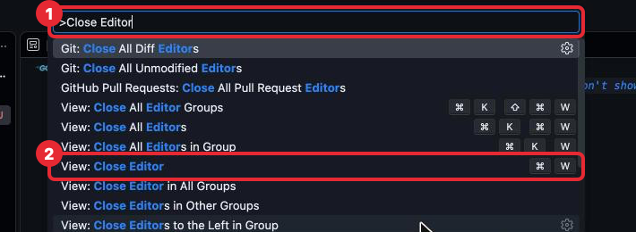
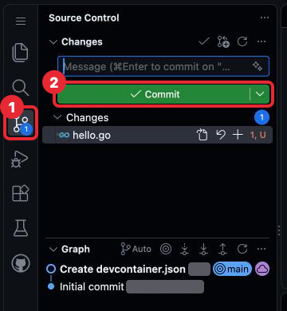
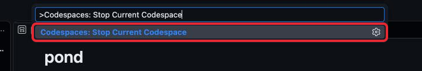

# Шаг 1. Редактор VS Code

## В прошлом уроке

В прошлом уроке ты создала свой репозиторий `pond`, добавила в него описание среды
`.devcontainer` и открыла Codespace. Среда настроена: `.devcontainer` и настройки
репозитория больше не меняются, а Codespace на весь курс один — его ты будешь
открывать, а не создавать заново. Но в окне Codespace много панелей и кнопок,
и пока непонятно, где что. Этот шаг — экскурсия по окну.

## Что такое редактор кода

Программа на Go — это обычный текст в файлах. Писать его можно где угодно, хоть
в «Заметках», но удобнее в программе, которая подсвечивает слова разным цветом,
показывает ошибки и сама расставляет отступы. Такая программа называется
**редактор кода** (code editor). Самый распространённый из них — **VS Code**
(Visual Studio Code).

Codespace из шага 0 — это компьютер в облаке. VS Code — его окно: через него ты
видишь файлы на этом компьютере, правишь их и даёшь компьютеру команды. Всё, что
ты делаешь в этом окне, происходит на облачном компьютере, а не на iPad.

Скриншоты в этом уроке сделаны на компьютере, у тебя окно может быть чуть другой
высоты. Красная рамка — куда смотреть или нажимать, номера расшифрованы под картинкой.

## Окно целиком


*Окно Codespace, пять частей.*

1. **Activity Bar** — узкая полоска иконок слева. Переключает, что показано в боковой
   панели рядом с ней.
2. **Explorer** — панель файлов. Здесь видны все файлы и папки проекта: сейчас это
   папка `.devcontainer` и файл `README.md`. Сверху — имя проекта, `pond`.
3. **Редактор** (editor) — большая область в центре. Здесь открываются файлы,
   здесь ты пишешь код. Каждый открытый файл — отдельная вкладка сверху.
4. **Panel** — нижняя панель. В ней несколько вкладок, тебе нужна одна —
   **Terminal**, о нём ниже.
5. **Status Bar** — строка состояния внизу. Слева — имя Codespace, справа после
   открытия файла `.go` появится версия Go. Нажимать здесь ничего не нужно.

Дальше в уроке части окна называются этими именами.

## Activity Bar: какие иконки нужны


1. **☰** — главное меню, как меню «Файл, Правка…» в обычных программах.
2. **Explorer** — панель файлов. Если панель файлов пропала, нажми сюда.
3. **Source Control** — работа с git через кнопки. В курсе git делается командами
   в терминале, эту панель не используем.
4. **Extensions** — расширения редактора. Всё нужное уже установлено в шаге 0,
   здесь ничего не меняй.

Остальные иконки (поиск, запуск и отладка, GitHub, аккаунт, настройки) в курсе
не понадобятся.

## Файлы и папки

### Создать файл

Наведи курсор на заголовок `pond` в Explorer — справа от него появятся четыре кнопки.


1. **New File...** — создать файл.
2. **New Folder...** — создать папку.

Две остальные, **Refresh** и **Collapse**, обновляют и сворачивают дерево файлов,
они не нужны.

Нажми **New File...**: в дереве появится пустое поле. Набери имя файла вместе
с расширением, например `hello.go`, и нажми Enter.


*Поле, в котором набирается имя нового файла.*

Файл появится в дереве (1) и сразу откроется во вкладке редактора (2).


Новый файл подсвечен в дереве цветом, рядом буква **U** (untracked — git этот файл
ещё не сохранял). Цифра рядом — количество замечаний редактора, у пустого файла `.go`
оно одно: файл пока не похож на программу. Пока ты учишься, на это можно не обращать
внимания.

**Куда попадёт новый файл.** В папку, которая выделена в Explorer. Если выделен файл —
в ту папку, где он лежит. Самая верхняя папка проекта, в которой лежит всё остальное,
называется **корнем проекта** (project root); у тебя это `pond`. Чтобы файл оказался
в корне проекта, перед нажатием **New File...** нажми на заголовок `pond`.

### Создать папку

Так же, кнопкой **New Folder...**: в дереве появится поле, набери имя папки и нажми Enter.
Нажатие Escape отменяет создание.


### Переименовать и удалить

Правый клик по файлу или папке в Explorer открывает меню. На iPad правый клик —
нажатие двумя пальцами на трекпаде. В меню:

- **Rename...** — переименовать.
- **Delete** — удалить. Редактор спросит подтверждение.

Если меню не открывается, то же можно сделать командой в терминале — это покажет
задача шага.

## Редактор и вкладки

Файл открывается нажатием на него в Explorer. Каждый открытый файл — вкладка сверху
редактора, между вкладками можно переключаться.

**Сохранять руками не нужно.** Автосохранение включено в `.devcontainer`: файл
сохраняется сам через секунду после правки.

**Закрыть файл** — крестик на его вкладке. Файл при этом не удаляется, он только
пропадает из редактора.


> **Осторожно с Cmd + W.** В Safari это сочетание закрывает вкладку браузера
> целиком, а не файл в редакторе. Закрывай файл крестиком.

`README.md` при первом открытии показан как **[Preview] README.md** — так, как его
увидят на GitHub. Чтобы править его как текст, открой его из Explorer ещё раз.

## Терминал

### Что это

Кроме кнопок, компьютеру можно давать команды текстом: набираешь строку, нажимаешь
Enter, компьютер выполняет и печатает ответ. Как переписка в чате, только собеседник —
компьютер. Окно, где идёт такая переписка, называется **терминал** (terminal),
а строка, которую ты набираешь, — **команда** (command).

Почему это нужно: запустить программу на Go, проверить её и сохранить в git можно
только командами. Кнопок для этого в курсе не будет.

### Как открыть

Терминал живёт в нижней панели, на вкладке **Terminal**. Обычно он открыт сразу.
Если нижней панели нет: главное меню **☰ → Terminal → New Terminal**.


*1 — главное меню ☰, 2 — пункт Terminal, 3 — New Terminal.*

### Куда набирать


1. Вкладка **Terminal** в нижней панели.
2. Строка приглашения (prompt). Она говорит, кто ты и где ты:
   `@логин → /workspaces/pond (main) $`. Здесь `/workspaces/pond` — папка, в которой
   выполнится команда, сейчас это корень твоего проекта; `main` — ветка git,
   о ветках — в шаге 3. Знак `$` значит «жду команду».

Нажми на терминал, чтобы курсор встал после `$`, набери команду и нажми Enter.
Приглашение набирать не нужно: в уроках команды пишутся без него.

### Первая команда

Набери и нажми Enter:

```sh
go version
```

Ответ — версия Go, вида `go version go1.26.x linux/amd64`.


*Команда и ответ на неё.*

Это и есть проверка, что Go на облачном компьютере установлен и работает.

### Если команда не заканчивается

Пока команда выполняется, новое приглашение `$` не появляется. Если команда
выполняется слишком долго или ты запустила не то — нажми **Ctrl + C**: команда
остановится, приглашение вернётся. Ctrl, а не Cmd.

**Вставить скопированную команду** — Cmd + V, как обычно. Если Safari спросит
разрешение на доступ к буферу обмена — разреши.

## Палитра команд

Всё, что умеет VS Code, можно найти по названию. Нажми **Cmd + Shift + P**: сверху
откроется поле, начинающееся с `>`. Набери часть названия — ниже появится список,
выбери нужное и нажми Enter.



*1 — поле палитры с набранным `Close Editor`, 2 — найденная команда.*

В курсе через палитру понадобятся:

| Команда | Что делает |
|---|---|
| **View: Close Editor** | Закрыть открытый файл |
| **Codespaces: Stop Current Codespace** | Остановить Codespace |
| **Codespaces: Rebuild Container** | Пересобрать среду, если она сломалась |

## Что здесь трогать не нужно



*1 — иконка Source Control, 2 — кнопка Commit. Этой панелью в курсе не пользуемся.*

- **Source Control** и кнопка **Commit** в ней. Git в курсе — командами в терминале,
  так видно, что именно происходит. Цифра на иконке — сколько файлов изменено, она
  не требует действий.
- **Extensions.** Всё нужное установлено.
- **Chat** и подсказки вроде «Generate code» в пустом файле. Курс учит писать код
  самой.
- Всплывающие уведомления справа внизу можно закрывать крестиком. Исключение: если
  расширение Go предлагает установить инструменты (**Install All**) — согласись.

## Сочетания клавиш

| Сочетание | Действие |
|---|---|
| Cmd + Shift + P | Палитра команд — через неё доступно всё |
| Cmd + P | Быстрый переход к файлу по имени |
| Ctrl + ` | Показать / скрыть терминал (клавиша слева от «1») |
| Cmd + B | Показать / скрыть Explorer |
| Ctrl + C в терминале | Остановить выполняющуюся команду |

## Как закончить занятие

Codespace сам останавливается через 30 минут бездействия, но лучше остановить его
сразу, чтобы не тратить часы. **Cmd + Shift + P**, набери `Stop Current Codespace`,
выбери **Codespaces: Stop Current Codespace**.



**Как открыть снова.** [github.com/codespaces](https://github.com/codespaces) — найди
свой Codespace в списке и нажми на его имя. Или через репозиторий `pond`:
**<> Code → Codespaces** — там уже есть твой Codespace, его нужно открыть, а не
создавать новый. Файлы, которые ты создала, остаются на месте.

## Если что-то пошло не так

| Проблема | Что делать |
|---|---|
| Пропала панель файлов | Нажми иконку Explorer в Activity Bar или Cmd + B |
| Пропал терминал | **☰ → Terminal → New Terminal** или Ctrl + ` |
| Файл создался не в той папке | Перетащи его мышью в нужную папку в Explorer |
| В терминале нет `$`, команда не отвечает | Ctrl + C |
| `go: command not found` | Cmd + Shift + P → **Codespaces: Rebuild Container** |
| Внизу надпись **Restricted Mode** | Нажми на неё и выбери **Trust** |
| Экран выглядит не так, как здесь | Напиши преподавателю, что видишь, — урок поправим |

## Что дальше

Сделай задачу [Рабочее место готово](tasks/01-workplace.md), затем переходи к шагу 2
[Первая программа](../02-intro/lesson.md).
