# Шаг 1. Редактор VS Code

## В прошлом уроке

Ты создала репозиторий *pond* с описанием среды *.devcontainer* и открыла Codespace.
Среда настроена и больше не меняется; Codespace на весь курс один — его открывают,
а не создают заново. Теперь разберёмся, что в этом окне где и как в нём работать.

## Что такое редактор кода

Программа на Go — текст в файлах. Пишут его в **редакторе кода** (code editor):
он подсвечивает слова, показывает ошибки и расставляет отступы. У нас это **VS Code** —
окно Codespace: через него ты правишь файлы облачного компьютера и даёшь ему команды.

## Окно целиком

У каждой части окна своё имя, дальше в уроке они называются так.

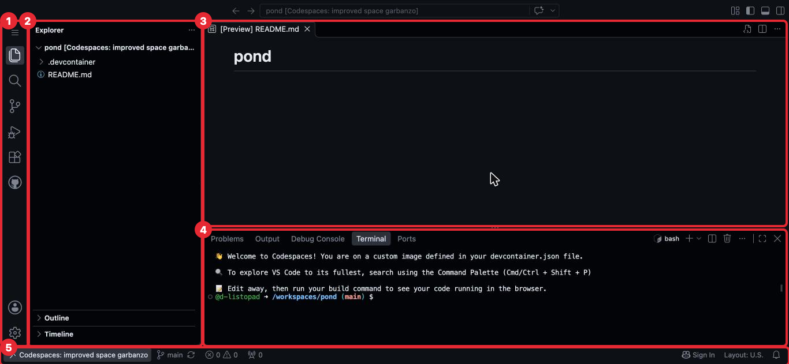

- **Activity Bar** (Панель действий) — полоска иконок слева. Переключает панель
  справа от неё.
- **Explorer** (Проводник) — файлы и папки проекта: сейчас *.devcontainer*
  и *README.md*. Сверху — *pond* и в квадратных скобках имя твоего Codespace
  (его придумал GitHub, у тебя другие слова).
- **Редактор** (editor) — открытые файлы, каждый во вкладке. При первом запуске
  Codespace сам открыл *README.md* как просмотр **[Preview]**. README пока не правим.
- **Panel** (Панель) — нижняя панель, из её вкладок нужна только **Terminal** (Терминал).
  Приветствие Codespaces в ней можно не читать.
- **Status Bar** (Строка состояния) — строка внизу, слева имя Codespace; остальное
  в ней пока не нужно.

Search (Поиск) сверху, иконки справа вверху, Outline (Структура) и Timeline (Временная
шкала) не нужны.

## Сочетания клавиш

Большинство действий ниже делается и мышью или пальцем, и клавишами. Сочетания,
которые понадобятся:

| Сочетание | Действие |
|---|---|
| Cmd + Shift + P | Command Palette (Палитра команд) |
| Cmd + S | Сохранить файл и выровнять код |
| Ctrl + \` | Показать / скрыть терминал (клавиша слева от «1») |
| Cmd + B | Показать / скрыть Explorer (Проводник), если он пропал |
| Ctrl + C в терминале | Остановить команду |
| Cmd + W | **Не нажимать** — закрывает вкладку Safari |

## Activity Bar (Панель действий): какие иконки нужны

Начнём с полоски слева: из её иконок нужны четыре.

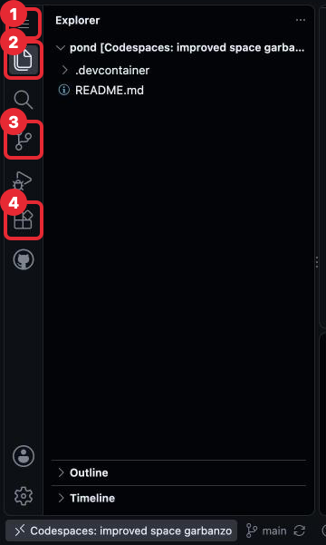

- **☰** — главное меню, как «Файл, Правка…» в обычных программах.
- **Explorer** (Проводник) — вернуть панель файлов.
- **Source Control** (Система управления версиями) — git кнопками. **Git** — программа,
  которая хранит историю версий файлов. Разберём позже, в разделе Git: каждую команду
  и рядом её кнопку здесь. Синяя цифра на иконке — число изменённых файлов.
- **Extensions** (Расширения) — дополнения редактора (поддержка Go), поставились сами,
  не меняй. Это не расширение имени файла.

Остальные иконки не нужны. Позже среди них появится колба **Testing** (Тестирование) —
её ставит дополнение Go, её тоже не трогай.

## Файлы и папки

Код курса лежит в файлах, поэтому первое, что нужно уметь в Explorer (Проводник), — создавать,
переименовывать и удалять файлы и папки. Попробуем на пробном файле и папке.

### Создать файл

Новый файл попадает в папку, выделенную в Explorer (Проводник) (строка с фоном), или в папку
выделенного файла. Верхняя папка проекта — **корень проекта** (project root), у тебя
*pond*. Чтобы создать файл в корне, сначала нажми на пустое место под списком файлов.

Нажми на заголовок *pond* (или наведи на него указатель трекпада или мыши) — справа появятся кнопки. Если список
файлов свернулся, нажми на заголовок ещё раз.

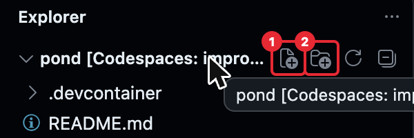

Нажми **New File...** (Создать файл), набери *hello.go* и нажми Enter (Escape — отмена).
*.go* — расширение файлов с кодом на Go.

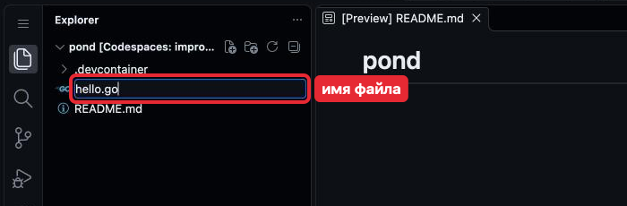

Файл появится в Explorer (Проводник) и откроется во вкладке редактора.

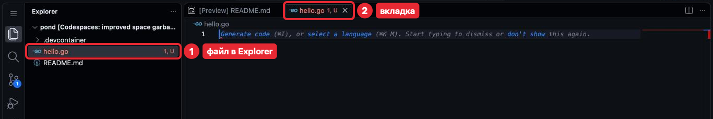

**U** — git ещё не записал файл в историю. Красное имя и **1** — одна ошибка: пустой
файл не программа. Generate code — подсказка, не обращай внимания.

### Создать папку

Папка создаётся так же, соседней кнопкой: **New Folder...** (Создать папку), имя *demo*,
Enter. Папка появится в Explorer (Проводник).

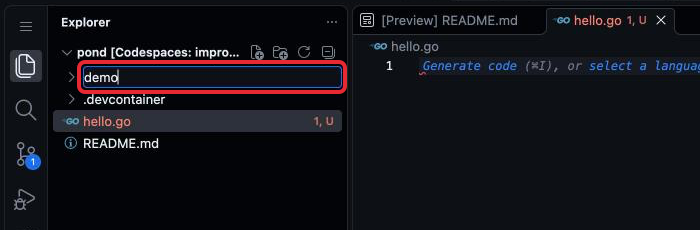

### Переименовать и удалить

Теперь переименуем и удалим пробные *hello.go* и *demo*. Правый клик по файлу или папке в Explorer (Проводник) (на iPad — двумя пальцами
по трекпаду или долгое нажатие пальцем) открывает меню:

- **Rename...** (Переименовать) — исправь имя и нажми Enter.
- **Delete** (Удалить) — подтверди **Delete** в окне. Удалённое не вернуть.

Переименуй *hello.go* в *hi.go*, затем удали *hi.go* и *demo*. Если меню
не открывается — набери в терминале (раздел «Терминал»):

```sh
mv hello.go hi.go
rm hi.go
rm -r demo
```

- *mv* — переименовывает;
- *rm* — удаляет файл;
- *rm -r* — удаляет папку.

При успехе терминал ничего не отвечает.

## Редактор и вкладки

Пробные файлы удалены, *README.md* остался. Нажми на него в Explorer (Проводник) — он откроется
во вкладке редактора как текст. Файл сохраняется сам; в коде всё равно
нажимай **Cmd + S**: только оно выравнивает отступы.

**Закрыть файл** — крестик на вкладке; файл не удаляется. Не Cmd + W: если окно
Codespace закрылось, открой его снова («Как закончить занятие»), файлы на месте.

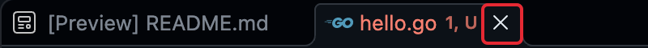

## Терминал

Кроме файлов, с облачным компьютером работают командами: так в курсе программу
запускают, проверяют и записывают в git.

Команду набирают текстом: набираешь строку, нажимаешь Enter, компьютер выполняет
и печатает ответ — как переписка в чате. Окно для этого — **терминал** (terminal),
набранная строка — **команда** (command).

Терминал — вкладка **Terminal** (Терминал) в Panel (Панель). Если Panel (Панель) не видно — Ctrl + \` или
**☰** → **Terminal** (Терминал) → **New Terminal** (Новый терминал).

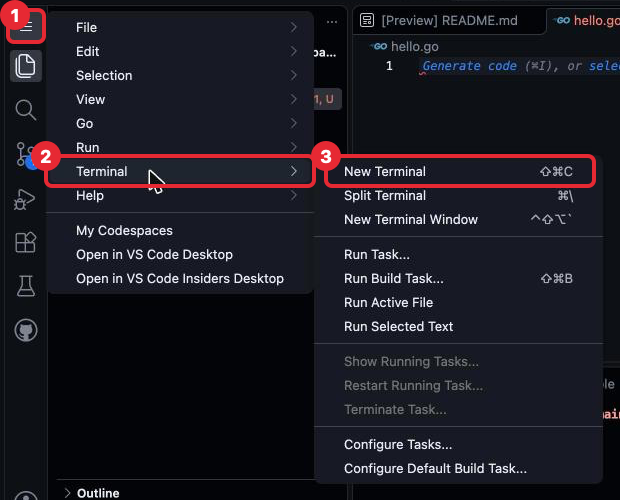

### Куда набирать

Перед тем как набрать первую команду, посмотри, что терминал показывает в своей строке.

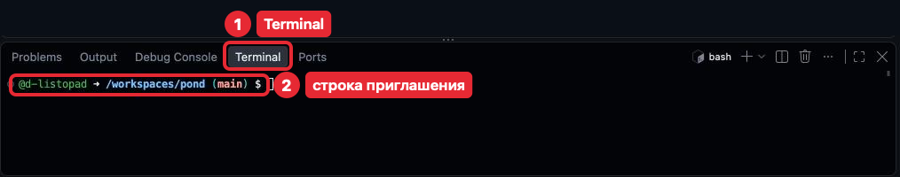

Строка приглашения (prompt) — «@логин → /workspaces/pond (main) $»:

- *@логин* — твой логин GitHub.
- */workspaces/pond* — **путь** (path) к папке, где выполнится команда: имена
  папок через */* от самой верхней. Explorer (Проводник) показывает только *pond*, папку
  *workspaces* над ней не видно.
- *main* — основная ветка.
- *$* — «жду команду».

Кружок слева и надпись *bash* справа не важны.

Нажми на терминал, набери команду после *$* и нажми Enter. Вставка — Cmd + V; если
Safari спросит доступ к буферу обмена — разреши.

### Первая команда

Проверим, что Go в Codespace работает. Набери:

```sh
go version
```

Терминал ответит (вместо *x* — цифра; *linux/amd64* — система облачного компьютера):

```
go version go1.26.x linux/amd64
```

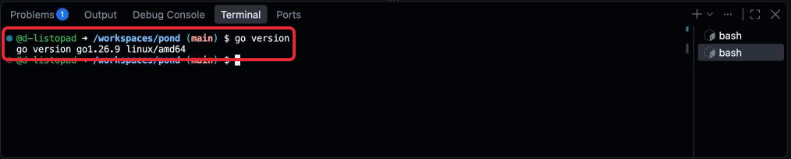

Если справа в Panel (Панель) видно два терминала — так бывает после лишнего New Terminal (Новый терминал).
Лишний закрывается корзиной у его строки (наведи или нажми на строку).

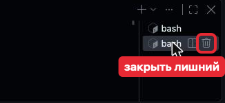

Пока команда выполняется, *$* нет; если она не заканчивается — Ctrl + C (не Cmd),
и *$* вернётся.

## Палитра команд

Не всё в VS Code есть на кнопках: остальное — в Command Palette (Палитра команд),
поиске по всем действиям редактора.

**Cmd + Shift + P** открывает сверху поле с *&gt;*. Набери после *&gt;* часть названия
действия, выбери его в списке, Enter. *&gt;* не стирай: без него поле ищет файлы.

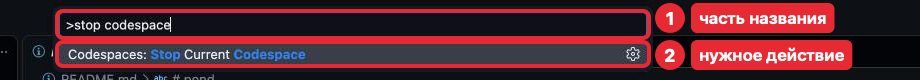

Действия палитры, которые понадобятся в курсе:

| Действие | Что делает |
|---|---|
| **View: Close Editor** | Закрыть файл, если крестик не виден |
| **Codespaces: Stop Current Codespace** | Остановить Codespace |
| **Codespaces: Rebuild Container** | Собрать сломанную среду заново; файлы остаются |

После Rebuild Container нажми зелёную **Rebuild**, не **Full Rebuild**: она собирает
среду с нуля, это дольше.

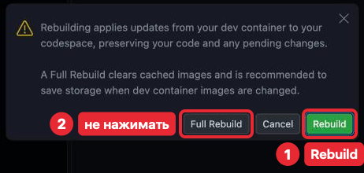

## Что здесь трогать не нужно

Панель Source Control (Система управления версиями) понадобится позже, вместе с git. Пока кнопку **Commit** в ней
не нажимай: что она делает, разберём в разделе Git.

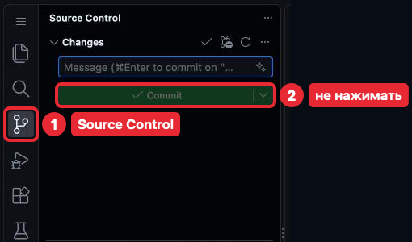

В окне есть и то, что курсу не нужно вовсе:

- **Chat** (Чат) и подсказки вроде Generate code: код пишешь сама.
- Уведомления справа внизу закрывай крестиком. Кроме уведомления Go с кнопкой
  **Install** или **Install All** — её нажми: она ставит инструменты Go.

## Как закончить занятие

Codespace расходует бесплатные часы, пока работает. Сам он остановится через
15 минут без действий, но в конце занятия останови его сразу:
**Cmd + Shift + P → Codespaces: Stop Current Codespace**.

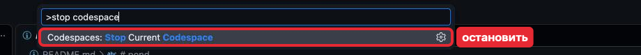

Появится экран **Codespace is stopped**, окно можно закрыть (**Restart codespace**
на нём запускает снова).

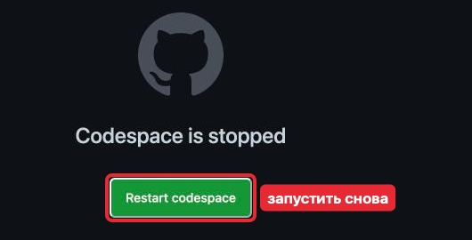

**Открыть снова:** [github.com/codespaces](https://github.com/codespaces) → нажми
на имя своего Codespace (те же слова, что в Status Bar (Строка состояния)). **New codespace**
и **Use this template** не нажимай: они создают новый Codespace.

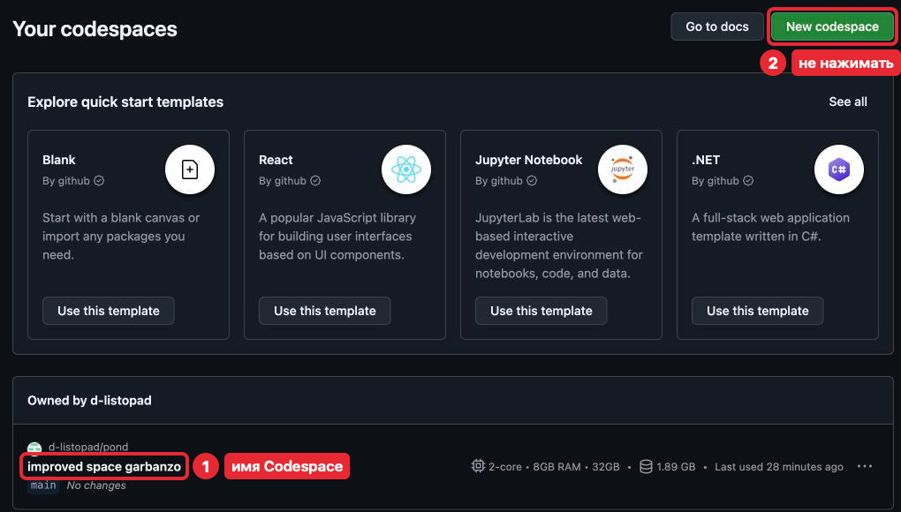

Файлы хранятся, пока Codespace не удалён: через 30 дней без входа.

## Если что-то пошло не так

| Проблема | Что делать |
|---|---|
| «go: command not found» | Command Palette (Палитра команд) → **Codespaces: Rebuild Container** |
| Внизу надпись **Restricted Mode** (Ограниченный режим) | Нажми на неё и выбери **Trust** |
| Экран выглядит не так, как здесь | Напиши преподавателю, что видишь |

## Что дальше

Задача [Рабочее место готово](tasks/01-workplace.md), затем урок
[Первая программа](../02-intro/lesson.md).
