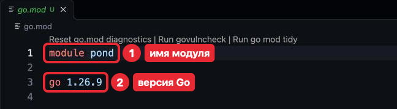
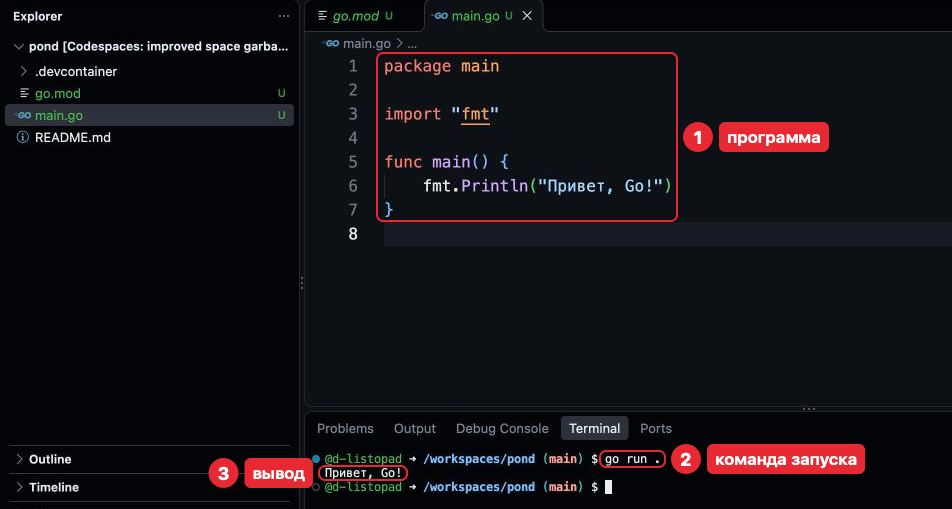
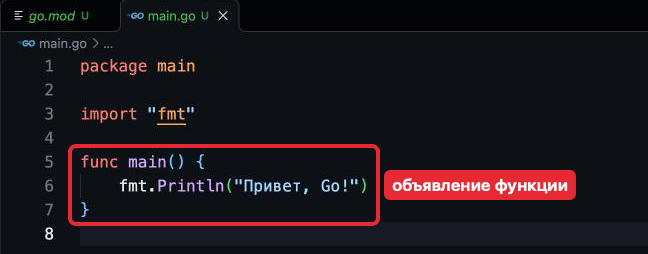
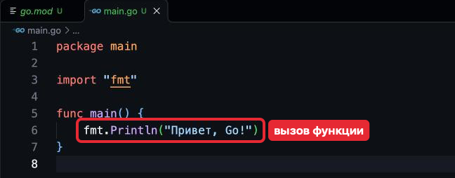
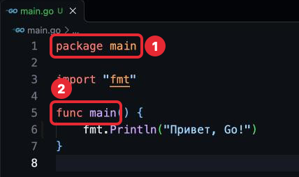
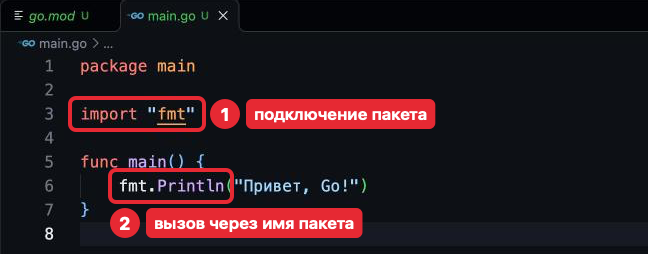
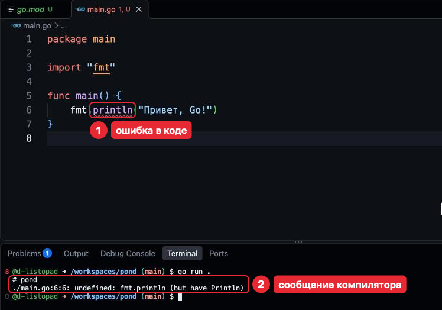

# Шаг 2. Первая программа

## В прошлом уроке

Мы разобрали окно VS Code: Explorer (Проводник), редактор и Terminal (Терминал).
Среда больше не меняется. Теперь *pond* становится проектом на Go с первой программой.

## Чему мы научимся

- Создавать проект на Go и понимать, из каких он файлов.
- Читать строки *package main*, *import "fmt"* и *func main()*.
- Запускать программу и читать сообщения об ошибках.
- Проверять код командами *gofmt* и *go vet*.

Без этого не запустить ни одной программы на Go.

## Где применяется. Как часто используется

- *package* — в каждом файле *.go*.
- *import* — почти в каждом файле.
- *func main* и *go.mod* — по одному на программу.
- *go run* — десятки раз в день.

## Объяснение материала

### Проект на Go

Проект на Go — **модуль** (module): папка, где лежат *go.mod* и файлы *.go*. После
урока *pond* будет таким:

```
pond/
  .devcontainer/   — описание среды
  README.md
  go.mod           — файл модуля
  main.go          — код программы
```

| Что | Как появляется | Можно ли назвать иначе |
|---|---|---|
| *.devcontainer/*, *README.md* | Уже есть, с создания *pond* | — |
| *go.mod* | Создаёт команда *go mod init*. Руками не правится: его меняют команды *go* | Нет |
| *main.go* | Создаёшь ты кнопкой **New File...** (Создать файл) | Можно, но принято *main.go* |

Сделаем *pond* таким проектом: создадим *go.mod* и *main.go* и запустим программу.
Команды урока набирай в Terminal (Терминал), в */workspaces/pond*.

**1. *go.mod*.** Набери:

```
go mod init pond
```

- *mod* — модуль;
- *init* — «создай»;
- *pond* — имя модуля.

Терминал ответит:

```
go: creating new go.mod: module pond
```

В Explorer (Проводник) появится *go.mod*. Открой его:

*go.mod*
```
module pond

go 1.26.9
```



*go 1.26.9* — версия Go, последняя цифра может отличаться. Мелкую строку над текстом
рисует редактор, её не нажимай.

**2. *main.go*.** Теперь файл с кодом. В Explorer (Проводник) нажми на пустое место под файлами,
затем **New File...** (Создать файл), имя *main.go*, Enter. Набери программу
и нажми **Cmd + S**:

*main.go*
```go
package main

import "fmt"

func main() {
	fmt.Println("Привет, Go!")
}
```

**3. Запуск.** Набери:

```
go run .
```

Точка — «текущая папка». Терминал ответит:

```
Привет, Go!
```



Номера строк слева и пунктир под *"fmt"* рисует редактор.

Компьютер не понимает человеческих слов, он работает с нулями и единицами. Программу
переводит программа-переводчик — **компилятор** (compiler), его запускает *go run*.
Компилятор читает весь код до запуска, поэтому ошибки видны сразу.

### Функция

Программа работает. Разберём, из чего она состоит, начиная с главного — функции.

**Функция** (function) — несколько действий под одним именем. Строки 5–7 —
**объявление** функции *main*: слово *func*, имя, скобки, а между *{* и *}* —
действия.



Выполнить функцию по имени — **вызов функции** (function call). В строке 6 вызвана
функция *Println* (Print line): в скобках то, что ей передают; она печатает это
отдельной строкой — следующий вывод появится строкой ниже.



### Пакет *main* и функция *main*

Над функцией — строка *package main*. Она говорит, к какому пакету относится файл.

**Пакет** (package) — файлы *.go* одной папки с одинаковой первой строкой
*package имя*. Имя пакета — из этой строки, а не из имени папки: папка *pond*,
пакет *main*. Запустить можно только пакет *main*, выполнение начинается с его
функции *main*; остальные пакеты, как *fmt*, — части для других программ.



### *import*: подключение пакета

Осталась строка 3. *Println* не написана в нашей программе — она лежит в пакете *fmt*
из **стандартной библиотеки** (standard library), пакетов, поставляемых с Go. Пакет
подключают строкой *import "fmt"*, функции из него вызывают через имя пакета и точку:
*fmt.Println*.



Снаружи пакета видны только имена с заглавной буквы — **экспортируемые** (exported):
*fmt.println* нет. Остальное — внутреннее устройство пакета, оно меняется
в обновлениях, а экспортируемые имена обещают не менять.

Неиспользованный импорт — ошибка: Go не даёт копиться мусору. **Cmd + S** сам убирает
лишние *import* и дописывает нужные (автосохранение — нет).

Текст в кавычках — **строковый литерал** (string literal): Go печатает его как есть,
он может быть любым.

### Проверка и чтение ошибок

Программа написана и разобрана. Перед тем как сохранить её в истории (это задачи
урока), код проверяют двумя командами. Набери их:

```
gofmt -l .
go vet ./...
```

- *gofmt -l .* перечисляет (*-l*, list) файлы, где отступы не по правилам Go.
  Вывела имя — открой файл и нажми Cmd + S.
- *go vet ./...* ищет код, который компилируется, но почти наверняка ошибочен.
  *./...* — эта папка и все внутри.

Молчат обе — всё в порядке.

Если в коде ошибка, компилятор показывает её с местом. Например, если в строке 6
написать *fmt.println* вместо *fmt.Println*, *go run .* ответит:

```
# pond
./main.go:6:6: undefined: fmt.println (but have Println)
```

- «# pond» — модуль;
- «./main.go:6:6» — файл, строка, столбец (символ в строке);
- дальше — описание.

Редактор подчёркивает ошибку в коде, а цифра у вкладки и у **Problems** (Проблемы)
— число ошибок.



Исправляй первую ошибку и запускай снова: следующие часто её следствие.

### Как принято в Go

*gofmt* (его запускает Cmd + S) расставляет отступы и пробелы одинаково для всех,
поэтому об оформлении кода не спорят.

### Типичные ошибки

| Сообщение | Причина |
|---|---|
| «undefined: fmt.println (but have Println)» | Имя со строчной буквы снаружи не видно |
| «"fmt" imported and not used» | Пакет подключён, но не используется |
| «syntax error: unexpected EOF, expected }» | Нет закрывающей *}*; EOF — конец файла |
| «package pond is not a main package» | Первая строка — не *package main* |

### Проверь себя

«Сломай» — в *main.go*. После ответа верни как было (Cmd + Z) и проверь: *go run .*
снова печатает «Привет, Go!».

1. Что напечатает эта программа?

   ```go
   package main

   import "fmt"

   func main() {
   	fmt.Println("раз")
   	fmt.Println("два")
   }
   ```

   <details>
   <summary>Ответ</summary>

   «раз», затем «два» на новой строке: действия выполняются сверху вниз.

   </details>

2. Сломай: удали последнюю *}*. Что скажет компилятор?

   <details>
   <summary>Ответ</summary>

   «syntax error: unexpected EOF, expected }»: файл кончился (EOF)
   раньше, чем закрылась функция *main*.

   </details>

3. Сломай: напиши *fmt.println*. Почему так нельзя?

   <details>
   <summary>Ответ</summary>

   «undefined: fmt.println (but have Println)»: имя не экспортируемое.

   </details>

4. Сломай: замени первую строку на *package pond*. Что ответит *go run .*?

   <details>
   <summary>Ответ</summary>

   «package pond is not a main package»: запустить можно только пакет *main*.

   </details>

## Источники

- **Начать с этого.** [A Tour of Go: Packages](https://go.dev/tour/basics/1),
  [Imports](https://go.dev/tour/basics/2),
  [Exported names](https://go.dev/tour/basics/3) — то же с запуском в браузере,
  по-английски. Незнакомые пакеты в примерах пропускай.
