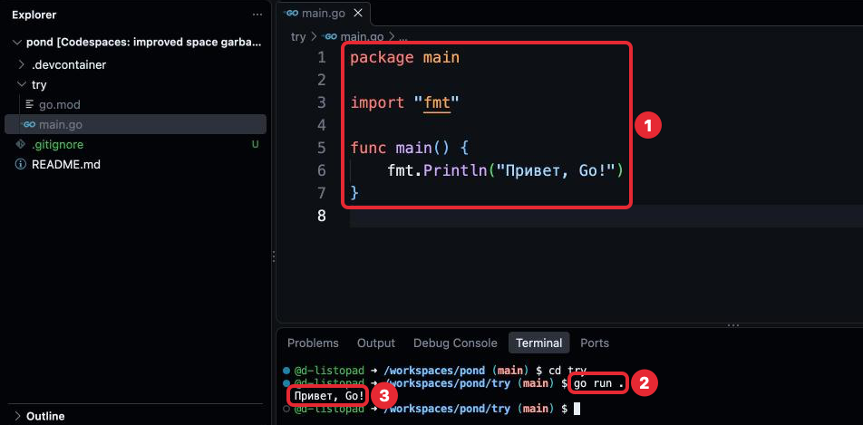
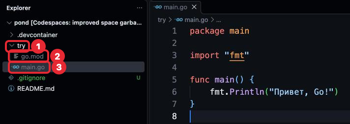
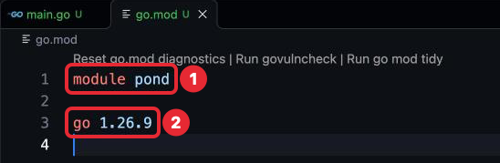
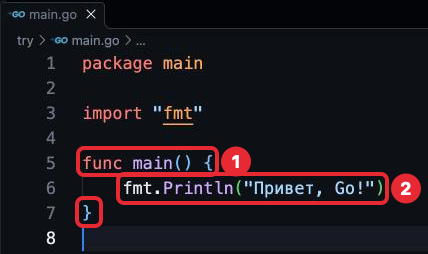
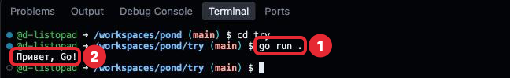
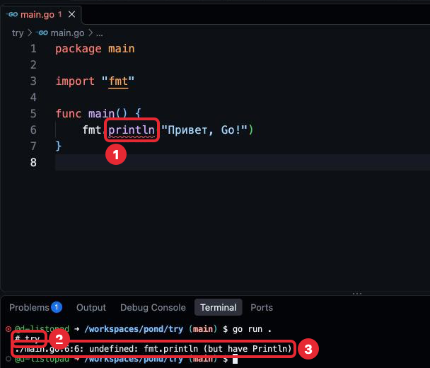

# Шаг 2. Предисловие: файл, пакет и программа на Go

## В прошлом уроке

В прошлом уроке мы разобрали окно VS Code — Explorer, редактор, терминал — и завели
в `pond` папку `try` для примеров. Среда больше не меняется: дальше мы создаём и правим
файлы и набираем команды. Кода в проекте пока нет; этот урок разбирает первую
программу.

## Чему мы научимся

- Понимать, что происходит с кодом после того, как он написан.
- Понимать, из каких файлов состоит проект на Go и кто их создаёт.
- Читать строки `package main`, `import "fmt"` и `func main()`.
- Запускать программу командой `go run` и читать сообщения об ошибках.
- Проверять код командами `gofmt` и `go vet` перед коммитом.

Для чего это нужно знать: каждый файл на Go начинается с одних и тех же строк. Пока
они непонятны, любой пример выглядит как заклинание; после этого шага примеры
читаются, а не заучиваются.

## Где применяется. Как часто используется

Слова ниже разобраны в «Объяснении материала». `package` — первая строка каждого
файла `.go`; `import` — почти в каждом файле; `func main` — один раз на программу;
`go.mod` — один на проект; `go run` — запускают десятки раз в день.

## Объяснение материала

### Первая программа

Весь урок разбирает одну программу. Примеры урока набирай в `try/main.go` и запускай
из папки `try` — как, сказано ниже, в «Проект на Go» и «Запуск».

`try/main.go`
```go
package main

import "fmt"

func main() {
	fmt.Println("Привет, Go!")
}
```

Её запускают командой в терминале, и в ответ она печатает одну строку:

```
$ go run .
Привет, Go!
```

В таких блоках `$` — знак приглашения из шага 1, его не набирай: после него команда,
строкой ниже — ответ.



*1 — программа, 2 — команда запуска, 3 — что напечатала программа. Цифры слева
от кода — номера строк, их рисует редактор, набирать не нужно. Пунктир под `"fmt"` —
ссылка на описание пакета, а не ошибка. Остальное (строка `try > main.go`, Outline,
`.gitignore` с буквой U) не обращай внимания.*

### Что происходит с кодом после того, как он написан

Важно понимать: код не выполняется сразу. Компьютер не понимает слов вроде `import`
или `main`, он понимает только машинный код — последовательности нулей и единиц.
Перевод делает программа **компилятор** (compiler) — переводчик на язык машины.
Текст, который пишем мы, называют **исходным кодом** (source code), результат
перевода — **исполняемым файлом** (executable): его можно запустить.

Запускать компилятор отдельно не нужно: это делает команда `go run`. Компилятор
читает весь код целиком до запуска. Если где-то ошибка, исполняемого файла не будет —
будет сообщение, где и что не так. Поэтому в Go ошибки видны до запуска.

### Проект на Go: папки и файлы

Код на Go хранится в текстовых файлах с расширением `.go` (шаг 1). Проект (шаг 0)
для Go — папка с файлами и признаком, по которому Go её узнаёт. Папка `try`
с первой программой:

```
try/          — папка проекта
  go.mod      — файл модуля
  main.go     — файл с кодом программы
```



*В Explorer: 1 — папка `try`, 2 — `go.mod`, 3 — `main.go`, открытый в редакторе справа.*

| Что | Как появилось | Можно ли назвать иначе |
|---|---|---|
| Папка `try` | Ты создала её в задаче шага 1 кнопкой **New Folder...** | Свою `try` не переименовывай: на это имя ссылаются `.gitignore` и уроки |
| Файл `go.mod` | Его создала команда `go mod init try` в задаче шага 1. Руками он не пишется и не правится | Нет, имя всегда `go.mod` |
| Файл `main.go` | Создаёшь ты: нажми в Explorer на папку `try`, чтобы выделить её, затем **New File...** на заголовке `pond` (как в шаге 1) — файл появится в `try` | Можно, но так принято: файл, с которого начинается программа, называют `main.go` |

**Модуль** (module) — так Go называет проект: папку со всем, что лежит внутри неё.
Признак модуля — файл `go.mod`: где он лежит, там для Go начинается проект. Папка
со своим `go.mod` — отдельный модуль, в модуль снаружи она не входит. Поэтому `try`
для Go — свой маленький проект, хотя и лежит внутри `pond`. Вот что в его `go.mod`:

`go.mod`
```
module try

go 1.26.9
```



*1 — имя модуля, то самое, что ты написала в команде; 2 — версия Go в Codespace,
у тебя последняя цифра может быть другой. Строку мелким шрифтом над ними добавляет
редактор, в файле её нет.*

Теперь понятна и команда из шага 1: `go mod init try` — «Go, модуль (`mod`),
создай (`init`, initialize) с именем `try`».

**Пакет** (package) — папка с файлами `.go`, у которых одинаковая первая строка
`package имя`. Имя пакета берётся из этой строки, а не из имени папки: папка
называется `try`, а пакет в ней — `main`. До шага 9 весь наш код живёт в одном
пакете `main`.

### Функция

Несколько действий программы, собранных вместе под одним именем, называются
**функцией** (function). Выполнить функцию по имени — **вызов функции** (function call).
Свои функции — в шаге 6. В первой программе два случая:



*1 — объявление функции `main`: верхняя рамка — её начало `func main() {`, нижняя —
закрывающая `}`; 2 — вызов функции `Println` внутри неё.*

- `func main() { ... }` (1) — здесь функция **объявляется**: слово `func`, имя `main`,
  круглые скобки и фигурные скобки, между которыми записаны её действия. Круглые
  скобки пустые: `main` ничего не получает. Функцию `main` пишешь ты.
- `fmt.Println("Привет, Go!")` (2) — здесь функция **вызывается**: имя, а в круглых
  скобках то, что ей передают. `Println` уже написана авторами Go. Она печатает
  в терминал то, что ей передали, и переводит строку: Print line — «напечатай строку».
  Что значит `fmt.` перед именем — в разделе про `import`.

### Пакет `main` и функция `main`


*1 — строка `package main`, 2 — начало функции `main`.*

Первая строка, `package main` (1), говорит, какому пакету принадлежит файл. Имя `main`
особое: пакет `main` — тот, который можно запустить. В нём обязана быть функция
`main` (2), с неё начинается выполнение программы, поэтому её называют **точкой
входа** (entry point). Без `package main` и `func main` программа не запустится.

### `import`: подключение пакета


*1 — подключение пакета `fmt`, 2 — имя пакета в вызове, 3 — имя функции из этого пакета.*

Функция `Println` лежит не в нашем пакете, а в пакете `fmt`, который поставляется
вместе с Go. Набор таких готовых пакетов называется **стандартной библиотекой**
(standard library). Скачивать их не нужно, но пакет надо подключить строкой
**`import`** с его именем в кавычках: `import "fmt"` (1). После этого функции
пакета вызываются через его имя (2) и точку: `fmt.Println` — функция `Println` (3)
из пакета `fmt`. Имя пакета пишется в каждом вызове: всегда видно, откуда функция.

**Заглавная буква — знак «можно пользоваться снаружи».** Из пакета наружу видны
только имена с заглавной буквы: `fmt.Println` существует, `fmt.println` — нет. Такие
имена называют **экспортируемыми** (exported). Зачем прятать остальные: имена
со строчной — внутреннее устройство пакета, авторы Go меняют его в обновлениях,
а экспортируемые обещают не менять, поэтому программа на них не сломается.

**Подключить пакет и не использовать его — ошибка**, а не предупреждение: программа
не запустится, пока лишняя строка не будет убрана. Лишний импорт — след удалённого
кода, Go не даёт мусору копиться. При **Cmd + S** редактор сам убирает лишние `import`
и дописывает недостающие (автосохранение этого не делает).

### Разбор программы построчно

Теперь первую программу можно прочитать целиком:

| Строка | Код | Значение |
|---|---|---|
| 1 | `package main` | Пакет `main`: программу можно запустить |
| 3 | `import "fmt"` | Подключён пакет `fmt` |
| 5 | `func main() {` | Начало функции `main`, точки входа |
| 6 | `fmt.Println("Привет, Go!")` | Вызов `Println`: печатает текст и переводит строку |
| 7 | `}` | Конец функции |

Текст в двойных кавычках — это данные, а не команда: Go печатает его как есть. Такой
текст называют **строковым литералом** (string literal); «строка» здесь значит
«текст», а не строчка кода.

`package main` и `func main() { … }` обязательны. Строка `import` зависит от того,
какие пакеты нужны. Текст в кавычках — твой, он может быть любым. Отступ перед
`fmt.Println` расставит редактор, когда нажмёшь Cmd + S.

### Запуск, проверка и чтение ошибок

Программу запускают командой в терминале. Терминал должен быть в папке, где лежит
`main.go`, — она видна в строке приглашения перед `$`. Для примеров это `try`: если
приглашение кончается на `/workspaces/pond`, набери `cd try`, обратно в корень —
`cd ..`. Сама команда:

```sh
go run .
```



*1 — команда, набранная после `$`; приглашение перед ней кончается
на `/workspaces/pond/try`. 2 — что напечатала программа.*

Точка — «текущая папка». Команда компилирует пакет из неё и сразу запускает
исполняемый файл; он создаётся во временной папке и удаляется, поэтому в Explorer
его нет.

**Внешний вид кода.** Отступы и пробелы в Go расставляет программа `gofmt` —
**форматировщик** (formatter); в Codespace она срабатывает при Cmd + S. Проверить
сразу все файлы можно командой `gofmt -l .`: `-l` (list) — только перечислить файлы,
отформатированные не так, ничего не меняя; `.` — эта папка и все папки внутри.
Если команда вывела имя файла — открой его и нажми Cmd + S. Если сразу появилось
новое приглашение `$` — всё в порядке.

**Проверка кода.** Компилятор отвергает только то, что нарушает правила языка.
Код, который правилам не противоречит, но почти наверняка написан с ошибкой, ищет
команда `go vet ./...`; `./...` тоже значит «эта папка и все внутри» — это другая
программа, и она записывает то же самое по-своему. Ничего не вывела — ничего
не нашла. Примеры её находок — в шаге 3.

Обе команды для примеров набирай в `try`, в задачах — в корне `pond`; перед каждым
коммитом (задача 1) обе должны молчать.

**Сообщения об ошибках.** Если компилятор нашёл ошибку, он указывает точное место.
Вот что напечатает `go run .` в `try`, если написать `fmt.println` со строчной буквы:

```
$ go run .
# try
./main.go:6:6: undefined: fmt.println (but have Println)
```



*1 — `println` подчёркнуто красной волной, 2 — модуль, 3 — место и описание ошибки.
Цифры 1 на вкладках и кружок перед строкой терминала — отметки об ошибке, после
исправления пропадут.*

`# try` — в каком модуле ошибка. Дальше через двоеточие: файл (`./` — «в этой папке»),
строка, столбец (символ в строке) и описание: «не определено `fmt.println` (но есть
`Println`)». Иногда причина строкой выше, например незакрытая скобка. Исправляй
первую ошибку и запускай снова — следующие часто её следствие.

### Как принято в Go

**Форматирование не обсуждается.** Стиль задаёт `gofmt`, он один для всех проектов
в мире: чужой код выглядит так же, как свой.

**Компилятор строг намеренно**: неиспользованный импорт — ошибка (раздел про `import`).

### Типичные ошибки

| Сообщение | Причина | Исправление |
|---|---|---|
| `undefined: fmt.println (but have Println)` | Имя написано со строчной буквы. Снаружи пакета видны только имена с заглавной | Исправить регистр: `fmt.Println` |
| `"fmt" imported and not used` | Пакет подключён, но ни одна его функция не вызвана | Удалить строку импорта или вызвать функцию пакета |
| `syntax error: unexpected EOF, expected }` | Не хватает закрывающей фигурной скобки. EOF — конец файла: компилятор дошёл до конца, а `}` не встретил | Добавить `}` |
| `package try is not a main package` | Первая строка файла — не `package main`. `go run` запускает только программы. В сообщении — имя модуля `try`, а не имя из строки `package` | Заменить имя пакета на `main` |

### Проверь себя

Сначала ответь сама, потом раскрой ответ. «Сломай» выполняй в `try/main.go`
с первой программой, запускай `go run .` из `try` и читай сообщение целиком, прежде
чем исправлять. После каждого «Сломай» верни пример в рабочее состояние.

1. Что напечатает эта программа?

   ```go
   package main

   import "fmt"

   func main() {
   	fmt.Println("раз")
   	fmt.Println("два")
   }
   ```

   <details>
   <summary>Ответ</summary>

   `раз`, затем `два`: действия в `main` выполняются сверху вниз, `Println` переводит
   строку.

   </details>

2. Сломай: удали последнюю строку с `}`. Что скажет компилятор?

   <details>
   <summary>Ответ</summary>

   `syntax error: unexpected EOF, expected }`. Компилятор дошёл до конца файла (EOF)
   и не встретил закрывающую скобку.

   </details>

3. Сломай: напиши `fmt.println` со строчной буквы. Почему так нельзя?

   <details>
   <summary>Ответ</summary>

   `undefined: fmt.println (but have Println)`. Снаружи пакета видны только имена
   с заглавной буквы, а `println` в пакете `fmt` нет.

   </details>

4. Сломай: замени первую строку на `package hello`. Что изменится?

   <details>
   <summary>Ответ</summary>

   `package try is not a main package`: запустить можно только пакет `main`
   (в сообщении — имя модуля `try`).

   </details>

5. Сломай: удали строку `fmt.Println(...)`, оставив `import "fmt"`, и запусти,
   не нажимая Cmd + S. Что скажет компилятор?

   <details>
   <summary>Ответ</summary>

   `"fmt" imported and not used`: пакет подключён, но не используется.

   </details>


## Источники

- **Начать с этого.** [A Tour of Go: Packages](https://go.dev/tour/basics/1),
  [Imports](https://go.dev/tour/basics/2),
  [Exported names](https://go.dev/tour/basics/3) — три интерактивные страницы ровно
  об этом шаге, с запуском кода в браузере, по-английски. В примерах есть
  незнакомые пакеты: смотри на устройство файла.
- [pkg.go.dev/fmt](https://pkg.go.dev/fmt) — документация пакета `fmt`.
- [Effective Go: Formatting](https://go.dev/doc/effective_go#formatting) — почему
  форматирование отдано инструменту.
