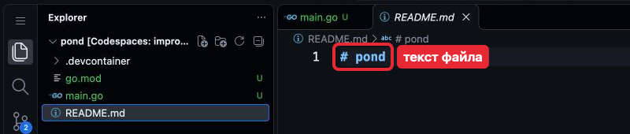

# Задача 1. Жабка квакает

## Контекст

Весь курс ты делаешь одну программу — «Пруд», о жабках; она работает в терминале.
Каждая задача добавляет ей новую возможность. В уроке `pond` стал проектом на Go;
сегодня жабка в первый раз квакает.

## Что нужно

При запуске программа квакает вместо приветствия из урока. В `README.md` — одна-две
фразы: что это за программа и как её запустить.

`README.md` открой из Explorer (Проводник) — он откроется как текст; сейчас в нём
одна строка `# pond`.



Например:

```
# pond

«Пруд» — программа о жабках. Запуск: go run .
```

`#` — заголовок: GitHub покажет строку крупно.

## Где менять

Меняются `main.go` и `README.md`. `go.mod` и `.devcontainer` не трогаем.

## Git: первое знакомство

Коммит сохраняет состояние файлов в истории, push отправляет его в GitHub — там его
видит преподаватель. Что это и как читать ответы команд — раздел Git:
[1. Репозиторий и коммит](../../../Git/01-repository-and-commit.md) и
[2. GitHub: push и pull](../../../Git/02-github-push-pull.md). Команды — в корне `pond`:

```sh
git status
git add .
git commit -m "Жабка квакает"
git push
```

## Критерии приёмки

- [ ] `go run .` в корне `pond` запускает программу, и жабка квакает.
- [ ] В `README.md` одна-две фразы: что это за программа и как её запустить.
      Как проверить: на странице `pond` на github.com README виден под списком файлов.
- [ ] `gofmt -l .` и `go vet ./...` ничего не выводят.
- [ ] Работа сохранена коммитом и отправлена в GitHub (push), сообщение говорит,
      что сделано.
      Как проверить: на странице `pond` над списком файлов — сообщение твоего коммита.

## Вопрос к разбору

Почему `gofmt -l .` и `go vet ./...` запускают перед каждым коммитом, а не один раз
в конце работы?

Ответ напиши комментарием к своему коммиту на GitHub (Git,
[2. GitHub: push и pull](../../../Git/02-github-push-pull.md), «Комментарии к коммиту»).

<details>
<summary>Подсказка</summary>

В уроке — раздел «Проверка и чтение ошибок».

</details>
