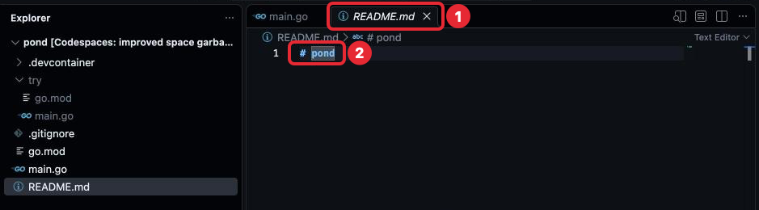

# Задача 1. У программы «Пруд» появляется дом

## Контекст

Весь курс ты делаешь одно приложение — «Пруд», программу о жабках, которая работает
в терминале: её запускают командой, и ответ она печатает туда же.
Каждая следующая задача будет добавлять ему новую возможность, и к концу курса
получится рабочая программа. Сегодня её репозиторий становится Go-проектом,
а жабка в первый раз подаёт голос.

## Перед задачей

Пройдены [шаг 0](../../00-setup/lesson.md) и [шаг 1](../../01-vscode/lesson.md):
репозиторий `pond` создан, преподаватель добавлен в collaborators, Codespace для `pond`
открывается и `go version` работает.

## Что нужно

Превратить репозиторий в Go-проект и сделать так, чтобы при запуске программы
жабка квакала.

Проект — Go-модуль. Модуль создаётся одной командой в корне проекта `pond`. В ней вместо
`ЛОГИН` подставляется твой логин на GitHub — целиком, как он написан в профиле;
он виден и в терминале, в строке приглашения после `@`:

```sh
go mod init github.com/ЛОГИН/pond
```

Например, если логин `anna-go`, команда будет `go mod init github.com/anna-go/pond`.

Почему имя длинное, а у `try` было короткое: модулю, который лежит на GitHub, принято
давать имя по адресу репозитория без `https://` — так по имени понятно, где лежит код.
У `try` адреса нет, поэтому имя короткое.

Команду набираешь ты в терминале, а файл `go.mod` создаёт она сама: что в нём
написано, разобрано в уроке, раздел «Проект на Go: папки и файлы». Терминал должен быть
в корне `pond` — строка приглашения кончается на `/workspaces/pond`. Если она кончается
на `/workspaces/pond/try`, сначала набери `cd ..`, как в задаче шага 1.

Команда ответит так:

```
go: creating new go.mod: module github.com/anna-go/pond
go: to add module requirements and sums:
	go mod tidy
```

Первая строка — файл создан. Две следующие — подсказка на случай, когда программа
использует пакеты не из стандартной библиотеки; у нас таких нет, `go mod tidy`
выполнять не нужно. В корне появится `go.mod` с твоим логином вместо `anna-go`:

```
module github.com/anna-go/pond

go 1.26.9
```

Последняя цифра версии у тебя может быть другой.

### Структура проекта

Так проект должен выглядеть после этой задачи. Эту структуру мы будем развивать
весь курс, поэтому важно начать с правильной.

```
pond/
  .devcontainer/
    devcontainer.json   — описание среды
  try/                  — примеры из уроков, git их не сохраняет
  .gitignore            — список того, что git не сохраняет
  go.mod                — файл модуля
  main.go               — код программы: package main и функция main
  README.md             — что это за программа и как её запустить
```

| Что | Как появляется |
|---|---|
| `.devcontainer/devcontainer.json` | Уже есть, с шага 0 |
| `try/`, `.gitignore` | Уже есть, с шага 1 |
| `README.md` | Уже есть, с шага 0. Текст переписываешь ты: нажми на `README.md` в Explorer — откроется вкладка `README.md` без слова [Preview], в ней текст правится (картинка ниже) |
| `go.mod` | Создаёт команда `go mod init` |
| `main.go` | Создаёшь ты: в Explorer нажми на пустое место под списком файлов, чтобы файл попал в корень, а не в `try` (шаг 1, «Создать файл»), затем **New File...**, набери `main.go` |

Код программы лежит в корне репозитория, без дополнительных папок; `try` — не часть
программы. Когда программа вырастет, у неё появятся свои пакеты; где они будут лежать,
мы разберём в шаге 9.



*1 — вкладка `README.md` без [Preview], имя написано наклонно; 2 — текст файла,
сейчас одна строка `# pond`.*

Сейчас в `README.md` одна строка `# pond`. Например, так он может выглядеть после
задачи:

```
# pond

«Пруд» — программа о жабках. Запуск: go run .
```

`#` в начале строки — заголовок: GitHub покажет эту строку крупно. Текст пиши свой.

## Где менять

Создаются `go.mod` (командой) и `main.go` (руками), меняется `README.md`.
`.devcontainer`, `.gitignore` и `try/go.mod` не трогаем.

## Git: первое знакомство

Коммит ты уже делала в шаге 0 кнопкой **Commit changes** — там он сразу попал
в GitHub. В Codespace коммит делается командой, а в GitHub отправляется отдельной
командой **push**: там его видит преподаватель, и там он не пропадёт вместе
с Codespace. Что такое коммит и push, подробно — в двух коротких частях раздела Git:
[1. Репозиторий и коммит](../../../Git/01-repository-and-commit.md) и
[2. GitHub: push и pull](../../../Git/02-github-push-pull.md). Для этой задачи
достаточно четырёх команд. Набирай их в корне `pond`: приглашение кончается
на `/workspaces/pond`. Если терминал остался в `try`, `git add .` ответит:

```
The following paths are ignored by one of your .gitignore files:
try
hint: Use -f if you really want to add them.
```

Это значит «эту папку git не записывает». Совет про `-f` не выполняй — иначе примеры
попадут в историю. Набери `cd ..` и повтори.

```sh
git status
git add .
git commit -m "Жабка квакает"
git push
```

Ответ `git status` перед `git add .` будет таким:

```
On branch main
Your branch is up to date with 'origin/main'.

Changes not staged for commit:
  (use "git add <file>..." to update what will be committed)
  (use "git restore <file>..." to discard changes in working directory)
	modified:   README.md

Untracked files:
  (use "git add <file>..." to include in what will be committed)
	.gitignore
	go.mod
	main.go

no changes added to commit (use "git add" and/or "git commit -a")
```

- **Changes not staged for commit** — файлы, которые уже были в истории и изменились:
  `README.md`.
- **Untracked files** — новые файлы, которых git ещё не записывал (буква **U**
  в Explorer, шаг 1). `git add .` отмечает и их. После коммита буквы **U** у этих
  файлов и цифра на иконке Source Control пропадут.
- Строки в скобках `(use …)` — подсказки git, выполнять их не нужно.

Папки `try` в списке нет: её скрывает строка `try/` в `.gitignore`, который ты создала
в шаге 1.

Ответ `git commit` будет похож на этот:

```
[main 99a16a0] Жабка квакает
 4 files changed, 13 insertions(+)
 create mode 100644 .gitignore
 create mode 100644 go.mod
 create mode 100644 main.go
```

Первая строка — ветка, короткий номер коммита (у тебя другой) и сообщение. Дальше —
сколько файлов и строк изменилось; `create mode` — новый файл, число перед именем
пропусти.

## Критерии приёмки

- [ ] Структура проекта совпадает с описанной выше.
      Как проверить: в терминале выполни `ls -a` в корне `pond` и сравни со списком.
      `ls` (list) показывает файлы папки, `-a` (all) — включая имена, которые
      начинаются с точки. В выводе будут ещё `.` — сама папка, `..` — папка выше
      (как в `cd ..`) и `.git` — здесь git хранит историю, она появилась вместе
      с репозиторием, её не трогай. Вложенные файлы `ls` не показывает:
      `devcontainer.json` смотри в Explorer.
- [ ] `go run .` в корне репозитория запускает программу, и жабка квакает.
- [ ] В `README.md` одна-две фразы: что это за программа и какой командой её запустить.
      Как проверить: открой репозиторий на github.com — README показывается
      под списком файлов.
- [ ] `gofmt -l .` и `go vet ./...` ничего не выводят.
      Если `gofmt -l .` вывел файл из `try/` — это пример из урока: верни его
      в рабочее состояние и нажми в нём Cmd + S.
- [ ] Работа сохранена коммитом и отправлена в GitHub (push). Сообщение коммита
      говорит, что сделано.
      Как проверить: открой `pond` на github.com — над списком файлов видно сообщение
      твоего коммита.

## Вопрос к разбору

Какие проверки ты выполнила перед коммитом и что именно проверяет каждая из них?

Ответ напиши комментарием к своему коммиту на GitHub (раздел Git,
[2. GitHub: push и pull](../../../Git/02-github-push-pull.md), «Комментарии к коммиту»).

<details>
<summary>Подсказка</summary>

Что делают `gofmt` и `go vet` — в уроке, раздел «Запуск, проверка и чтение ошибок».

</details>
