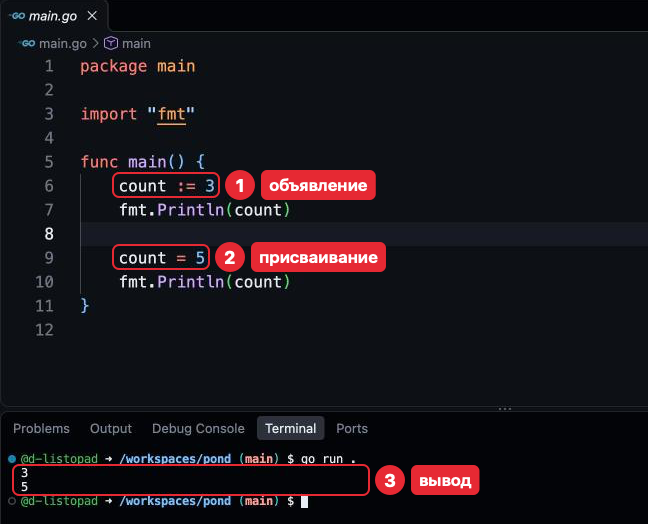
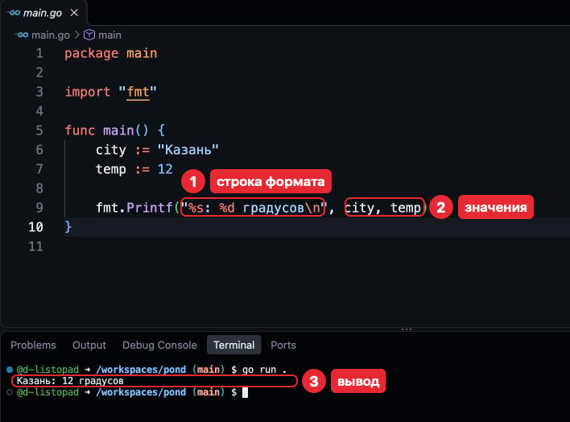
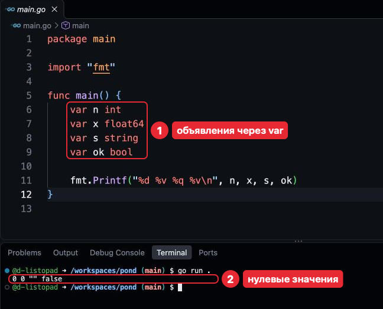

# Шаг 3. Переменные и типы

## В прошлом уроке

Мы разобрали файл на Go (`package main`, `import "fmt"`, `func main`), запустили его
`go run .` и проверили `gofmt` и `go vet`. Код по-прежнему пишется в `main.go`,
`go.mod` руками не трогается. После задач программа в `pond` печатает две строки,
но только текст в кавычках; чтобы работать с данными, которые меняются, нужны
переменные.

## Чему мы научимся

- Хранить значения в переменных и заменять их.
- Различать типы: целое число, дробное число, текст, «да или нет».
- Объявлять переменные через `:=` и `var`.
- Печатать значения внутри фразы через `fmt.Printf`.

Переменная даёт значению имя: его печатают в нескольких местах, а меняют в одном.

## Где применяется. Как часто используется

Переменные и `:=` — в каждой функции; `var` — реже. `int` и `string` — повседневно,
`float64` — в расчётах, `bool` — в проверках «да или нет».

## Объяснение материала

Примеры урока читаются: под каждым — что он печатает, набирать их не нужно. Свою
программу ты меняешь в «Сломай» и в задачах.

### Переменная

До сих пор текст для печати стоял прямо в `Println`. **Переменная** (variable) — имя,
под которым программа хранит одно значение; его можно прочитать и заменить другим.

```go
package main

import "fmt"

func main() {
	count := 3
	fmt.Println(count)

	count = 5
	fmt.Println(count)
}
```

Программа напечатает:

```
3
5
```

- `count := 3` — объявление (declaration, шаг 2): создать переменную и записать в неё
  `3`. Делается один раз.
- `count = 5` — **присваивание** (assignment): записать новое значение в существующую
  переменную. Старое `3` теряется. Присваивать можно сколько угодно.



*На кадре — пример урока, не твой файл.*

`=` — не равенство, а запись значения справа в переменную слева; строки
кода выполняются по порядку, поэтому первый `Println` печатает `3`. Имя без кавычек
печатает значение переменной, `"count"` в кавычках — само слово.

### Тип

В `count` лежит число, а в переменной может быть и текст. **Тип** (type) — вид
значений, которые хранит переменная:

| Тип | Что хранит | Примеры значений |
|---|---|---|
| `int` | Целое число | `42`, `-7`, `0` |
| `float64` | Число с дробной частью, через точку | `3.14`, `-0.5`, `2.0` |
| `string` | Текст, его называют **строкой** | `"Привет"`, `""` — пустая строка |
| `bool` | `true` (да) или `false` (нет) | `true`, `false` |

Тип задаётся при объявлении и не меняется, поэтому компилятор до запуска проверяет,
что с переменной делают допустимое: `"3"` — текст, считать с ним нельзя. Строку
файла урок называет «строкой кода», чтобы не путать со строкой-текстом.

При `:=` тип не пишется: компилятор определяет его по значению (type inference): `3` —
`int`, `3.0` — `float64`, `"3"` — `string`, `true` — `bool`.

Записать в переменную значение другого типа нельзя:

Фрагмент:
```go
count = "три" // ошибка: count хранит int
```

Текст после `//` до конца строки кода — **комментарий** (comment): пояснение для
человека, компилятор его пропускает.

### Вывод значений: `fmt.Printf`

`Println` печатает значения переменных по одному. Чтобы вставить их внутрь фразы,
есть `fmt.Printf` (print formatted): он печатает фразу, в которую подставлены значения.

```go
package main

import "fmt"

func main() {
	city := "Казань"
	temp := 12

	fmt.Printf("%s: %d градусов\n", city, temp)
}
```

Программа напечатает:

```
Казань: 12 градусов
```



*На кадре — пример урока, не твой файл.*

Первое значение в скобках — **строка формата** (format string): текст с метками `%`,
их называют **глаголами** (verb). Значения после неё подставляются в глаголы по порядку.
`\n` — переход на новую строку: `Println` переходит сам, `Printf` — только по `\n`.

| Глагол | Что печатает | Пример | Результат |
|---|---|---|---|
| `%d` | Целое число | `Printf("%d", 42)` | `42` |
| `%s` | Строку как есть | `Printf("%s", "Go")` | `Go` |
| `%q` | Строку в кавычках, видна и пустая | `Printf("%q", "Go")` | `"Go"` |
| `%v` | Любое значение | `Printf("%v", 3.5)` | `3.5` |
| `%T` | Тип значения | `Printf("%T", 3)` | `int` |

Глагол должен подходить к типу значения, иначе вместо значения программа напечатает
пометку об ошибке.

### `var` и нулевое значение

Через `:=` переменная получает значение сразу. Бывает, что значения ещё нет — тогда
её объявляют `var имя тип`. В ней сразу лежит **нулевое значение** (zero value)
её типа, а не пустота:

| Тип | Нулевое значение |
|---|---|
| `int` | `0` |
| `float64` | `0` |
| `string` | `""` |
| `bool` | `false` |

```go
package main

import "fmt"

func main() {
	var n int
	var x float64
	var s string
	var ok bool

	fmt.Printf("%d %v %q %v\n", n, x, s, ok)
}
```

Программа напечатает:

```
0 0 "" false
```



*На кадре — пример урока, не твой файл.*

Когда какой способ объявления выбрать:

- `:=` — значение известно сразу. Основной способ.
- `var x тип` — переменная начинает с нулевого значения.
- `var x тип = значение` — нужен другой тип, чем определил бы компилятор:
  `var price float64 = 3`.

### Как принято в Go

Компилятор принимает любой из способов выше; программисты на Go договорились о стиле:

- **Нулевое значение — готовое начало.** `var count int` вместо `count := 0`, если
  счёт начинается с нуля.
- **Имена в стиле MixedCaps** — слова слитно, следующее с заглавной: `maxSize`,
  не `max_size` и не `MAX_SIZE`. Первая буква строчная: заглавную оставляют для имён,
  видных снаружи пакета (шаг 2).
- **Короткое имя — для короткого кода.** На три строки кода — `n`, `s`; на всю
  функцию — `total`.
- **Количество — в `int`:** половины штуки не бывает.
- **Неиспользуемая переменная — ошибка**, как неиспользуемый импорт (шаг 2).

### Типичные ошибки

Сообщения, которые с переменными встретятся чаще всего:

| Сообщение | Причина |
|---|---|
| `declared and not used: x` | Переменная нигде не используется |
| `cannot use "три" (untyped string constant) as int value in assignment` | В `int` записывается текст в кавычках; скобки пока пропусти |
| `no new variables on left side of :=` | `:=` для уже объявленной переменной |
| `undefined: count` | Переменная не объявлена или опечатка в имени |
| `assignment mismatch: 1 variable but 2 values` | Дробь через запятую: `x := 3,5` |
| `%!d(string=три)` в выводе | Глагол не подходит к типу |
| `%!d(MISSING)` в выводе | Глаголов больше, чем значений |

Последние две `go vet ./...` находит без запуска.

### Проверь себя

Вопросы 1–3 — на чтение кода. «Сломай» — в твоём `main.go`: внеси ошибку
и запусти `go run .`, так сообщение из таблицы выше в задаче будет знакомым. После
ответа верни как было (Cmd + Z).

1. Что напечатает этот фрагмент?

   ```go
   x := 5
   x = 7
   fmt.Println(x)
   ```

   <details>
   <summary>Ответ</summary>

   `7`: присваивание заменило `5`.

   </details>

2. Что напечатает этот фрагмент?

   ```go
   var s string
   fmt.Printf("[%s] %q\n", s, s)
   ```

   <details>
   <summary>Ответ</summary>

   `[] ""`. Нулевое значение строки — пустая строка; `%q` делает её видимой.

   </details>

3. Какой тип у `a := 10`, `b := 10.0`, `c := "10"`?

   <details>
   <summary>Ответ</summary>

   `int`, `float64`, `string`: при `:=` тип определяется по значению (раздел «Тип»).
   Проверка: `fmt.Printf("%T %T %T\n", a, b, c)`.

   </details>

4. Сломай: первой строкой в `main` добавь `x := 1` и больше нигде `x` не используй.

   <details>
   <summary>Ответ</summary>

   Терминал ответит:

   ```
   # pond
   ./main.go:6:2: declared and not used: x
   ```

   `x` объявлена и нигде не используется — это ошибка («Как принято в Go»).

   </details>

5. Сломай: первыми строками в `main` добавь `x := 1`, `x := 2` и `fmt.Println(x)`.

   <details>
   <summary>Ответ</summary>

   Терминал ответит:

   ```
   # pond
   ./main.go:7:4: no new variables on left side of :=
   ```

   `x` уже объявлена. Новое значение — через `=`.

   </details>

6. Сломай: замени `fmt.Println("Ква!")` на `fmt.Printf("%d\n", "Ква!")` и набери
   в терминале по очереди:

   ```
   go run .
   go vet ./...
   ```

   <details>
   <summary>Ответ</summary>

   Вместо `Ква!` — `%!d(string=Ква!)`: `%d` ждёт целое число. `go vet` ответит:

   ```
   main.go:6:14: fmt.Printf format %d has arg "Ква!" of wrong type string
   ```

   </details>

## Источники

- **Начать с этого.** [A Tour of Go: Variables](https://go.dev/tour/basics/8)
  и следующие страницы до Type inference — эти же темы с запуском в браузере,
  по-английски. Незнакомые типы, пакеты и Type conversions пропускай.
- [pkg.go.dev/fmt](https://pkg.go.dev/fmt) — все глаголы `Printf`, раздел «Printing».
- [Effective Go: Names](https://go.dev/doc/effective_go#names) — как выбирают имена.
