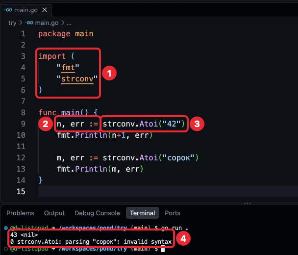
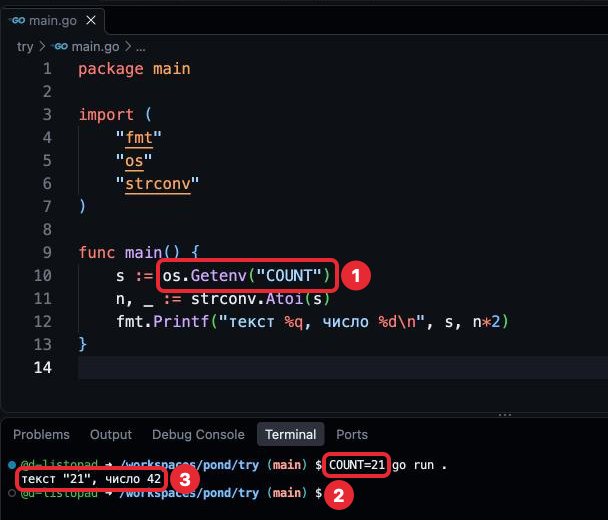

# Шаг 4. Операторы и константы

## В прошлом уроке

В прошлом уроке мы разобрали переменные и типы: создавали их через `:=` и `var`,
узнали нулевые значения и печатали значения внутри фразы через `fmt.Printf`.
В задачах появилась вторая жабка, а работа пошла через ветки: каждая задача — своя
ветка и pull request, так будет и дальше. `.devcontainer` и `go.mod` по-прежнему
не трогаем, код по-прежнему пишется в `main.go`. Но значения переменных пока только
записаны в коде, а не вычисляются, — для этого нужны операторы.

## Чему мы научимся

- Считать: складывать, вычитать, умножать, делить и находить остаток.
- Менять значение переменной на основе её прежнего значения: `+=`, `++`.
- Понимать, почему целые и дробные числа нельзя смешивать и почему дробные считают неточно.
- Давать постоянным значениям имена с помощью `const`.
- Получать число из текста, в том числе из текста, заданного при запуске программы.

Для чего это нужно знать: в шаге 3 переменные хранили значения, которые написаны
в коде. Но данные меняются по правилам: к количеству прибавляют, от остатка отнимают,
цену умножают на число штук. Без операторов программа может только запомнить
значение, но не вычислить новое. А данные, которые приходят снаружи, почти всегда
приходят текстом, и считать с ними можно только после того, как текст превращён
в число.

## Где применяется. Как часто используется

- Арифметические операторы и `+=`, `++` — в большинстве функций, где есть числа:
  счётчики, суммы, размеры.
- `const` — в большинстве пакетов: пределы, размеры, значения по умолчанию.
  Стандартная библиотека тоже хранит в константах постоянные величины, например
  число π.
- `strconv.Atoi` — везде, где число приходит текстом: настройки, ввод человека,
  содержимое файлов.
- `float64` — в измерениях и расчётах, где небольшая неточность допустима.
  Для денег и количества не используется.

Это повседневный материал: операторы встречаются почти в каждой программе.

## Объяснение материала

Примеры урока набирай в `try/main.go`: каждую новую программу — вместо прежней,
целиком, и запускай `go run .` из папки `try` (строка приглашения кончается
на `/workspaces/pond/try`). Второй файл с `func main` в той же папке даст ошибку
`main redeclared in this block`: в пакете может быть только одна функция `main`.

### Арифметические операторы

Значок, который берёт значения и вычисляет из них новое, называется **оператором**
(operator): в записи `a + b` оператор `+` берёт `a` и `b` и вычисляет сумму.

| Оператор | Что вычисляет | Пример | Результат |
|---|---|---|---|
| `+` | Сумму | `7 + 2` | `9` |
| `-` | Разность | `7 - 2` | `5` |
| `*` | Произведение | `7 * 2` | `14` |
| `/` | Частное | `7 / 2` | `3` |
| `%` | Остаток от деления | `7 % 2` | `1` |

`try/main.go`
```go
package main

import "fmt"

func main() {
	a := 7
	b := 2

	fmt.Println(a+b, a-b, a*b)
	fmt.Println(a/b, a%b)
	fmt.Println(2 + 3*4)
	fmt.Println((2 + 3) * 4)
}
```

```
$ go run .
9 5 14
3 1
14
20
```

**Деление целых чисел даёт целое.** `7 / 2` — это `3`, а не `3.5`: дробная часть
отбрасывается. Остаток, который при этом теряется, вычисляет `%`: `7 % 2` — это `1`.
Чтобы получить `3.5`, делить нужно дробные числа, об этом ниже.

**Порядок как в математике.** Умножение, деление и остаток выполняются раньше
сложения и вычитания: `2 + 3*4` — это `14`. Скобки меняют порядок: `(2 + 3) * 4` —
это `20`. Пробелы вокруг операторов на порядок не влияют, `gofmt` расставляет их так,
чтобы порядок было видно.

**На ноль делить нельзя.** Ноль, записанный прямо в коде (`a / 0`), заметит
компилятор и не запустит программу. Ноль в переменной компилятор не видит: программа
запустится и аварийно остановится на этой строке. Как это выглядит — в разделе
«Типичные ошибки».

Оператор `+` работает и со строками: склеивает их. `"При" + "вет"` — это `"Привет"`.

### Изменение переменной

Часто новое значение вычисляется из старого: к сумме прибавить ещё, от остатка
отнять. Справа от `=` можно использовать саму переменную:

Фрагмент:
```go
total := 10
total = total + 5 // было 10, стало 15
```

Текст от `//` до конца строки — **комментарий** (comment): пояснение для человека.
Компилятор его пропускает, поэтому набирать комментарии из примеров не обязательно.

Как любое присваивание из шага 3, строка выполняется в два действия: сначала
вычисляется `total + 5` из текущего значения, потом результат записывается в `total`.

Такое изменение встречается так часто, что для него есть короткая запись — **составное
присваивание** (compound assignment): `total += 5` значит то же, что
`total = total + 5`. Так же работают `-=`, `*=`, `/=`, `%=`.

Для изменения ровно на единицу есть `total++` (**инкремент**, increment, прибавить
единицу) и `total--` (**декремент**, decrement, отнять единицу).

`try/main.go`
```go
package main

import "fmt"

func main() {
	total := 10
	total += 5
	total -= 2
	total *= 2
	fmt.Println(total)

	total++
	fmt.Println(total)
}
```

```
$ go run .
26
27
```

В Go `total++` пишется отдельной строкой: у него нет результата, который можно
записать в другую переменную, поэтому `y := total++` — ошибка. Так сделано, чтобы
в одной строке не было двух действий сразу — изменения `total` и записи в `y`.
В языках, где это разрешено, легко ошибиться, какое значение попало в `y`, старое
или новое.

### Целые и дробные числа не смешиваются

Операция применяется к двум значениям одного типа. `int` и `float64` — разные типы,
поэтому записать `n * x`, где `n` — `int`, а `x` — `float64`, нельзя:

Фрагмент:
```go
n := 7
x := 2.0
fmt.Println(n * x) // ошибка: mismatched types int and float64
```

Компилятор не угадывает, какой тип нужен в результате, его нужно указать явно.
Это делает **преобразование типа** (type conversion): имя типа и значение в скобках.
`float64(n)` даёт дробное число с тем же значением, что в `n`; сама переменная `n`
при этом остаётся `int`.

`try/main.go`
```go
package main

import "fmt"

func main() {
	n := 7
	fmt.Println(n / 2)
	fmt.Println(float64(n) / 2)
}
```

```
$ go run .
3
3.5
```


*1 — целое число делится на целое: дробная часть отбрасывается, 2 — `n` сначала
преобразуется в `float64`, а `2` становится дробным само, 3 — что напечатала программа.*

Почему `float64(n) / 2` работает, если `int` и `float64` не смешиваются? Число,
записанное прямо в коде, как `2`, своего типа ещё не имеет и принимает тип значения,
с которым стоит в операции: здесь — `float64`. Тип `int` число получает, когда
записывается в переменную через `:=`, как `n := 7` в шаге 3. Поэтому `float64(n) / 2`
работает, а `n * x` из двух переменных разных типов — нет.

### Дробные числа считаются неточно

`try/main.go`
```go
package main

import "fmt"

func main() {
	x := 0.1
	y := 0.2
	fmt.Println(x + y)
}
```

```
$ go run .
0.30000000000000004
```

Это не ошибка Go, так работают дробные числа в компьютере. `float64` хранит число
в двоичной системе, то есть только нулями и единицами, и в ограниченном количестве
знаков. Многие десятичные дроби
в ней записываются бесконечно, как 1/3 в десятичной: 0,333… Хранится только начало
такой дроби, поэтому почти каждое значение `float64` чуть-чуть неточное, а при
вычислениях погрешности накапливаются.

Для измерений это допустимо: температура `12.000000000000002` градуса на деле
не отличается от `12`. Для количества и денег — нет: сумма на счёте должна сходиться
до копейки. Поэтому деньги хранят в `int` в самых мелких единицах: не `0.1` рубля,
а `10` копеек. Целые числа складываются точно: `10 + 20` — всегда `30`. Точно — пока
результат не выходит за предел `int`, это 9 223 372 036 854 775 807; в курсе таких
чисел нет.

### Константы

Некоторые значения в программе не меняются: предел, размер, число дней в неделе.
Если записать такое число прямо в вычисление, читателю непонятно, что оно значит,
а если оно встречается в нескольких местах, при изменении его можно
забыть поправить в одном из мест.

**Константа** (constant) — имя для значения, которое задаётся один раз и не меняется,
пока программа работает. Объявляется словом `const`:

`try/main.go`
```go
package main

import "fmt"

const limit = 10

func main() {
	used := 3
	fmt.Println(limit - used)

	price := 2.5
	fmt.Println(price * limit)
}
```

```
$ go run .
7
25
```


*1 — константа объявлена вне функций, между `import` и `func main`, 2 — она
используется внутри `main`, 3 — что напечатала программа.*

Изменить константу нельзя: строка `limit = 20` — ошибка компиляции. Её текст —
в разделе «Типичные ошибки».

Константы, в отличие от переменных, принято объявлять вне функций, между `import`
и `func main`: изменить их всё равно никто не может, а видны они всем функциям пакета.

Тип константе можно указать, как переменной: `const limit int = 10`. Тогда она
работает только с `int`. В курсе тип не указываем: константа без указанного типа,
как число в коде, принимает тип того места, где используется. Поэтому `limit`
работает и с `int` (`limit - used`), и с `float64` (`price * limit`), хотя переменные
`int` и `float64` между собой не смешиваются.

### Число из текста: `strconv.Atoi`

`"42"` в кавычках — строка, а не число: `"4" + "2"` даёт `"42"`, а `"42" + 1` —
ошибка компиляции. Если число пришло текстом, перед вычислениями его превращают
в `int` функцией `strconv.Atoi` из пакета `strconv` (string conversion —
«преобразование строк»). Этот пакет из стандартной библиотеки, как `fmt`: скачивать
его не нужно, подключается строкой `import`. `Atoi` — сокращение от ASCII to integer,
«из текста в целое число».

Как `strings.ToUpper` из шага 2, `Atoi` возвращает результат. В шаге 2 результат
сразу передавали в `Println`, а здесь его записывают в переменную, как любое число
или строку. Как писать свои функции с результатом — в шаге 5.

Текст может и не быть числом, например `"сорок"`. Поэтому `Atoi` возвращает два
значения: число и **ошибку** (error) — значение, которое сообщает, что пошло не так.
Если всё в порядке, ошибка равна `nil`, это значит «ошибки нет»; печатается
как `<nil>`. Два значения принимаются в две переменные через запятую.

Пакетов в этой программе два, `fmt` и `strconv`. Когда пакетов несколько, их
перечисляют в одном `import` в круглых скобках, по пакету на строку. Это то же, что
несколько строк `import "…"`; редактор при сохранении сам приводит импорт к такому виду.

`try/main.go`
```go
package main

import (
	"fmt"
	"strconv"
)

func main() {
	n, err := strconv.Atoi("42")
	fmt.Println(n+1, err)

	m, err := strconv.Atoi("сорок")
	fmt.Println(m, err)
}
```

```
$ go run .
43 <nil>
0 strconv.Atoi: parsing "сорок": invalid syntax
```



*1 — два пакета в одном `import`, 2 — две переменные, в которые записываются два
результата, 3 — вызов `strconv.Atoi`, 4 — что напечатала программа: число и `<nil>`
(ошибки нет), затем `0` и ошибка.*

Если текст не число, `Atoi` возвращает `0` и ошибку с объяснением: `parsing "сорок"` —
«разбираю текст "сорок"», `invalid syntax` — «в тексте не число». Пробелы и пустая строка тоже дают эту ошибку.

Во второй строке с `:=` переменная `err` уже существует. Это допустимо: `:=` требует,
чтобы слева была хотя бы одна новая переменная, здесь это `m`; в `err` записывается
новое значение.

Проверять ошибку и действовать по-разному в зависимости от неё мы научимся в шаге 6.
До тех пор ошибку можно отбросить: вместо имени переменной ставится `_` —
**пустой идентификатор** (blank identifier), место, куда значение выбрасывается
без сохранения:

Фрагмент, здесь `s` — строка с числом, например `s := "42"`:
```go
n, _ := strconv.Atoi(s)
```

Отбрасывать ошибку в Go не принято: если текст не число, программа молча продолжит
работать с нулём. Это временная запись до шага 6, где такие строки будут исправлены.

### Значение при запуске: `os.Getenv`

Значения, записанные в коде, меняются только правкой кода. Часто значение удобнее
задать при запуске: одна и та же программа работает с разными данными.

Один из способов — **переменная окружения** (environment variable): имя и текстовое
значение, которые задаются в терминале перед командой запуска и доступны программе.
Это не переменная Go из шага 3: в коде её не объявляют, она существует вне программы.
**Окружение** (environment) — набор таких имён и значений, которые терминал передаёт
каждой программе, которую запускает. «Переменной» её называют потому, что у неё тоже
есть имя и значение. Другой способ — ввод с клавиатуры во время работы программы,
он будет в шаге 9.

Программа читает переменную окружения функцией `os.Getenv` из пакета `os`
(operating system, «операционная система»; тоже стандартная библиотека): в нём
функции для работы с компьютером, на котором запущена программа. `Getenv` — get
environment, «получить из окружения». Имя переменной пишется в кавычках. Если
переменная не задана, `os.Getenv` возвращает пустую строку.

`try/main.go`
```go
package main

import (
	"fmt"
	"os"
	"strconv"
)

func main() {
	s := os.Getenv("COUNT")
	n, _ := strconv.Atoi(s)
	fmt.Printf("текст %q, число %d\n", s, n*2)
}
```

```
$ COUNT=21 go run .
текст "21", число 42
$ go run .
текст "", число 0
```



*1 — чтение переменной окружения в коде, 2 — значение, заданное перед командой
в терминале (из папки `try`), 3 — что напечатала программа.*

Набирай это в терминале, из папки `try`. `COUNT=21` перед командой задаёт
переменную окружения только для этого запуска.

Пробелов вокруг `=` нет: терминал делит строку на части по пробелам, и `COUNT = 21`
прочитал бы как команду `COUNT` — ответ будет `bash: COUNT: command not found`.

Имена переменных окружения принято писать заглавными латинскими буквами. Это
соглашение терминала, а не Go: так их легко отличить от команд, которые пишутся
строчными. MixedCaps из шага 3 — про имена в коде Go, а `"COUNT"` в коде — строка
в кавычках, а не имя.

### Как принято в Go

**Константа вместо числа в коде.** Число без объяснения посреди вычисления называют
магическим: `x * 10` не говорит, что такое `10`. `const limit = 10` и `x * limit`
говорят. Константу без типа можно использовать и с целыми, и с дробными значениями.

**Преобразования только явные.** Go не превращает `int` во `float64` сам и не
складывает строку с числом. Что написано в коде, то и происходит: если нужен другой
тип, это видно по `float64(n)` или `strconv.Atoi(s)`.

**Количество и деньги — в целых числах.** Это то, что обещал шаг 3: `float64`
накапливает неточность, `int` считает точно. Деньги — в копейках.

**Ошибку не выбрасывают молча.** `_` вместо ошибки допустим в курсе только до шага 6.
В рабочем коде отброшенная ошибка — первое, что заметят на разборе. В задачах шага 4
`_` вместо ошибки допустим, на разборе это не замечание: в шаге 6 ты исправишь эту
строку в `pond`.

### Типичные ошибки

| Сообщение | Причина | Исправление |
|---|---|---|
| `invalid operation: n * x (mismatched types int and float64)` | В одной операции `int` и `float64` | Преобразовать одно значение: `float64(n) * x` |
| `invalid operation: s + 1 (mismatched types string and untyped int)` | Строка складывается с числом. `untyped int` — так компилятор называет целое число, записанное прямо в коде | Превратить строку в число через `strconv.Atoi` |
| `cannot assign to limit (neither addressable nor a map index expression)` | Присваивание константе. Хвост в скобках значит «это не место в памяти и не элемент карты»: присваивать можно только тому, что хранится в памяти, то есть переменной. Карты — в шаге 9 | Если значение меняется, это переменная: объявить через `:=` |
| `assignment mismatch: 1 variable but strconv.Atoi returns 2 values` | `Atoi` возвращает два значения, а принято одно | `n, err :=` или `n, _ :=` |
| `syntax error: unexpected ++ at end of statement` | `x++` использован как значение: `y := x++` | Сначала `x++` отдельной строкой, потом `y := x` |
| `invalid operation: division by zero` | Деление на `0`, записанный прямо в коде | Исправить делитель |
| `panic: runtime error: integer divide by zero` | Деление на переменную, в которой оказался `0` | Компилятор этого не видит, программа аварийно останавливается при запуске; проверять делитель научимся в шаге 6 |

Последняя строка — не сообщение компилятора. Программа запустилась и остановилась
посреди работы; такую остановку называют **паникой** (panic). Вывод выглядит так:

```
$ go run .
panic: runtime error: integer divide by zero

goroutine 1 [running]:
main.main()
	/workspaces/pond/try/main.go:9 +0x54
exit status 2
```

Важна строка с именем файла и номером строки после двоеточия: `main.go:9` — здесь
программа остановилась; у тебя номер будет тот, где в твоей программе деление. Строки `goroutine 1 [running]`, `+0x54` и `exit status 2`
пока пропусти, они объясняются в шаге 14.

### Проверь себя

Сначала ответь сам, потом раскрой ответ. Задания «Сломай» выполняются в папке `try`.

1. Что напечатает этот фрагмент?

   ```go
   fmt.Println(17/5, 17%5)
   ```

   <details>
   <summary>Ответ</summary>

   `3 2`. Деление целых отбрасывает дробную часть: в 17 три раза по 5. Остаток
   от этого деления — `2`.

   </details>

2. Что напечатает этот фрагмент?

   ```go
   x := 4
   x += 2
   x *= 3
   x--
   fmt.Println(x)
   ```

   <details>
   <summary>Ответ</summary>

   `17`. Каждая строка меняет значение, начиная с текущего: 4 + 2 = 6, 6 × 3 = 18,
   18 − 1 = 17.

   </details>

3. Что напечатает этот фрагмент и почему?

   ```go
   n := 9
   fmt.Println(n/2, float64(n)/2)
   ```

   <details>
   <summary>Ответ</summary>

   `4 4.5`. `n/2` — деление целых, дробная часть отбрасывается. `float64(n)` —
   дробное число, и деление тоже дробное.

   </details>

4. Сломай: объяви `count := 3` и `rate := 1.5`, напечатай `count * rate`. Затем
   удали строку `count := 3` из `main` и добавь `const count = 3` между `import`
   и `func main`.

   <details>
   <summary>Ответ</summary>

   С переменной: `invalid operation: count * rate (mismatched types int and float64)`.
   С константой программа печатает `4.5`: у константы без типа нет своего типа,
   она принимает тип `rate`.

   </details>

5. Сломай: присвой константе новое значение внутри `main`.

   <details>
   <summary>Ответ</summary>

   `cannot assign to ... (neither addressable nor a map index expression)`.
   Константа не меняется, пока программа работает; изменяемое значение — переменная.

   </details>

6. Что напечатает программа из раздела «Значение при запуске», если запустить её
   командой `COUNT=пять go run .`?

   <details>
   <summary>Ответ</summary>

   `текст "пять", число 0`. `Atoi` не смогла превратить текст в число, вернула `0`
   и ошибку, а ошибка отброшена через `_`. Программа не сообщила о проблеме — вот
   почему отбрасывать ошибку не принято.

   </details>

## Источники

- **Начать с этого.** [A Tour of Go: Type conversions](https://go.dev/tour/basics/13),
  [Constants](https://go.dev/tour/basics/15),
  [Numeric Constants](https://go.dev/tour/basics/16) — интерактивные страницы
  о преобразованиях и константах, с запуском кода в браузере. В их примерах
  встречаются пакеты, функции и операторы, которых в уроке нет (`math`, `<<`, функции
  с результатом): смотри на преобразования и константы, а не на них.
- [Спецификация Go: Arithmetic operators](https://go.dev/ref/spec#Arithmetic_operators) —
  все арифметические операторы и правила деления целых.
- [Спецификация Go: Operator precedence](https://go.dev/ref/spec#Operator_precedence) —
  порядок выполнения операторов.
- [Спецификация Go: Constants](https://go.dev/ref/spec#Constants) — константы с типом
  и без типа.
- [pkg.go.dev: strconv.Atoi](https://pkg.go.dev/strconv#Atoi) — описание функции
  и её ошибок.
- [pkg.go.dev: os.Getenv](https://pkg.go.dev/os#Getenv) — чтение переменной окружения.
