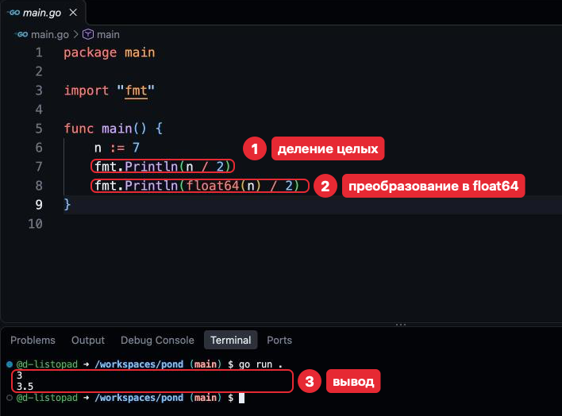
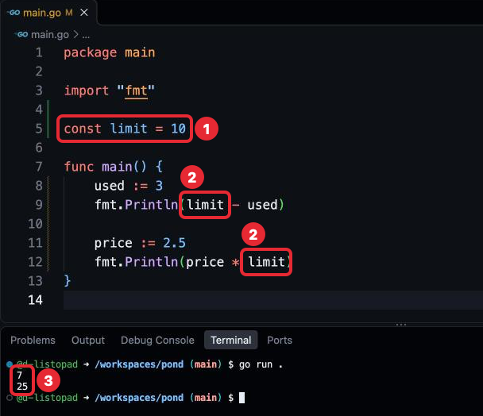

# Шаг 4. Операторы и константы

## В прошлом уроке

В прошлом уроке мы разобрали переменные и типы, *:=*, *var* и *fmt.Printf*. Каждая
задача теперь делается в своей ветке и сдаётся через pull request. Код по-прежнему
пишется в *main.go* в корне *pond*; *.devcontainer* и *go.mod* не трогаем. Пока
программа только хранит значения и печатает их.

## Чему мы научимся

- Складывать, вычитать, умножать, делить и находить остаток.
- Менять переменную от её прежнего значения: *+=*, *++*.
- Понимать, почему *int* и *float64* не смешиваются и почему дробные считаются неточно.
- Давать постоянным значениям имена через *const*.

Без операторов программа хранит значения, но не вычисляет новые.

## Где применяется. Как часто используется

- Операторы, *+=* и *++* — почти в каждой функции, где есть числа.
- *const* — в большинстве пакетов: пределы, размеры, значения по умолчанию.

## Объяснение материала

Примеры урока набирать не нужно: каждый показан кодом с выводом под ним или кадром
редактора, где видны программа и её вывод в терминале.

### Арифметические операторы

**Оператор** (operator) — значок, который вычисляет новое значение из других.

| Оператор | Что вычисляет | Пример | Результат |
|---|---|---|---|
| *+* | Сумму; строки склеивает: *"При" + "вет"* — *"Привет"* | *7 + 2* | *9* |
| *-* | Разность | *7 - 2* | *5* |
| «*» | Произведение | «7 * 2» | *14* |
| */* | Частное; у целых дробная часть отбрасывается | *7 / 2* | *3* |
| *%* | Остаток от деления | *7 % 2* | *1* |

```go
package main

import "fmt"

func main() {
	a := 7
	b := 2

	fmt.Println(a+b, a-b, a*b)
	fmt.Println(a/b, a%b)
	fmt.Println(2 + 3*4)
	fmt.Println((2 + 3) * 4)
}
```

Программа напечатает:

```
9 5 14
3 1
14
20
```

Порядок как в математике: «*», */*, *%* раньше *+* и *-*, скобки меняют порядок.
Пробелы расставляет Cmd + S так, чтобы порядок был виден: «2 + 3*4».

### Изменение переменной

Результат вычисления часто записывают в ту же переменную: в *total = total + 5* сначала
вычисляется *total + 5* из текущего значения, потом результат записывается в *total*.
Короткая запись — **составное присваивание** (compound assignment): *total += 5*
значит *total = total + 5*; так же *-=*, «*=», */=*, *%=*. *total++* прибавляет
единицу, *total--* отнимает.

```go
package main

import "fmt"

func main() {
	total := 10
	total += 5
	total -= 2
	total *= 2
	fmt.Println(total)

	total++
	fmt.Println(total)
}
```

Программа напечатает:

```
26
27
```

*total++* пишется только отдельной строкой: в *y := total++* было бы неясно, старое
или новое значение попало в *y*.

### Целые и дробные числа не смешиваются

До сих пор в операциях были только целые числа. Но оператор работает с двумя
значениями одного типа, поэтому «n * x», где *n* — *int*, а *x* — *float64*, —
ошибка компилятора: он не угадывает тип результата. Тип указывают явно —
**преобразованием типа** (type conversion): *float64(n)* даёт дробное число с тем же
значением, а *n* остаётся *int*.



*На кадре — пример урока, не твой файл.*

Число, записанное прямо в коде, как *2*, принимает тип соседнего значения — здесь
*float64*; *int* оно становится, когда его записывают в переменную через *:=*.

### Дробные числа считаются неточно

Сумма двух дробных чисел может отличаться от точной на крошечную величину:

```go
package main

import "fmt"

func main() {
	x := 0.1
	y := 0.2
	fmt.Println(x + y)
}
```

Программа напечатает:

```
0.30000000000000004
```

*float64* хранит ограниченное число знаков, а многие десятичные дроби в двоичной
записи бесконечны, как 1/3 = 0,333… в десятичной. Для измерений это допустимо,
для количества и денег — нет. Поэтому деньги хранят в *int* в мелких единицах:
не *0.1* рубля, а *10* копеек.

### Константы

Некоторые значения не меняются, пока программа работает, например предел.
Имя для такого значения — **константа** (constant). Объявляется словом *const*, обычно
вне функций, между *import* и *func main*: так она видна всем функциям пакета.
Имя объясняет число (*limit*, а не *10*), и число меняется в одном месте.



*На кадре — пример урока, не твой файл.*

Константа без типа, как число в коде, принимает тип места, где используется:
поэтому *limit* работает и с *int*, и с *float64*.

### Как принято в Go

- **Константа вместо числа в коде:** «x * limit», а не «x * 10».
- **Преобразования только явные:** *float64(n)*.
- **Количество и деньги — в целых числах.**

### Типичные ошибки

| Сообщение | Причина | Исправление |
|---|---|---|
| «invalid operation: n * x (mismatched types int and float64)» | В одной операции *int* и *float64* | «float64(n) * x» |
| «invalid operation: s + 1 (mismatched types string and untyped int)» | Строка *"42"* складывается с числом; *untyped int* — целое число, записанное в коде | Строку в число превращают функцией, разберём позже |
| «cannot assign to limit (neither addressable nor a map index expression)» | Присваивание константе; хвост в скобках пропусти | Если значение меняется, это переменная |
| «syntax error: unexpected ++ at end of statement» | *y := x++* | *x++* отдельной строкой, потом *y := x* |
| «invalid operation: division by zero» | Деление на *0*, записанный в коде | Исправить делитель |
| «panic: runtime error: integer divide by zero» | Деление на переменную, в которой *0* | Проверять делитель научимся позже |

Последняя строка таблицы — не сообщение компилятора, а **паника** (panic): аварийная
остановка программы во время работы:

```go
package main

import "fmt"

func main() {
	a := 10
	b := 0
	fmt.Println(a / b)
}
```

Программа напечатает:

```
panic: runtime error: integer divide by zero

goroutine 1 [running]:
main.main()
	/workspaces/pond/main.go:8 +0x…
exit status 2
```

*main.go:8* — строка, где программа остановилась; остальное пока пропусти.

### Проверь себя

«Сломай» делается в своём *main.go* в корне *pond*: измени, запусти *go run .*,
прочитай сообщение и верни как было (Cmd + Z).

1. Что напечатает этот фрагмент?

   ```go
   x := 15
   x += 2
   x++
   fmt.Println(x/5, x%5)
   ```

   <details>
   <summary>Ответ</summary>

   *3 3*. *x* стал *18*; деление целых отбрасывает дробную часть, остаток — *3*.

   </details>

2. Что напечатает этот фрагмент?

   ```go
   n := 9
   fmt.Println(n/2, float64(n)/2)
   ```

   <details>
   <summary>Ответ</summary>

   *4 4.5*. *n/2* — деление целых, *float64(n)/2* — дробных.

   </details>

3. Сломай: первыми строками в *main* добавь *n := 3*, *rate := 1.5*
   и «fmt.Println(n * rate)». Как исправить?

   <details>
   <summary>Ответ</summary>

   Терминал ответит:

   ```
   # pond
   ./main.go:8:14: invalid operation: n * rate (mismatched types int and float64)
   ```

   *n* — *int*, *rate* — *float64*. Исправление — «float64(n) * rate».

   </details>

4. Сломай: добавь *const limit = 10* между *import* и *func main*, как в примере
   «Константы», а первой строкой в *main* — *limit = 20*.

   <details>
   <summary>Ответ</summary>

   Терминал ответит:

   ```
   # pond
   ./main.go:8:2: cannot assign to limit (neither addressable nor a map index expression)
   ```

   Константа не меняется; изменяемое значение — переменная.

   </details>

## Источники

- **Начать с этого.** [A Tour of Go: Type conversions](https://go.dev/tour/basics/13),
  [Constants](https://go.dev/tour/basics/15),
  [Numeric Constants](https://go.dev/tour/basics/16) — с запуском в браузере;
  незнакомое в примерах (*math*, *&lt;&lt;*, «func … int») пропусти.
- [Спецификация Go: Arithmetic operators](https://go.dev/ref/spec#Arithmetic_operators) —
  все арифметические операторы.
