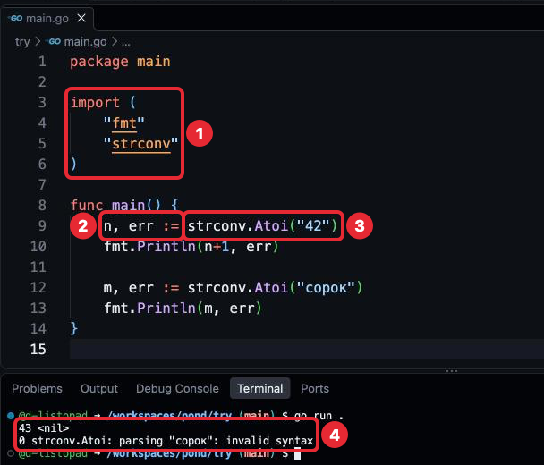
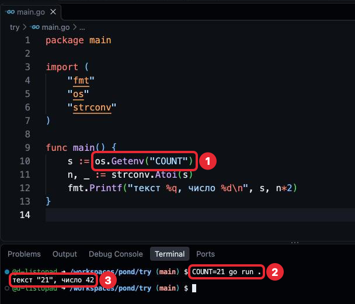

# Шаг 5. Число из текста

## В прошлом уроке

В прошлом уроке мы разобрали операторы, преобразование типа и константы: жабка
научилась ловить мух и считать, сколько ещё влезет. Работа по-прежнему идёт через
ветки и pull request, код — в `main.go` в корне `pond`, `.devcontainer`, `.gitignore`
и `go.mod` не трогаем. Но сколько мух поймано, записано прямо в коде: чтобы изменить
улов, надо править программу. Этот урок о том, как получить число снаружи, при запуске.

## Чему мы научимся

- Понимать, что функция может вернуть результат, и записывать его в переменную.
- Подключать несколько пакетов одним `import`.
- Превращать текст в число функцией `strconv.Atoi` и понимать, почему она возвращает
  два значения.
- Читать значение, заданное при запуске программы, функцией `os.Getenv`.

Для чего это нужно знать: данные, которые приходят в программу снаружи, — настройки,
ввод человека, содержимое файлов — почти всегда приходят текстом. Считать с ними
можно только после того, как текст превращён в число. Без этого программа работает
только с тем, что записано в её коде.

## Где применяется. Как часто используется

- Функции, которые возвращают результат, — в каждой программе: большая часть функций
  стандартной библиотеки что-то возвращает.
- `import` в скобках — почти в каждом файле: пакет `fmt` редко бывает единственным.
- `strconv.Atoi` — везде, где число приходит текстом.
- `os.Getenv` — в программах, которые настраиваются при запуске: адрес сервера,
  режим работы. В учебных программах — реже.

## Объяснение материала

Примеры урока набирай в `try/main.go`, каждую программу вместо прежней, и запускай
`go run .` из папки `try` (в строке приглашения путь `/workspaces/pond/try`),
как в шагах 3 и 4.

### Функция с результатом

До сих пор мы вызывали функции, которые что-то делают: `fmt.Println` печатает текст.
Бывают функции, которые не печатают, а вычисляют новое значение и отдают его туда,
где их вызвали. Говорят, что функция **возвращает значение** (return value). Результат
вызова записывают в переменную, как любое число или строку:

Фрагмент:
```go
n, err := strconv.Atoi("42")
```

Здесь функция `Atoi` возвращает число `42` — и ещё одно значение, о нём ниже. Как
писать свои функции с результатом — в шаге 6.

### Число из текста: `strconv.Atoi`

`"42"` в кавычках — строка, а не число: `"4" + "2"` даёт `"42"`, а сложить строку
с числом нельзя (шаг 4, «Типичные ошибки»). Если число пришло текстом, перед
вычислениями его превращают в `int` функцией `Atoi` из пакета `strconv`. Название
пакета — от string conversion, «преобразование строк». Он из стандартной библиотеки
(шаг 2), как `fmt`: скачивать его не нужно, только подключить. `Atoi` читается
«A to i»: из текста (A) в целое число (integer).

Пакетов в программе теперь два, `fmt` и `strconv`. Несколько пакетов подключают одним
`import` в круглых скобках, по пакету на строку:

`try/main.go`
```go
package main

import (
	"fmt"
	"strconv"
)

func main() {
	n, err := strconv.Atoi("42")
	fmt.Println(n+1, err)

	m, err := strconv.Atoi("сорок")
	fmt.Println(m, err)
}
```

```
$ go run .
43 <nil>
0 strconv.Atoi: parsing "сорок": invalid syntax
```



*1 — два пакета в одном `import`, 2 — две переменные, в которые записываются два
результата, 3 — вызов `strconv.Atoi`, 4 — что напечатала программа.*

**Почему результатов два.** Текст может и не быть числом, например `"сорок"`.
Поэтому `Atoi` возвращает число и **ошибку** (error). Это не ошибка компилятора:
программа работает, а значение-ошибка сообщает, что у функции не вышло. Если всё
в порядке, ошибка равна `nil` — слово Go для «ничего», печатается как `<nil>`. Если
текст не число, `Atoi` возвращает `0` и ошибку с объяснением: `parsing "сорок"` —
«разбираю текст "сорок"», `invalid syntax` — «в тексте не число». Пробел в тексте
или пустая строка тоже дают эту ошибку.

Два результата записываются в две переменные через запятую: первая получает число,
вторая — ошибку. Во второй строке с `:=` переменная `err` уже существует. Это
допустимо: `:=` требует, чтобы слева была хотя бы одна новая переменная, здесь это
`m`; в `err` просто записывается новое значение.

### Отбросить значение: `_`

Проверять ошибку и действовать по-разному в зависимости от неё мы научимся
в шаге 7. До тех пор ошибку можно отбросить: вместо имени переменной ставится `_` —
**пустой идентификатор** (blank identifier), место, куда значение выбрасывается
без сохранения:

Фрагмент, здесь `s` — строка с числом, например `s := "42"`:
```go
n, _ := strconv.Atoi(s)
```

Отбрасывать ошибку в Go не принято: если текст не число, программа молча продолжит
работать с нулём (см. «Как принято в Go»).

### Значение при запуске: `os.Getenv`

Значения, записанные в коде, меняются только правкой кода. Часто значение удобнее
задать при запуске: одна и та же программа работает с разными данными.

Один из способов — **переменная окружения** (environment variable). Это не переменная
Go из шага 3: в коде её не объявляют. Это имя и текстовое значение, которые
задаются в терминале перед командой запуска. Набор таких значений, которые терминал
передаёт запущенной программе, называют **окружением** (environment). Другой способ —
ввод с клавиатуры во время работы программы — будет в шаге 11.

Программа читает переменную окружения функцией `Getenv` из пакета `os` (operating
system, «операционная система»; тоже стандартная библиотека). `Getenv` — get
environment, «получить из окружения». Имя переменной окружения пишется в кавычках.
Если переменная окружения не задана, `os.Getenv` возвращает пустую строку.

`try/main.go`
```go
package main

import (
	"fmt"
	"os"
	"strconv"
)

func main() {
	s := os.Getenv("COUNT")
	n, _ := strconv.Atoi(s)
	fmt.Printf("текст %q, число %d\n", s, n*2)
}
```

Запусти её двумя командами из папки `try`: сначала с переменной окружения, потом без:

```
$ COUNT=21 go run .
текст "21", число 42
$ go run .
текст "", число 0
```



*1 — чтение переменной окружения в коде, 2 — значение, заданное перед командой
в терминале, 3 — что напечатала программа.*

`COUNT=21` перед командой задаёт переменную окружения только для этого запуска.
Пробелов вокруг `=` нет: терминал делит строку на части по пробелам, и `COUNT = 21`
прочитал бы как команду с именем `COUNT`. Ответ будет
`bash: COUNT: command not found`: bash — программа, которая в терминале читает твои
команды, а остальное значит «команда COUNT не найдена».

Имена переменных окружения принято писать заглавными латинскими буквами. Это
соглашение терминала, а не Go: так их легко отличить от команд, которые пишутся
строчными. MixedCaps из шага 3 — про имена в коде Go, а `"COUNT"` в коде — строка,
а не имя.

### Как принято в Go

**Преобразования только явные.** Строка с числом сама числом не становится: это видно
по `strconv.Atoi(s)`.

**Ошибку не выбрасывают молча.** В рабочем коде отброшенная через `_` ошибка — первое,
что заметят на разборе. В курсе `_` вместо ошибки допустим только до шага 7: в задаче
этого шага это не замечание, в шаге 7 ты исправишь эту строку в `pond`.

### Типичные ошибки

| Сообщение | Причина | Исправление |
|---|---|---|
| `assignment mismatch: 1 variable but strconv.Atoi returns 2 values` | `Atoi` возвращает два значения, а принято одно | `n, err :=` или `n, _ :=` |
| `no new variables on left side of :=` | Слева от `:=` нет ни одной новой переменной | Для уже объявленных — `=` |
| `undefined: strconv` | Пакет вызывается, но не подключён в `import` | Добавить `"strconv"` в `import` |
| `bash: COUNT: command not found` | Пробелы вокруг `=` в `COUNT=21` | Писать слитно: `COUNT=21 go run .` |

### Проверь себя

Сначала ответь сама, потом раскрой ответ. Задания «Сломай» выполняются в папке `try`.

1. Что напечатает этот фрагмент?

   ```go
   n, err := strconv.Atoi("7")
   fmt.Println(n*2, err)
   ```

   <details>
   <summary>Ответ</summary>

   `14 <nil>`. Текст `"7"` превратился в число `7`, ошибки нет — `nil`.

   </details>

2. Сломай: в первой программе урока замени `n, err :=` на `n :=`.

   <details>
   <summary>Ответ</summary>

   `assignment mismatch: 1 variable but strconv.Atoi returns 2 values`. `Atoi` всегда
   возвращает два значения, и принять нужно оба — второе можно отбросить через `_`.

   </details>

3. Сломай: убери `"strconv"` из `import`, не трогая остального.

   <details>
   <summary>Ответ</summary>

   `undefined: strconv`. Функцию из пакета можно вызвать, только если пакет подключён.

   </details>

4. Что напечатает программа из раздела «Значение при запуске», если запустить её
   командой `COUNT=пять go run .`?

   <details>
   <summary>Ответ</summary>

   `текст "пять", число 0`. `Atoi` не смогла превратить текст в число, вернула `0`
   и ошибку, а ошибка отброшена через `_`. Программа не сообщила о проблеме — вот
   почему отбрасывать ошибку не принято.

   </details>

## Источники

- **Начать с этого.** [pkg.go.dev: strconv.Atoi](https://pkg.go.dev/strconv#Atoi) —
  описание функции и пример. Страница на английском: смотри на пример кода.
- [A Tour of Go: Multiple results](https://go.dev/tour/basics/6) — функция с двумя
  результатами. В примере функция объявлена сама, это будет в шаге 6: смотри на то,
  как два результата записываются в две переменные.
- [pkg.go.dev: os.Getenv](https://pkg.go.dev/os#Getenv) — чтение переменной окружения.
